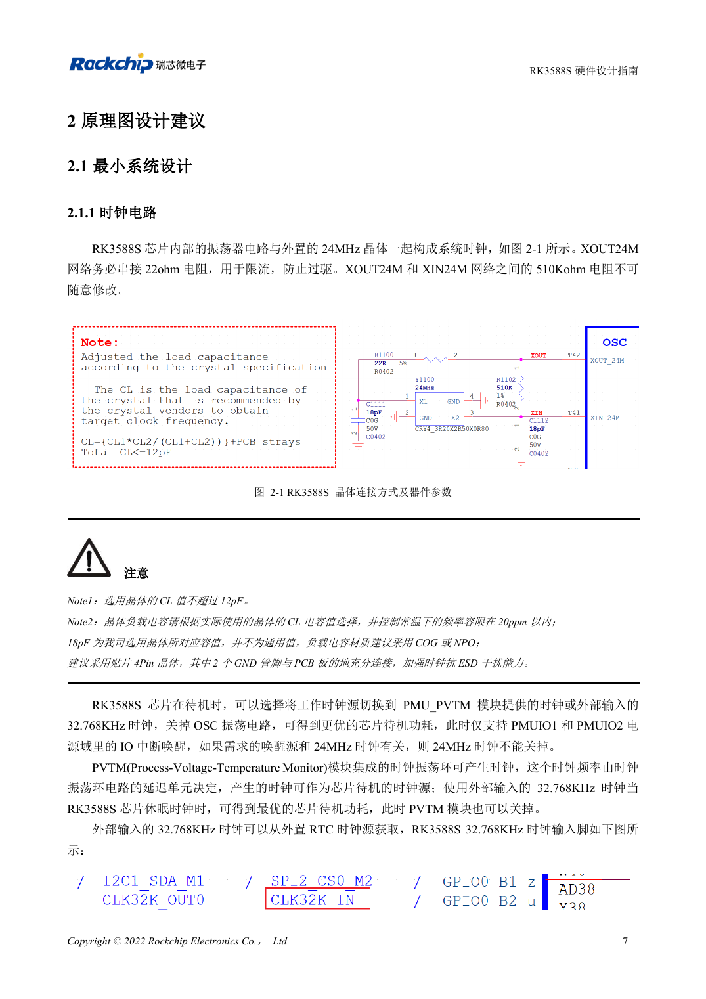
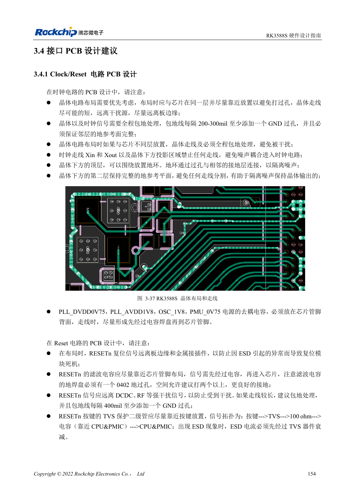

<!-- rk3588s-hardware-v12-20261109 -->

# RK3588S clocks: 24MHz, 32kHz and layout

Based on the Chinese RK3588S Hardware Design Guide V1.2 (2023-12-14) for circuit and PCB review. CM7S carriers must follow module interface definitions; Sige7S supports software and peripheral evaluation. SoC capabilities are not a board connector list. Verify SDK/BSP, kernel, board revision, firmware and multiplexing. Values are source references, not ArmSoM hardware measurements.

**RK3588S Hardware Design Guide V1.2 (2023-12-14), CN** · §2.1.1; §3.4.1

## Match load to the crystal

The 22Ω at XOUT24M limits drive; do not arbitrarily change the 510kΩ between XOUT24M and XIN24M. Crystal CL must not exceed 12pF. The illustrated 18pF is specific to the reference crystal; determine the real load from CL and parasitics, preferably using C0G/NP0 and a four-pad crystal. Probe capacitance also affects oscillation.

## Review wake-up and PCB together

Before stopping 24MHz, check wake-source dependencies. The low-power path uses PMU_PVTM or external 32.768kHz and relevant PMUIO1/2 IO wake-up. Place the crystal near the SoC on the same side where possible; keep other signals out of the crystal/XIN/XOUT projection, maintain adjacent ground and stitch guard ground every 200–300mil.

## Design parameters and review table

| Item | Source reference |
| --- | --- |
| 24MHz tolerance | ≤20ppm |
| 32.768kHz tolerance | ±30ppm |
| 32kHz duty cycle | 45–55% |
| 32kHz amplitude | 0.7×VDD … VDD; VDD=PMUIO1 |

## Source figures

No corresponding English design guide was found for this batch. All four editions use Chinese source screenshots with localized captions. Open an image for full resolution; the article text and parameter tables remain copyable. Page references are physical PDF pages.

Chinese original · PDF 22 · 2-1

Chinese original · PDF 169 · 3-37

## ArmSoM development path

CM7S supports custom carriers: first identify supplies, DDR and boot circuits already integrated in the module, then design outside its connectors. Sige7S provides a starting point for software and peripheral evaluation. For both products, verify exposed interfaces, pin assignments, levels, system images and cooling against the relevant revision. A chip reference schematic is not a product wiring diagram.

- [ArmSoM CM7S](https://www.armsom.org/cm7s) · [CM7S Docs](https://docs.armsom.org/armsom-cm7s)
- [ArmSoM Sige7S](https://www.armsom.org/sige7s) · [Sige7S Docs](https://docs.armsom.org/armsom-sige7s)

## Continue reading

- [RK3588S hardware design: 30 topics](/articles/rk3588s-hardware-design-series/)
- [RK3588S and CM7S carrier design: resources and validation](/articles/rk3588s-cm7s-carrier-design/)
- [RK3588S reset, watchdog and thermal protection](/articles/rk3588s-reset-watchdog-hardware/)
