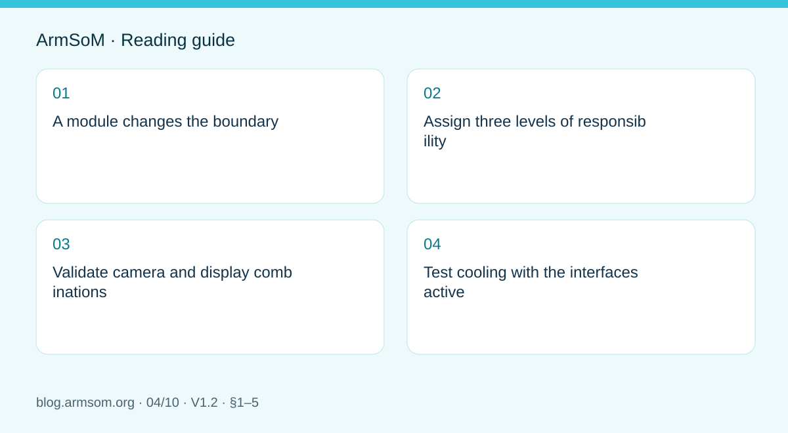
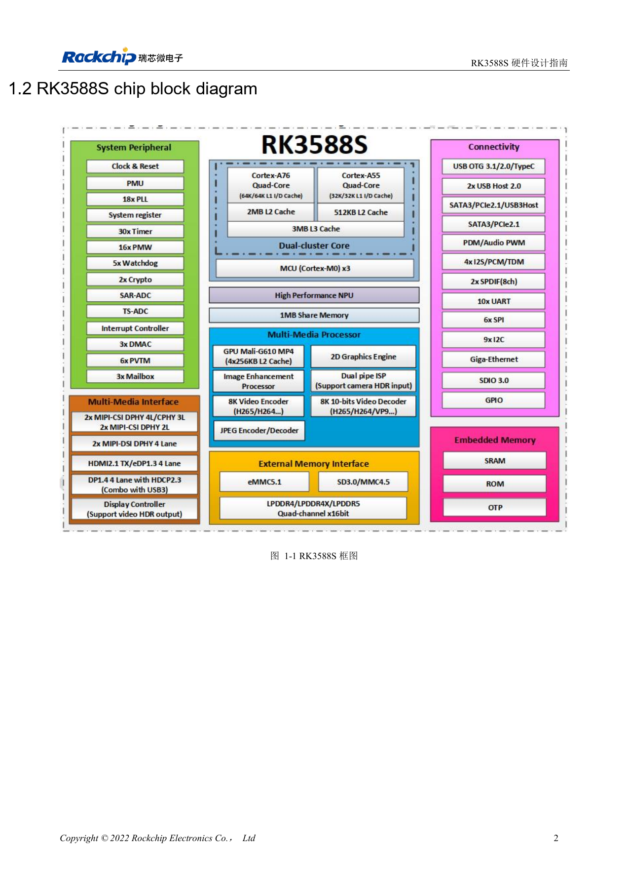
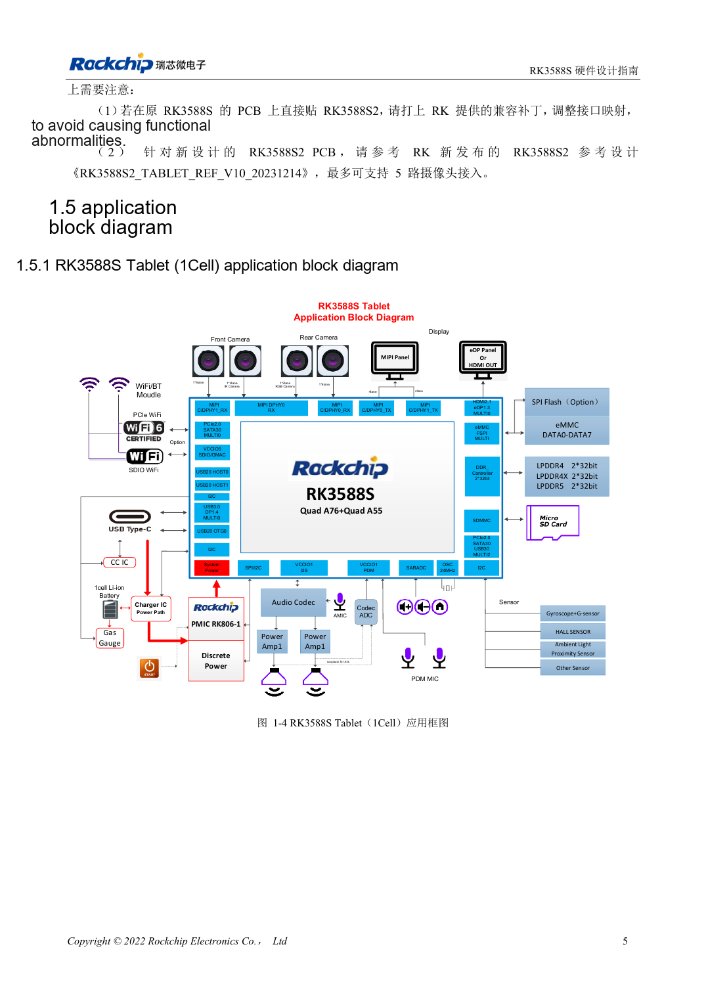

# RK3588S hardware design: from a reference circuit to a CM7s carrier

## Scope and sources

This is a task-focused engineering guide, not a page-by-page translation of the complete PDF. Source examples are not ArmSoM measurements. Check voltages, pins, SDK/BSP and kernel against the actual board revision.

**Rockchip:** `RK3588S Hardware Design Guide-V1.2-20231214.pdf` · V1.2 · §1–5

## A module changes the boundary

CM7s integrates an RK3588S compute platform. Start a carrier with its actual pins, mechanics, connectors and power requirements, not a wholesale copy of an EVB schematic. Chip-level DDR escape and regulator circuits explain the system; carrier work focuses on peripheral supplies, connections, protection and enclosure cooling.

RK3588S and RK3588 do not expose identical interfaces. RK3588S2 pin definitions must not silently replace RK3588S definitions either. Lock the complete chip name, module revision and document version.

## Assign three levels of responsibility

| Level | Main work | Evidence |
| --- | --- | --- |
| Module | Integrated processor, memory, boot and power implementation | CM7s schematic and revision |
| Carrier | Routed signals, peripheral power, connectors and protection | Module pinout and carrier circuit |
| Product | Cables, cooling, enclosure, EMC and workload | Mechanical design and validation plan |

At the module boundary, still check voltage domains, reset and enable timing, unused pins and multiplexing. Integration does not remove those obligations.

## Validate camera and display combinations

Start with a particular panel or sensor. Besides video lanes, reserve control buses, clocks, reset and backlight or sensor power. Record resolution, frame rate, lane configuration, cable and connector, then match the driver and device tree. SoC interface counts do not establish carrier-level concurrency.

## Test cooling with the interfaces active

Concurrent AI, video, display and storage create a different load from an idle desktop. Define a heat path to the heatsink, enclosure or air, leaving mechanical and insulation clearance. Record ambient and system temperatures, throttling and application throughput. A short peak is not sustained performance.

Sige7s or a CM7s IO platform can establish an application baseline. Their connectors and mechanics differ, so results apply only to the tested configuration and must be rechecked on a custom carrier.

## Source illustration

Chinese original; no matching English figure was found in the supplied materials. Reference design, not an ArmSoM board schematic.

`RK3588S Hardware Design Guide-V1.2-20231214.pdf` · PDF p. 17.

## Products and development resources

- **CM7s** — [Product page](https://www.armsom.org/cm7s) · [Documentation](https://docs.armsom.org/armsom-cm7s)
- **Sige7s** — [Product page](https://www.armsom.org/sige7s) · [Documentation](https://docs.armsom.org/armsom-sige7s)

## Continue this series

- [RK3576 hardware bring-up: minimum system and first-power checks](/articles/rk3576-hardware-bringup/)
- [ArmSoM CM5 carrier-board checklist: power, boot and interface planning](/articles/019-cm5-carrier-production/)
- [RK3576 high-speed interfaces: review schematics and PCB together](/articles/rk3576-high-speed-interface-design/)
- [RK3588 edge-AI hardware: plan power, cooling and expansion together](/articles/rk3588-edge-ai-hardware-design/)
- [RK3588 high-speed PCB review: stackup, impedance and routing](/articles/rk3588-high-speed-pcb-review/)
- [RK3506 industrial HMI hardware: choosing a CM1 or Forge1 development path](/articles/rk3506-industrial-hmi-hardware/)
- [RK3308 hardware variants: compatibility checks for P2 Pro audio projects](/articles/rk3308-hardware-variant-compatibility/)
- [RK3588S versus RK3588S2: what to check before a hardware revision](/articles/rk3588s-rk3588s2-hardware-differences/)
- [Rockchip prototype to production: process requirements and test records](/articles/rockchip-hardware-production-checklist/)

<!-- rk3588s-hardware-v12-20261109 -->

## RK3588S and CM7S carrier design: resources and validation

Based on the Chinese RK3588S Hardware Design Guide V1.2 (2023-12-14) for circuit and PCB review. CM7S carriers must follow module interface definitions; Sige7S supports software and peripheral evaluation. SoC capabilities are not a board connector list. Verify SDK/BSP, kernel, board revision, firmware and multiplexing. Values are source references, not ArmSoM hardware measurements.

**RK3588S Hardware Design Guide V1.2 (2023-12-14), CN** · §1.2–1.5; §2.2.5.3

## Separate SoC boards from module carriers

The Tablet diagram is a SoC reference, not a connector list for CM7S or Sige7S. CM7S integrates the compute core; start carrier design from its connector definitions. Sige7S offers a starting point for software, display and peripheral evaluation. List cameras, video formats, inference, network traffic and storage loads, then verify pins, PHYs, power and BSP.

## Test in stages

Check cold boot, UART and recovery, then individual peripherals and finally combined sustained load. Table 2-12 reports separate module stress cases at 100°C junction temperature on a bare board without a heatsink, recorded after 15 minutes of stable operation. Their sum is not measured ArmSoM system power. Record supply minima, temperature, clocks, dropped frames and errors.

## Design parameters and review table

| Item | Source reference |
| --- | --- |
| Source test | 100°C; 15 min; no heatsink |
| CPU BIG0/BIG1 example | 0.980V; 4.00A each |
| GPU example | 0.850V; 6.50A |

## Source figures

No corresponding English design guide was found for this batch. All four editions use Chinese source screenshots with localized captions. Open an image for full resolution; the article text and parameter tables remain copyable. Page references are physical PDF pages.

Chinese original · PDF 17 · 1-1

Chinese original · PDF 20 · 1-4

## ArmSoM development path

CM7S supports custom carriers: first identify supplies, DDR and boot circuits already integrated in the module, then design outside its connectors. Sige7S provides a starting point for software and peripheral evaluation. For both products, verify exposed interfaces, pin assignments, levels, system images and cooling against the relevant revision. A chip reference schematic is not a product wiring diagram.

- [ArmSoM CM7S](https://www.armsom.org/cm7s) · [CM7S Docs](https://docs.armsom.org/armsom-cm7s)
- [ArmSoM Sige7S](https://www.armsom.org/sige7s) · [Sige7S Docs](https://docs.armsom.org/armsom-sige7s)

## Continue reading

- [RK3588S hardware design: 30 topics](/articles/rk3588s-hardware-design-series/)
- [RK3588S clocks: 24MHz, 32kHz and layout](/articles/rk3588s-clock-hardware-design/)
