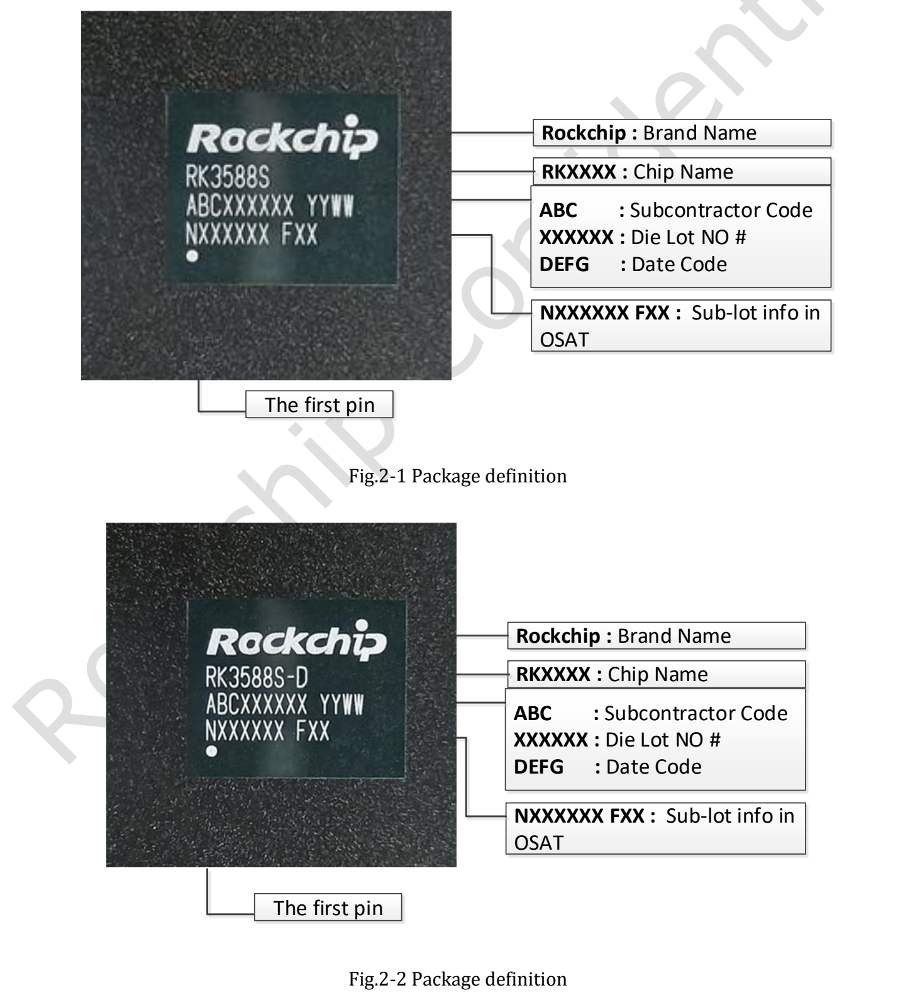
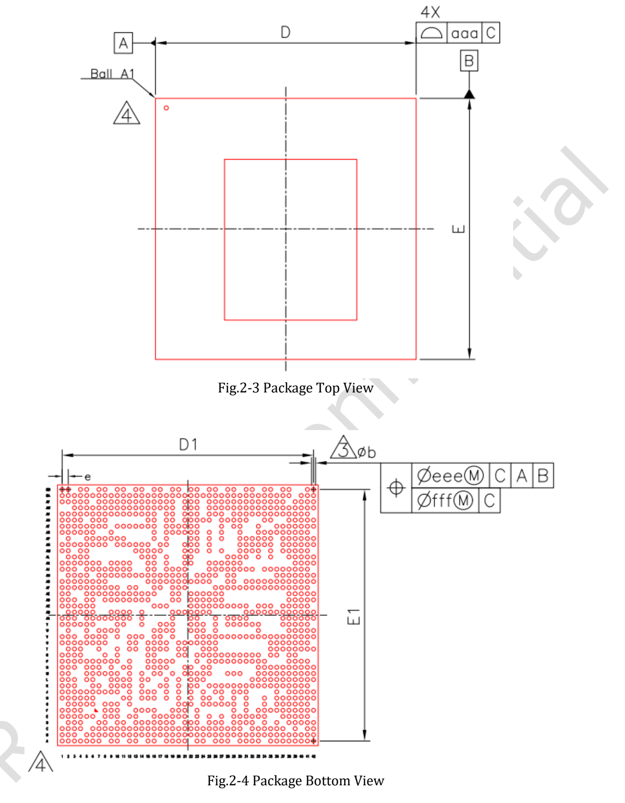
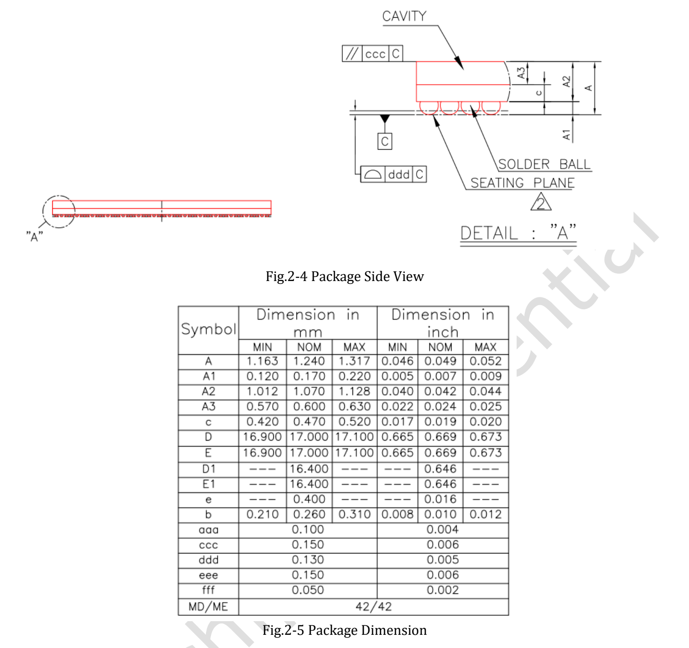

This guide accompanies the supplied **Rockchip RK3588S Datasheet V1.3, dated 2022-03-10, 35 pages**. It is a silicon reference, not a replacement for CM7S or Sige7S schematics, mechanical files or current SDK documentation. It is not presented as the latest revision.

[Download the original PDF (V1.3, about 2.46 MiB)](/assets/rk3588s/Rockchip-RK3588S-Datasheet-V1.3-20220310.pdf) · [Download editable English technical text and tables](/docs/rk3588s/technical-reference-en.md)

The technical reference covers PDF pages 6–35. Cover material, revision history, disclaimers and repeated headers/footers are omitted from the extraction. Parameters and source ambiguities are retained. Consult the PDF to resolve the scope of complex merged cells.

## Where to find the information

| PDF pages | Content | Use |
|---|---|---|
| 6–16, chapter 1 | CPU, memory, codecs, NPU, graphics, interfaces and block diagram | Architecture and capability assessment |
| 17–28, chapter 2 | Ordering, marking, package and pin list | Package and signal identification |
| 29–34, chapter 3 | Ratings, operating conditions, IO, PLL, PHY and ADC | Silicon electrical checks |
| 35, chapter 4 | Thermal management and resistance | Thermal assumptions |

## Block diagram and package drawings

The English drawings retain their original dimensions. The source specifies FCCSP1253L, a 17 × 17 mm body, 0.26 mm balls and 0.4 mm pitch. These are chip package dimensions, not CM7S or Sige7S board dimensions.

## Ratings are not design targets

Section 3.1 gives absolute limits associated with potential damage. Use section 3.2 recommended operating conditions together with sequencing and hardware design guidance. IO thresholds depend on the supply domain; do not assume GPIO is 5V tolerant.

Maximum CPU, GPU and NPU frequency entries remain TBD in this revision. Do not replace them with frequencies from a newer product page: those are separate sources and dates.

## Interpret thermal values in context

| Parameter | V1.3 typical value | Unit |
|---|---|---|
| Junction-to-ambient θJA | 8.2 | °C/W |
| Junction-to-board θJB | 3.7 | °C/W |
| Junction-to-case θJC | 0.01 | °C/W |

The source describes reference simulation data with a 10-layer, 200 × 130 mm PCB and 25°C ambient. These are not ArmSoM system measurements and cannot predict an arbitrary enclosure's temperature rise. Section 4.1 requires junction temperature below 125°C; that is not a 125°C ambient rating.

## Source discrepancies retained

- The cover says V1.3; headers from page 20 still show V1.2.
- The feature list says five SPI controllers; the block diagram says 6× SPI. Verify the TRM and pin multiplexing.
- HDMI/eDP counts require reconciliation with the block diagram; do not promise a board's dual outputs from this alone.
- Page 34 uses Table 3-10 twice; figure-index numbering also differs from the body.
- Thermal values, negative-current Min/Max entries and repeated PHY rows with unclear conditions remain as printed.

For a CM7S carrier, begin with module pins and power requirements. For Sige7S applications, begin with board interfaces, images and drivers. Silicon documentation explains limits but does not replace board validation.

## Further reading and product resources

- [RK3588S explained: eight CPU cores, a 6 TOPS NPU and ArmSoM platforms](/articles/rk3588s-chip-guide/)
- [CM7S or Sige7S? Choosing an RK3588S development platform](/articles/cm7s-sige7s-rk3588s-selection/)
- [RK3588S edge AI and multimedia: planning a product with CM7S or Sige7S](/articles/rk3588s-edge-ai-multimedia/)

### Products and development resources

- [CM7S](https://www.armsom.org/cm7s) · [CM7S Docs](https://docs.armsom.org/armsom-cm7s)
- [Sige7S](https://www.armsom.org/sige7s) · [Sige7S Docs](https://docs.armsom.org/armsom-sige7s)
- [Rockchip RKNN-Toolkit2](https://github.com/airockchip/rknn-toolkit2) · [RKNN-LLM](https://github.com/airockchip/rknn-llm)
