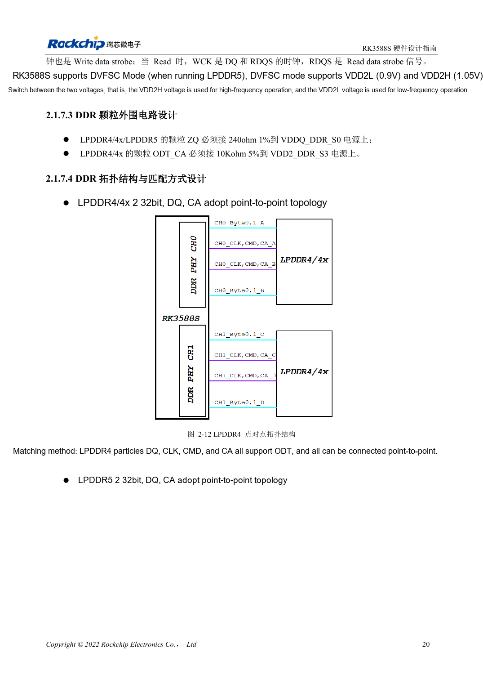
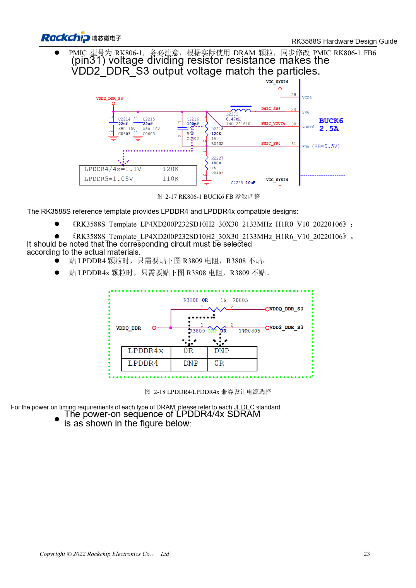

<!-- rk3588s-hardware-v12-20261109 -->

# RK3588S DDR circuits: LPDDR4/4X/5 and capacity

Based on the Chinese RK3588S Hardware Design Guide V1.2 (2023-12-14) for circuit and PCB review. CM7S carriers must follow module interface definitions; Sige7S supports software and peripheral evaluation. SoC capabilities are not a board connector list. Verify SDK/BSP, kernel, board revision, firmware and multiplexing. Values are source references, not ArmSoM hardware measurements.

**RK3588S Hardware Design Guide V1.2 (2023-12-14), CN** · §2.1.7

## Select capacity and template together

V1.2 describes four 16-bit channels forming 64 bits, up to 8GB per channel and 32GB total. Schematic 32-bit CH0/CH1 cannot use unequal capacities such as 4GB+2GB. This is the guide version’s scope, not a statement about other variants or later BSPs. Confirm memory part, package, firmware and template as a set.

## Voltage and mapping are not label changes

Two 32-bit devices use point-to-point DQ/CA. The compatible template fits R3809 and omits R3808 for LPDDR4, reversing this for LPDDR4X. These designators belong to the source template; verify nets on another schematic. LPDDR5 needs its own WCK, mapping and supplies. CM7S integrates DDR, shifting carrier work to input power, interfaces and cooling.

## Design parameters and review table

| Item | Source reference |
| --- | --- |
| V1.2 bus | 4×16bit =64bit |
| V1.2 addressing | 8GB/channel; 32GB total |
| CH0 / CH1 | Equal capacity |

## Source figures

No corresponding English design guide was found for this batch. All four editions use Chinese source screenshots with localized captions. Open an image for full resolution; the article text and parameter tables remain copyable. Page references are physical PDF pages.

Chinese original · PDF 35 · 2-12

Chinese original · PDF 38 · 2-18

## ArmSoM development path

CM7S supports custom carriers: first identify supplies, DDR and boot circuits already integrated in the module, then design outside its connectors. Sige7S provides a starting point for software and peripheral evaluation. For both products, verify exposed interfaces, pin assignments, levels, system images and cooling against the relevant revision. A chip reference schematic is not a product wiring diagram.

- [ArmSoM CM7S](https://www.armsom.org/cm7s) · [CM7S Docs](https://docs.armsom.org/armsom-cm7s)
- [ArmSoM Sige7S](https://www.armsom.org/sige7s) · [Sige7S Docs](https://docs.armsom.org/armsom-sige7s)

## Continue reading

- [RK3588S hardware design: 30 topics](/articles/rk3588s-hardware-design-series/)
- [RK3588S and RK806: single and dual PMIC power trees](/articles/rk3588s-rk806-pmic-design/)
- [RK3588S DDR routing: length and delay matching](/articles/rk3588s-ddr-pcb-routing/)
