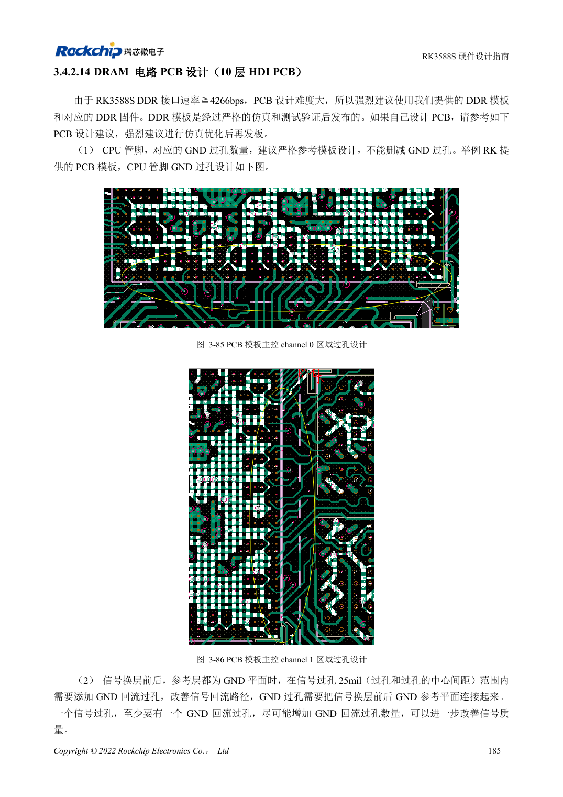
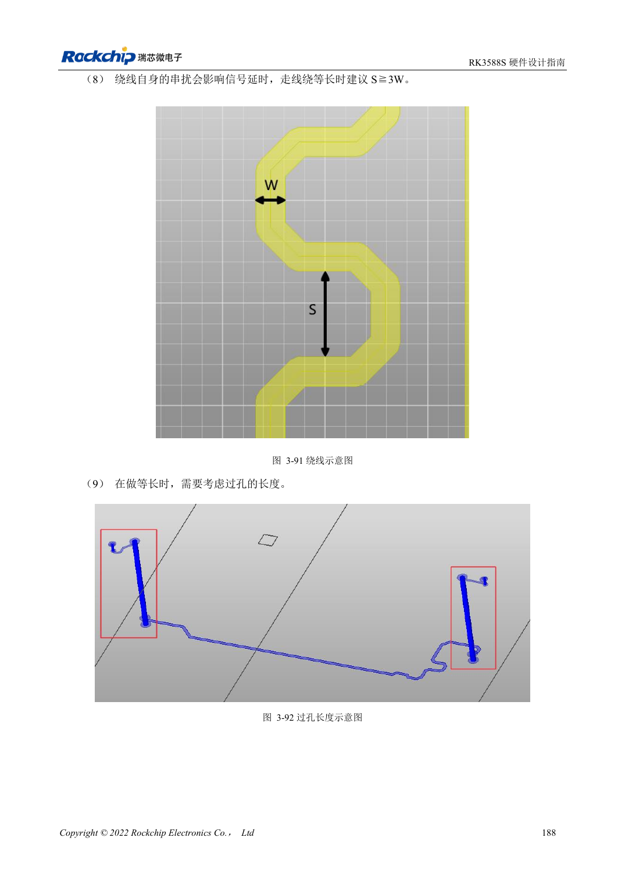

<!-- rk3588s-hardware-v12-20261109 -->

# RK3588S DDR routing: length and delay matching

Based on the Chinese RK3588S Hardware Design Guide V1.2 (2023-12-14) for circuit and PCB review. CM7S carriers must follow module interface definitions; Sige7S supports software and peripheral evaluation. SoC capabilities are not a board connector list. Verify SDK/BSP, kernel, board revision, firmware and multiplexing. Values are source references, not ArmSoM hardware measurements.

**RK3588S Hardware Design Guide V1.2 (2023-12-14), CN** · §3.4.2.14

## Use the RK3588S routing tables

Tables 3-13, 3-14 and 3-15 in §3.4.2.14 cover LPDDR5, LPDDR4X and LPDDR4. Their length constraints assume inner-layer routing on a 10-layer HDI reference. Do not import the 16ps rule for an 8-layer through-hole board from a different RK3588 guide. DQ/DM target 45Ω, address/control 50Ω and differential pairs 90Ω, all ±10%.

## Define byte groups and spacing

For LPDDR5, same-byte DQ/DM to DQS/WCLK mismatch is ≤25mil, address/control to CLK ≤40mil, pair mismatch ≤5mil, and DQS/WCLK to CLK ≤200mil. LPDDR4X allows ≤250mil between DQS and CLK. Data spacing is at least twice trace width; data-to-strobe preferably three times, at least twice. Validate with training logs, temperature, target-frequency stress and repeated cold boots.

## Design parameters and review table

| Item | Source reference |
| --- | --- |
| LPDDR5 DQ/DM impedance | 45Ω ±10% |
| LPDDR5 address/control | 50Ω ±10% |
| LPDDR5 differential target | 90Ω ±10% |
| Byte mismatch | DQ/DM ↔ DQS/WCLK: ≤25mil |
| Address mismatch | ≤40mil |
| Differential mismatch | ≤5mil |

## Source figures

No corresponding English design guide was found for this batch. All four editions use Chinese source screenshots with localized captions. Open an image for full resolution; the article text and parameter tables remain copyable. Page references are physical PDF pages.

Chinese original · PDF 200 · 3-85

Chinese original · PDF 203 · 3-91

## ArmSoM development path

CM7S supports custom carriers: first identify supplies, DDR and boot circuits already integrated in the module, then design outside its connectors. Sige7S provides a starting point for software and peripheral evaluation. For both products, verify exposed interfaces, pin assignments, levels, system images and cooling against the relevant revision. A chip reference schematic is not a product wiring diagram.

- [ArmSoM CM7S](https://www.armsom.org/cm7s) · [CM7S Docs](https://docs.armsom.org/armsom-cm7s)
- [ArmSoM Sige7S](https://www.armsom.org/sige7s) · [Sige7S Docs](https://docs.armsom.org/armsom-sige7s)

## Continue reading

- [RK3588S hardware design: 30 topics](/articles/rk3588s-hardware-design-series/)
- [RK3588S DDR circuits: LPDDR4/4X/5 and capacity](/articles/rk3588s-ddr-circuit-design/)
- [RK3588S eMMC: clock, pull-ups and strobe](/articles/rk3588s-emmc-hardware-design/)
