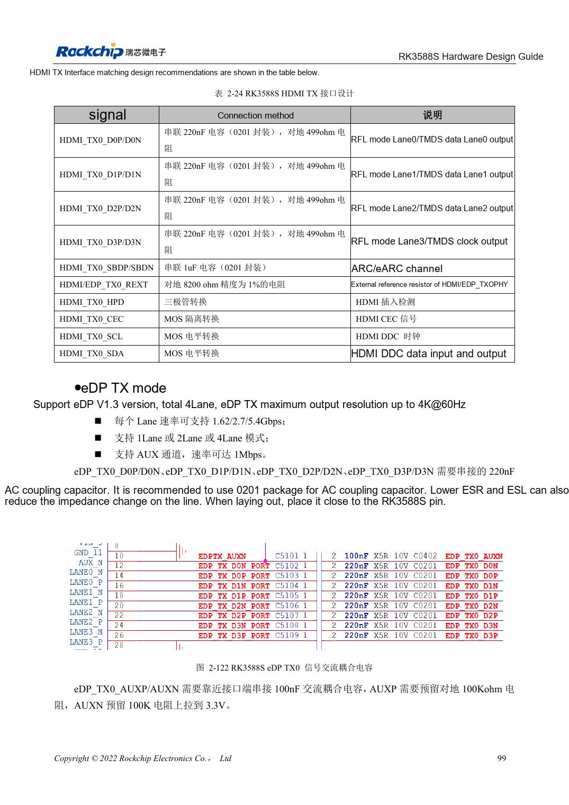
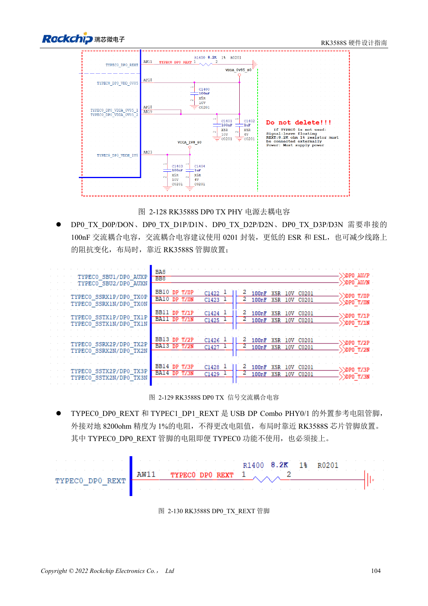

<!-- rk3588s-hardware-v12-20261109 -->

# RK3588S DP and eDP: shared PHYs, AUX and coupling

Based on the Chinese RK3588S Hardware Design Guide V1.2 (2023-12-14) for circuit and PCB review. CM7S carriers must follow module interface definitions; Sige7S supports software and peripheral evaluation. SoC capabilities are not a board connector list. Verify SDK/BSP, kernel, board revision, firmware and multiplexing. Values are source references, not ArmSoM hardware measurements.

**RK3588S Hardware Design Guide V1.2 (2023-12-14), CN** · §2.3.8.1; §2.3.8.3; §3.4.3; §3.4.11

## Similar names do not mean identical circuits

DP0 share PHYs with USB Type-C; eDP shares with HDMI TX. DP main links use 100nF, eDP main links 220nF, and AUX 100nF. Do not interchange impedance, coupling and pins. Cable, connector, display input and BSP are all part of the channel.

## TYPEC0 requirements and scope

Preserve all three TYPEC0_DP0 supplies and the 8.2kΩ, 1% REXT even when the interface is unused, as specified. eDP uses 220nF main-link and 100nF AUX coupling; check connector and cable impedance. RK3588S has one DP Combo. Residual TYPEC1 or TX1 wording does not establish a second interface.

## Design parameters and review table

| Item | Source reference |
| --- | --- |
| DP-only / USB-DP impedance | 100Ω / 95Ω; ±10% |
| eDP impedance | 90Ω ±10%; match cable |
| Main link coupling DP / eDP | 100nF / 220nF |
| AUX coupling | 100nF |
| Length / intra-pair | <6in / <6mil |

## Source figures

No corresponding English design guide was found for this batch. All four editions use Chinese source screenshots with localized captions. Open an image for full resolution; the article text and parameter tables remain copyable. Page references are physical PDF pages.

Chinese original · PDF 114 · 2-122

Chinese original · PDF 119 · 2-129

## ArmSoM development path

CM7S supports custom carriers: first identify supplies, DDR and boot circuits already integrated in the module, then design outside its connectors. Sige7S provides a starting point for software and peripheral evaluation. For both products, verify exposed interfaces, pin assignments, levels, system images and cooling against the relevant revision. A chip reference schematic is not a product wiring diagram.

- [ArmSoM CM7S](https://www.armsom.org/cm7s) · [CM7S Docs](https://docs.armsom.org/armsom-cm7s)
- [ArmSoM Sige7S](https://www.armsom.org/sige7s) · [Sige7S Docs](https://docs.armsom.org/armsom-sige7s)

## Continue reading

- [RK3588S hardware design: 30 topics](/articles/rk3588s-hardware-design-series/)
- [RK3588S MIPI displays: D-PHY, C-PHY and panel integration](/articles/rk3588s-mipi-display-hardware/)
- [RK3588S audio hardware: I2S, PDM and microphone arrays](/articles/rk3588s-audio-hardware-design/)
