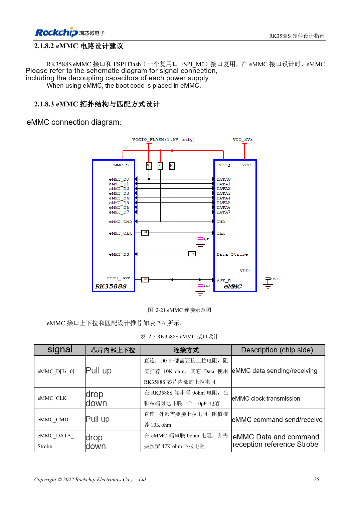
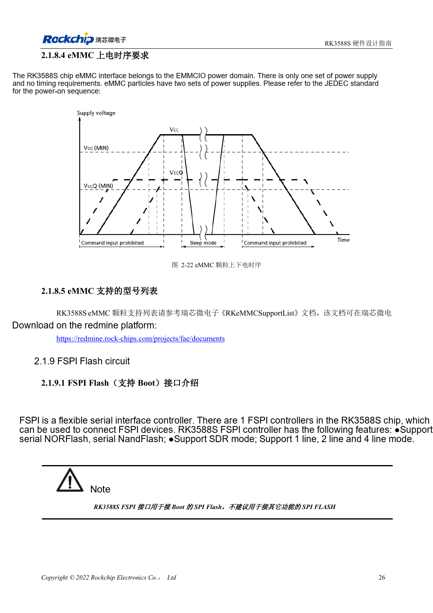

<!-- rk3588s-hardware-v12-20261109 -->

# RK3588S eMMC: clock, pull-ups and strobe

Based on the Chinese RK3588S Hardware Design Guide V1.2 (2023-12-14) for circuit and PCB review. CM7S carriers must follow module interface definitions; Sige7S supports software and peripheral evaluation. SoC capabilities are not a board connector list. Verify SDK/BSP, kernel, board revision, firmware and multiplexing. Values are source references, not ArmSoM hardware measurements.

**RK3588S Hardware Design Guide V1.2 (2023-12-14), CN** · §2.1.8; §3.4.12

## Apply the V1.2 clock connection

Table 2-5 places 0Ω in CLK at RK3588S and 10pF to ground at the eMMC. D0 and CMD use external 10kΩ pull-ups; other data uses internal pull-ups. Strobe gets 0Ω at the device and a reserved 47kΩ pull-down. Do not apply one template to all signals; component location matters.

## Validate supplies and mode

EMMCIO and the device dual supplies are different concerns; verify device sequencing for the exact part. Check support lists and Loader/BSP versions, then test target mode, cold boot, sustained transfers and power-loss recovery. CM7S eMMC is on the module; replacement or external access must follow module documentation, not inference from a SoC drawing.

## Design parameters and review table

| Item | Source reference |
| --- | --- |
| CLK | 0Ω at SoC; 10pF at eMMC |
| D0 / CMD | 10kΩ pull-up |
| Strobe | 0Ω at eMMC; reserve 47kΩ pull-down |
| PCB impedance / length | 50Ω ±10% / <3.5in |
| Clock-data mismatch | <120mil |

## Source figures

No corresponding English design guide was found for this batch. All four editions use Chinese source screenshots with localized captions. Open an image for full resolution; the article text and parameter tables remain copyable. Page references are physical PDF pages.

Chinese original · PDF 40 · 2-21

Chinese original · PDF 41 · 2-22

## ArmSoM development path

CM7S supports custom carriers: first identify supplies, DDR and boot circuits already integrated in the module, then design outside its connectors. Sige7S provides a starting point for software and peripheral evaluation. For both products, verify exposed interfaces, pin assignments, levels, system images and cooling against the relevant revision. A chip reference schematic is not a product wiring diagram.

- [ArmSoM CM7S](https://www.armsom.org/cm7s) · [CM7S Docs](https://docs.armsom.org/armsom-cm7s)
- [ArmSoM Sige7S](https://www.armsom.org/sige7s) · [Sige7S Docs](https://docs.armsom.org/armsom-sige7s)

## Continue reading

- [RK3588S hardware design: 30 topics](/articles/rk3588s-hardware-design-series/)
- [RK3588S DDR routing: length and delay matching](/articles/rk3588s-ddr-pcb-routing/)
- [RK3588S FSPI Flash: boot, supply and matching](/articles/rk3588s-fspi-boot-hardware/)
