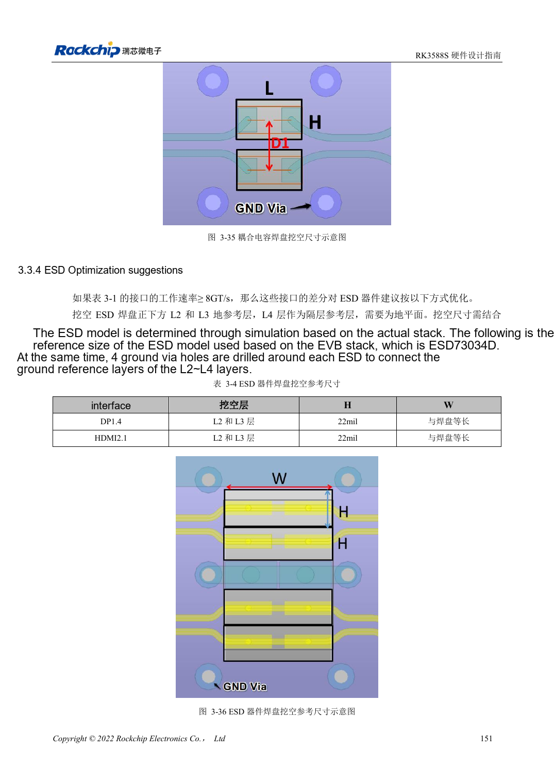

<!-- rk3588s-hardware-v12-20261109 -->

# RK3588S ESD and EMI: interface protection and return paths

Based on the Chinese RK3588S Hardware Design Guide V1.2 (2023-12-14) for circuit and PCB review. CM7S carriers must follow module interface definitions; Sige7S supports software and peripheral evaluation. SoC capabilities are not a board connector list. Verify SDK/BSP, kernel, board revision, firmware and multiplexing. Values are source references, not ArmSoM hardware measurements.

**RK3588S Hardware Design Guide V1.2 (2023-12-14), CN** · §5; §3.3.4

## Place protection where current enters

TVS belongs near connectors or discharge entry points with short low-impedance ground return. Keep reset, clock and interrupt nets away from edges; the guide suggests at least 5mm. Include ESD capacitance and pads in signal-integrity analysis rather than assuming higher ratings or more capacitance always help.

## Start EMI diagnosis at source and coupling path

Check broken returns, long stubs, common-mode conversion and switching supplies before choosing filters or shields. Heatsinks can radiate coupled energy; provide grounding options and test. General series-resistor advice does not override USB/HDMI/PCIe rules. Test real enclosure, cables, grounding and certification conditions; design guidance is not certification.

## Design parameters and review table

| Item | Source reference |
| --- | --- |
| Sensitive-net edge distance | ≥5mm |
| Clock source-to-series resistor | ≤400mil |
| Power-plane edge reference | 20H; H=power/ground dielectric spacing |
| High-speed ESD | Use interface-specific capacitance limits |

## Source figures

No corresponding English design guide was found for this batch. All four editions use Chinese source screenshots with localized captions. Open an image for full resolution; the article text and parameter tables remain copyable. Page references are physical PDF pages.

Chinese original · PDF 166 · 3-36

## ArmSoM development path

CM7S supports custom carriers: first identify supplies, DDR and boot circuits already integrated in the module, then design outside its connectors. Sige7S provides a starting point for software and peripheral evaluation. For both products, verify exposed interfaces, pin assignments, levels, system images and cooling against the relevant revision. A chip reference schematic is not a product wiring diagram.

- [ArmSoM CM7S](https://www.armsom.org/cm7s) · [CM7S Docs](https://docs.armsom.org/armsom-cm7s)
- [ArmSoM Sige7S](https://www.armsom.org/sige7s) · [Sige7S Docs](https://docs.armsom.org/armsom-sige7s)

## Continue reading

- [RK3588S hardware design: 30 topics](/articles/rk3588s-hardware-design-series/)
- [RK3588S thermal design: reference resistance and system validation](/articles/rk3588s-thermal-hardware-design/)
- [RK3588S assembly and storage: reflow, MSL3 and bake records](/articles/rk3588s-assembly-storage-design/)
