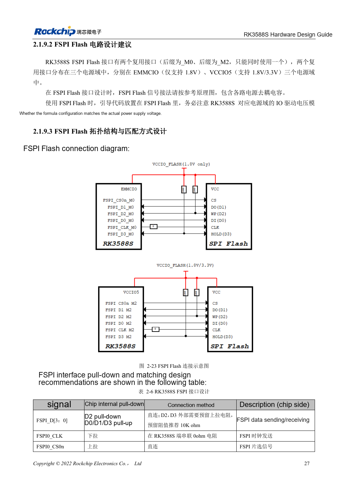

<!-- rk3588s-hardware-v12-20261109 -->

# RK3588S FSPI Flash: boot, supply and matching

Based on the Chinese RK3588S Hardware Design Guide V1.2 (2023-12-14) for circuit and PCB review. CM7S carriers must follow module interface definitions; Sige7S supports software and peripheral evaluation. SoC capabilities are not a board connector list. Verify SDK/BSP, kernel, board revision, firmware and multiplexing. Values are source references, not ArmSoM hardware measurements.

**RK3588S Hardware Design Guide V1.2 (2023-12-14), CN** · §2.1.9; §2.1.4; §3.4.15

## Select boot role and domain

FSPI can provide early boot code, including PCIe initialization before loading an SSD system. The selected mux group determines the IO domain, and Flash must use the same supply as that domain. Package compatibility alone does not establish interchangeability: verify part support, capacity, loader and programming procedure.

## Keep test and recovery options

Table 2-6 reserves 10kΩ pull-ups on D2/D3, 0Ω in CLK at the SoC and direct CS. Review placement, length and startup together, then repeat cold boot and full read-back comparison. Preserve USB recovery for production so corrupted Flash does not prevent servicing.

## Source mux inconsistency

PDF page 42 lists only FSPI_M0 and FSPI_M2 but mentions three supply domains; boot text also mentions FSPI_M1. This does not establish a third usable interface. Check M0/M2 against the actual EMMCIO/VCCIO5 pin tables, boot firmware and TRM before selecting the routing.

## Design parameters and review table

| Item | Source reference |
| --- | --- |
| D2 / D3 | Reserve 10kΩ pull-up |
| CLK | 0Ω at SoC |
| Supply | Same rail as selected FSPI IO domain |
| PCB impedance / length | 50Ω ±10% / <4in |
| Clock-data mismatch | <200mil |

## Source figures

No corresponding English design guide was found for this batch. All four editions use Chinese source screenshots with localized captions. Open an image for full resolution; the article text and parameter tables remain copyable. Page references are physical PDF pages.

Chinese original · PDF 42 · 2-23

## ArmSoM development path

CM7S supports custom carriers: first identify supplies, DDR and boot circuits already integrated in the module, then design outside its connectors. Sige7S provides a starting point for software and peripheral evaluation. For both products, verify exposed interfaces, pin assignments, levels, system images and cooling against the relevant revision. A chip reference schematic is not a product wiring diagram.

- [ArmSoM CM7S](https://www.armsom.org/cm7s) · [CM7S Docs](https://docs.armsom.org/armsom-cm7s)
- [ArmSoM Sige7S](https://www.armsom.org/sige7s) · [Sige7S Docs](https://docs.armsom.org/armsom-sige7s)

## Continue reading

- [RK3588S hardware design: 30 topics](/articles/rk3588s-hardware-design-series/)
- [RK3588S eMMC: clock, pull-ups and strobe](/articles/rk3588s-emmc-hardware-design/)
- [RK3588S SDMMC and SDIO Wi-Fi: voltage switching and protection](/articles/rk3588s-sdmmc-sdio-wifi-design/)
