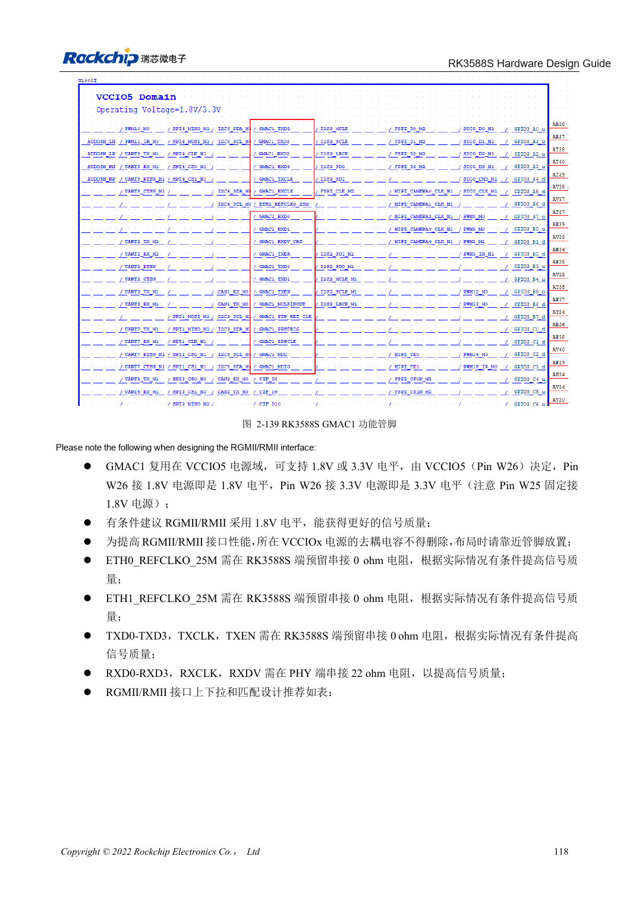
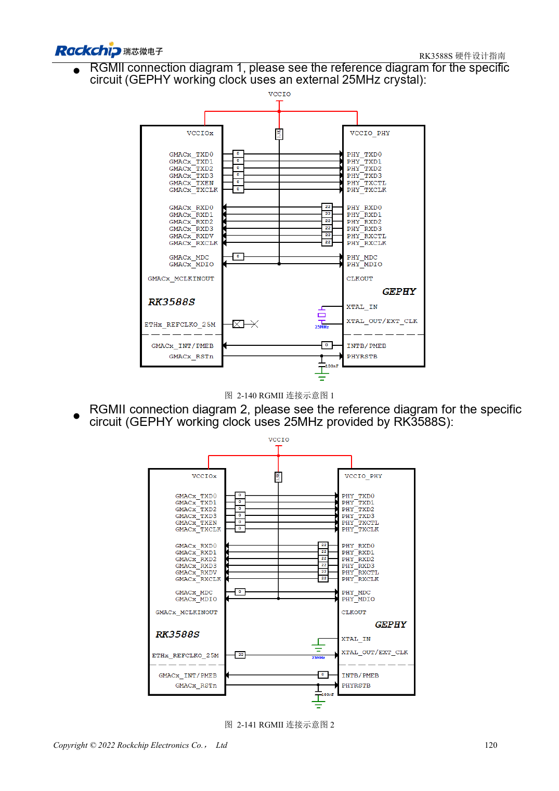

<!-- rk3588s-hardware-v12-20261109 -->

# RK3588S Ethernet hardware: GMAC, PHY and clock direction

Based on the Chinese RK3588S Hardware Design Guide V1.2 (2023-12-14) for circuit and PCB review. CM7S carriers must follow module interface definitions; Sige7S supports software and peripheral evaluation. SoC capabilities are not a board connector list. Verify SDK/BSP, kernel, board revision, firmware and multiplexing. Values are source references, not ArmSoM hardware measurements.

**RK3588S Hardware Design Guide V1.2 (2023-12-14), CN** · §2.3.10; §3.4.17

## One GMAC1, with VCCIO5 voltage checks

RK3588S exposes one GMAC1 for an external RGMII/RMII PHY. VCCIO5 W26 selects 1.8V/3.3V; retain the fixed 1.8V auxiliary supply at W25. Isolated ETH0 wording in the source does not indicate a second controller. Match the 50MHz RMII input/output mode at MAC and PHY to avoid two drivers.

## Validate delay and termination separately

Reserve 0Ω on TX at the SoC, use 22Ω on RX at the PHY and 1.5–1.8kΩ MDIO pull-up. Review PHY internal delay, PCB delay and BSP configuration together to avoid double compensation. Test speeds, sustained bidirectional traffic, errors and reset recovery. RGMII is not the twisted-pair port and cannot connect directly to RJ45.

## Design parameters and review table

| Item | Source reference |
| --- | --- |
| RGMII impedance | 50Ω ±10% single-ended |
| TX/RX group to clock | <120mil |
| Trace length | <5in |
| MDIO pull-up | 1.5–1.8kΩ |

## Source figures

No corresponding English design guide was found for this batch. All four editions use Chinese source screenshots with localized captions. Open an image for full resolution; the article text and parameter tables remain copyable. Page references are physical PDF pages.

Chinese original · PDF 133 · 2-139

Chinese original · PDF 135 · 2-140

## ArmSoM development path

CM7S supports custom carriers: first identify supplies, DDR and boot circuits already integrated in the module, then design outside its connectors. Sige7S provides a starting point for software and peripheral evaluation. For both products, verify exposed interfaces, pin assignments, levels, system images and cooling against the relevant revision. A chip reference schematic is not a product wiring diagram.

- [ArmSoM CM7S](https://www.armsom.org/cm7s) · [CM7S Docs](https://docs.armsom.org/armsom-cm7s)
- [ArmSoM Sige7S](https://www.armsom.org/sige7s) · [Sige7S Docs](https://docs.armsom.org/armsom-sige7s)

## Continue reading

- [RK3588S hardware design: 30 topics](/articles/rk3588s-hardware-design-series/)
- [RK3588S audio hardware: I2S, PDM and microphone arrays](/articles/rk3588s-audio-hardware-design/)
- [RK3588S GPIO and SARADC: domains and button inputs](/articles/rk3588s-gpio-saradc-hardware/)
