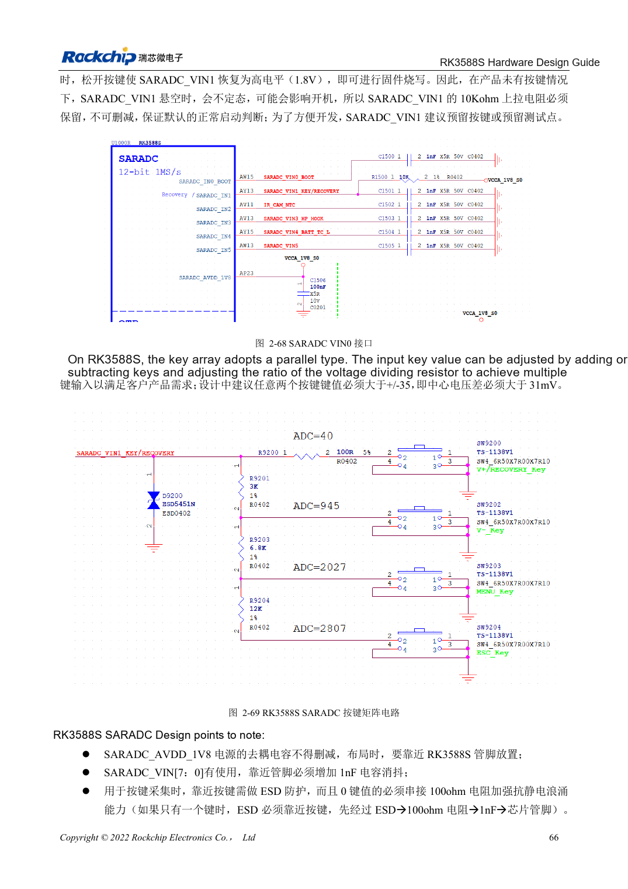

<!-- rk3588s-hardware-v12-20261109 -->

# RK3588S GPIO and SARADC: domains and button inputs

Based on the Chinese RK3588S Hardware Design Guide V1.2 (2023-12-14) for circuit and PCB review. CM7S carriers must follow module interface definitions; Sige7S supports software and peripheral evaluation. SoC capabilities are not a board connector list. Verify SDK/BSP, kernel, board revision, firmware and multiplexing. Values are source references, not ArmSoM hardware measurements.

**RK3588S Hardware Design Guide V1.2 (2023-12-14), CN** · §2.1.10; §2.3.2; §2.3.16

## Check domains before connecting peripherals

PMUIO1, EMMCIO and VCCIO1 are fixed 1.8V; PMUIO2, VCCIO2 and VCCIO4/5/6 select 1.8V or 3.3V. Fixed 1.8V companion pins and selectable pins must not mix S0/S3 retention. Automatic recognition of some domains does not permit 5V signals.

## Not all ADC channels are free

SARADC is 12-bit, 1MS/s, 0–1.8V with eight inputs; IN0_BOOT is dedicated and IN1 retains recovery with 10kΩ pull-up. Add 1nF near used inputs and ESD before the button series resistor. The source’s ±35 key-code/123mV relationship is unclear alongside 12-bit resolution; determine thresholds from actual driver scaling and measured voltages, not an assumed conversion.

## Design parameters and review table

| Item | Source reference |
| --- | --- |
| SARADC | 12bit; 1MS/s; 0–1.8V |
| Reserved inputs | IN0_BOOT; IN1 recovery |
| Input filter | 1nF |
| Recovery pull-up | 10kΩ |

## Source figures

No corresponding English design guide was found for this batch. All four editions use Chinese source screenshots with localized captions. Open an image for full resolution; the article text and parameter tables remain copyable. Page references are physical PDF pages.

Chinese original · PDF 81 · 2-69

## ArmSoM development path

CM7S supports custom carriers: first identify supplies, DDR and boot circuits already integrated in the module, then design outside its connectors. Sige7S provides a starting point for software and peripheral evaluation. For both products, verify exposed interfaces, pin assignments, levels, system images and cooling against the relevant revision. A chip reference schematic is not a product wiring diagram.

- [ArmSoM CM7S](https://www.armsom.org/cm7s) · [CM7S Docs](https://docs.armsom.org/armsom-cm7s)
- [ArmSoM Sige7S](https://www.armsom.org/sige7s) · [Sige7S Docs](https://docs.armsom.org/armsom-sige7s)

## Continue reading

- [RK3588S hardware design: 30 topics](/articles/rk3588s-hardware-design-series/)
- [RK3588S Ethernet hardware: GMAC, PHY and clock direction](/articles/rk3588s-gmac-hardware-design/)
- [RK3588S UART, SPI, CAN, I2C and PWM allocation](/articles/rk3588s-serial-control-hardware/)
