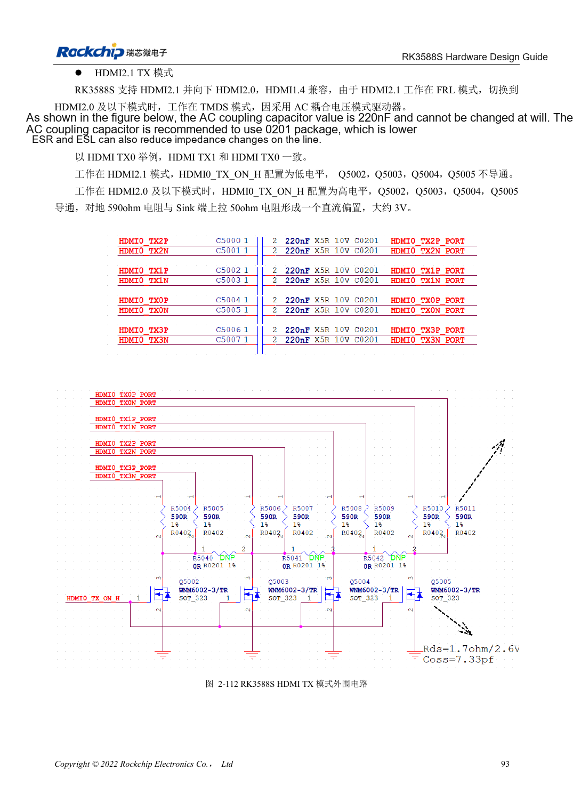
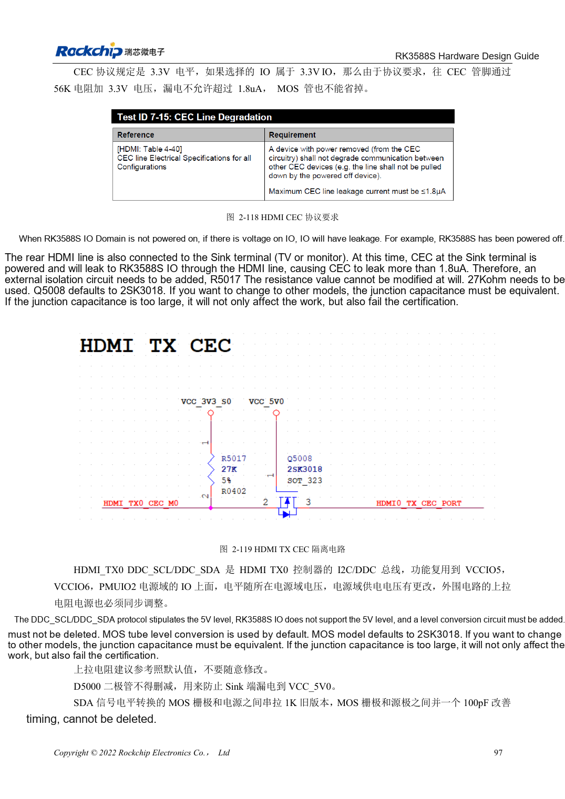

<!-- rk3588s-hardware-v12-20261109 -->

# RK3588S HDMI TX: FRL, TMDS and compatibility circuits

Based on the Chinese RK3588S Hardware Design Guide V1.2 (2023-12-14) for circuit and PCB review. CM7S carriers must follow module interface definitions; Sige7S supports software and peripheral evaluation. SoC capabilities are not a board connector list. Verify SDK/BSP, kernel, board revision, firmware and multiplexing. Values are source references, not ArmSoM hardware measurements.

**RK3588S Hardware Design Guide V1.2 (2023-12-14), CN** · §2.3.8.1; §3.4.6

## FRL and TMDS need different circuit states

HDMI2.1 uses FRL, while compatibility with HDMI2.0 and earlier uses TMDS. The reference has 220nF coupling and switched bias; TMDS uses 590Ω with receiver bias. MOS off-state behavior and parasitic capacitance matter. A working picture does not justify removing control circuitry. Shared HDMI/eDP PHYs also constrain simultaneous use.

## Validate control and high-speed paths

REXT is 8.2kΩ, 1%. DDC requires 5V translation; the TX CEC reference uses 27kΩ and isolation against off-state leakage. Connector pin 18 must be 4.8–5.3V. HDMI2.1 ESD capacitance must not exceed 0.2pF. Test hot-plug, powered-off connection and multiple displays/cables. Historical unsupported-feature notes describe this source version, not every current BSP.

## 590Ω versus 499Ω remains unresolved

TMDS text on page 108 and the layout on page 220 specify 590Ω, while table 2-24 on page 114 says 499Ω. Do not silently reconcile them. Confirm the actual reference schematic, PHY configuration and vendor guidance before releasing the BOM. There is one HDMI/eDP Combo; residual TX1 labels do not establish a second interface.

## Design parameters and review table

| Item | Source reference |
| --- | --- |
| TX coupling / bias reference | 220nF; 590Ω (PDF108/220) vs 499Ω (PDF114) |
| REXT | 8.2kΩ ±1% |
| PCB differential / length | 100Ω ±10% / <4in |
| Vias / airgap | Prefer no vias / ≥7× trace width |

## Source figures

No corresponding English design guide was found for this batch. All four editions use Chinese source screenshots with localized captions. Open an image for full resolution; the article text and parameter tables remain copyable. Page references are physical PDF pages.

Chinese original · PDF 108 · 2-112

Chinese original · PDF 112 · 2-119

## ArmSoM development path

CM7S supports custom carriers: first identify supplies, DDR and boot circuits already integrated in the module, then design outside its connectors. Sige7S provides a starting point for software and peripheral evaluation. For both products, verify exposed interfaces, pin assignments, levels, system images and cooling against the relevant revision. A chip reference schematic is not a product wiring diagram.

- [ArmSoM CM7S](https://www.armsom.org/cm7s) · [CM7S Docs](https://docs.armsom.org/armsom-cm7s)
- [ArmSoM Sige7S](https://www.armsom.org/sige7s) · [Sige7S Docs](https://docs.armsom.org/armsom-sige7s)

## Continue reading

- [RK3588S hardware design: 30 topics](/articles/rk3588s-hardware-design-series/)
- [RK3588S versus RK3588S2: camera PHYs and compatibility](/articles/rk3588s-rk3588s2-hardware-differences/)
- [RK3588S MIPI displays: D-PHY, C-PHY and panel integration](/articles/rk3588s-mipi-display-hardware/)
