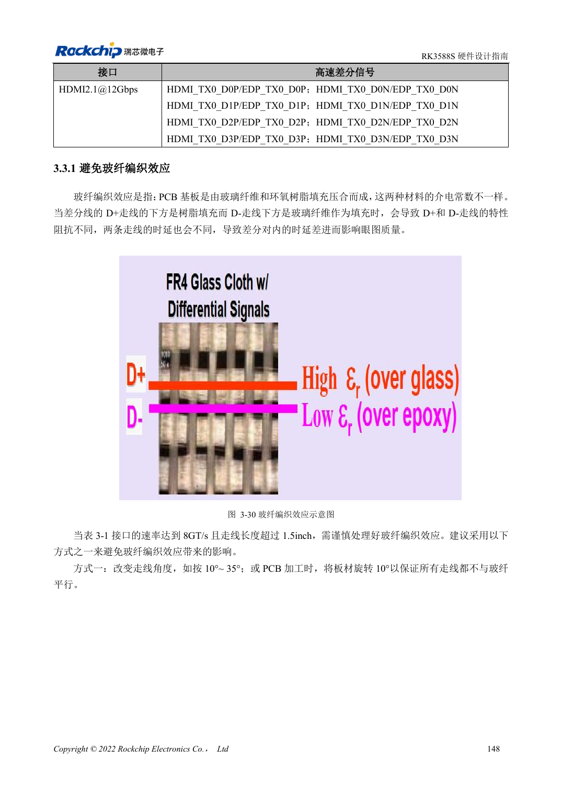
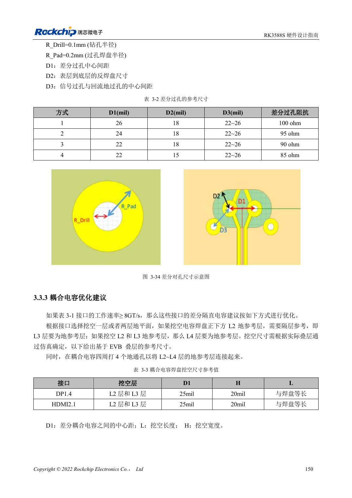
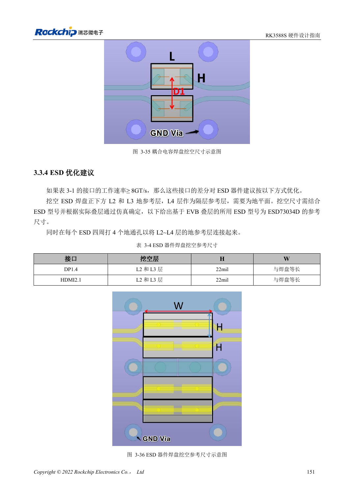

<!-- rk3588s-hardware-v12-20261109 -->

# RK3588S high-speed PCB: pads and vias above 8GT/s

Based on the Chinese RK3588S Hardware Design Guide V1.2 (2023-12-14) for circuit and PCB review. CM7S carriers must follow module interface definitions; Sige7S supports software and peripheral evaluation. SoC capabilities are not a board connector list. Verify SDK/BSP, kernel, board revision, firmware and multiplexing. Values are source references, not ArmSoM hardware measurements.

**RK3588S Hardware Design Guide V1.2 (2023-12-14), CN** · §3.2–3.3

## Identify the actual fast links

Table 3-1 lists DP1.4 at 8.1Gbps and HDMI2.1 at 12Gbps. RK3588 PCIe3.0 rules do not add PCIe3.0 to RK3588S. Review glass weave for links at ≥8GT/s longer than 1.5in; 10°–35° routing is one option. Reference via drill radius is 0.1mm and pad radius 0.2mm; simulate again for a different stack.

## Preserve return paths after voiding

If L2 is removed below a capacitor, L3 must provide ground; if L2/L3 are removed, L4 must provide ground, with nearby ground stitching. Dimensions apply to the EVB stack and parts. Relevant high-speed traces longer than 1.5in need glass-weave attention, for example angled routing. Evaluate the complete module/carrier/connector channel by simulation or measurement.

## Design parameters and review table

| Item | Source reference |
| --- | --- |
| Glass-weave review | 8GT/s and length >1.5in |
| Angle example | 10°–35° |
| Reference via radii | Drill 0.1mm; pad 0.2mm |

## Source figures

No corresponding English design guide was found for this batch. All four editions use Chinese source screenshots with localized captions. Open an image for full resolution; the article text and parameter tables remain copyable. Page references are physical PDF pages.

Chinese original · PDF 163 · 3-30

Chinese original · PDF 165 · 3-34

Chinese original · PDF 166 · 3-36

## ArmSoM development path

CM7S supports custom carriers: first identify supplies, DDR and boot circuits already integrated in the module, then design outside its connectors. Sige7S provides a starting point for software and peripheral evaluation. For both products, verify exposed interfaces, pin assignments, levels, system images and cooling against the relevant revision. A chip reference schematic is not a product wiring diagram.

- [ArmSoM CM7S](https://www.armsom.org/cm7s) · [CM7S Docs](https://docs.armsom.org/armsom-cm7s)
- [ArmSoM Sige7S](https://www.armsom.org/sige7s) · [Sige7S Docs](https://docs.armsom.org/armsom-sige7s)

## Continue reading

- [RK3588S hardware design: 30 topics](/articles/rk3588s-hardware-design-series/)
- [RK3588S stackup and fanout: HDI versus through-hole](/articles/rk3588s-pcb-stackup-fanout/)
- [RK3588S power PCB and PDN: copper, returns and decoupling](/articles/rk3588s-power-pcb-pdn-design/)
