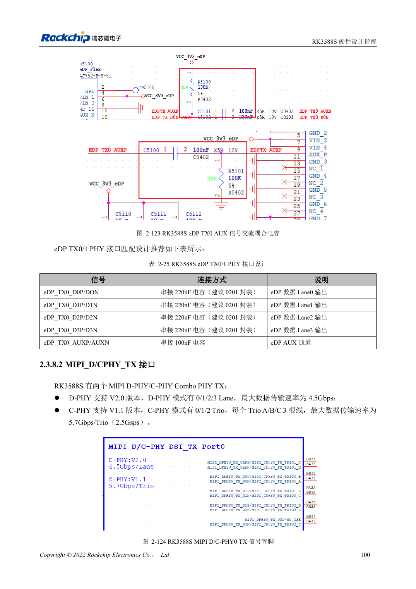
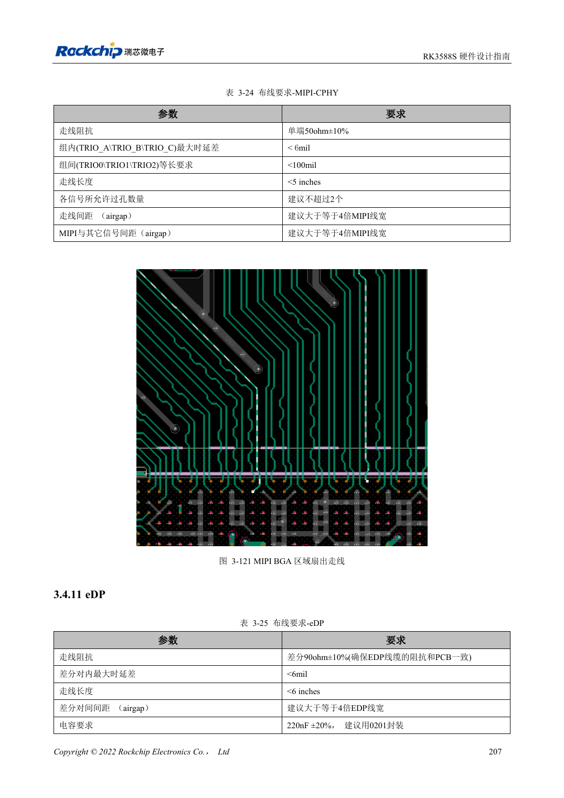

<!-- rk3588s-hardware-v12-20261109 -->

# RK3588S MIPI displays: D-PHY, C-PHY and panel integration

Based on the Chinese RK3588S Hardware Design Guide V1.2 (2023-12-14) for circuit and PCB review. CM7S carriers must follow module interface definitions; Sige7S supports software and peripheral evaluation. SoC capabilities are not a board connector list. Verify SDK/BSP, kernel, board revision, firmware and multiplexing. Values are source references, not ArmSoM hardware measurements.

**RK3588S Hardware Design Guide V1.2 (2023-12-14), CN** · §2.3.8.2; §3.4.10; §3.4.21

## Design lanes and trios separately

The two D/C Combo PHYs provide four two-wire data lanes in D-PHY or three A/B/C trios in C-PHY. TX and RX of the same PHY must both use D-PHY or both C-PHY, not mixed modes. Check panel protocol, lane/trio count and timing before wiring.

## A panel needs more than high-speed data

Match backlight power, enable, reset, touch I2C and interrupt voltages and sequence. D-PHY differential and C-PHY single-ended impedances require separate DRC rules. Validate panel initialization on the actual BSP, then brightness transitions, sleep/wake, touch interference and sustained display.

## Design parameters and review table

| Item | Source reference |
| --- | --- |
| D-PHY source rate | 4.5Gbps/lane |
| C-PHY source rate | 5.7Gbps/trio |
| C-PHY impedance | 50Ω ±10% single-ended |
| C-PHY intra-trio / inter-trio | <6mil / <100mil |
| C-PHY length | <5in |

## Source figures

No corresponding English design guide was found for this batch. All four editions use Chinese source screenshots with localized captions. Open an image for full resolution; the article text and parameter tables remain copyable. Page references are physical PDF pages.

Chinese original · PDF 115 · 2-124

Chinese original · PDF 222 · 3-121

## ArmSoM development path

CM7S supports custom carriers: first identify supplies, DDR and boot circuits already integrated in the module, then design outside its connectors. Sige7S provides a starting point for software and peripheral evaluation. For both products, verify exposed interfaces, pin assignments, levels, system images and cooling against the relevant revision. A chip reference schematic is not a product wiring diagram.

- [ArmSoM CM7S](https://www.armsom.org/cm7s) · [CM7S Docs](https://docs.armsom.org/armsom-cm7s)
- [ArmSoM Sige7S](https://www.armsom.org/sige7s) · [Sige7S Docs](https://docs.armsom.org/armsom-sige7s)

## Continue reading

- [RK3588S hardware design: 30 topics](/articles/rk3588s-hardware-design-series/)
- [RK3588S HDMI TX: FRL, TMDS and compatibility circuits](/articles/rk3588s-hdmi-tx-hardware-design/)
- [RK3588S DP and eDP: shared PHYs, AUX and coupling](/articles/rk3588s-dp-edp-hardware-design/)
