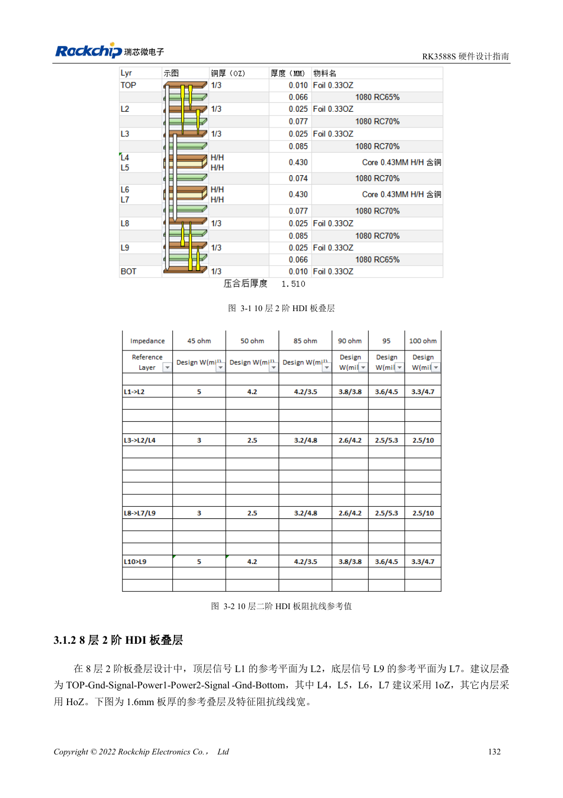
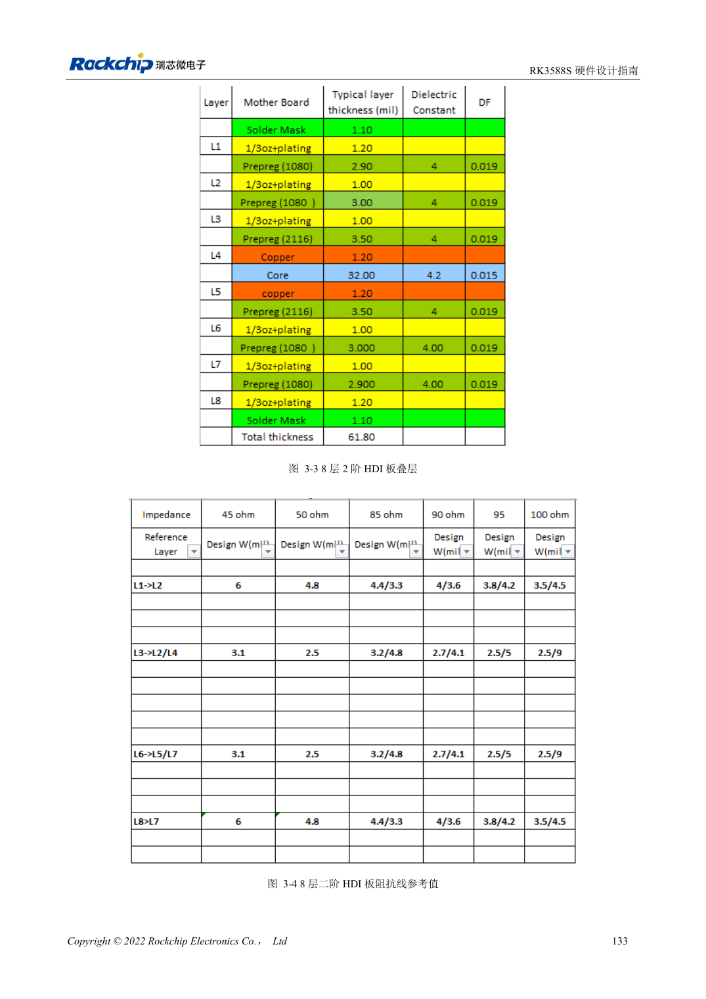
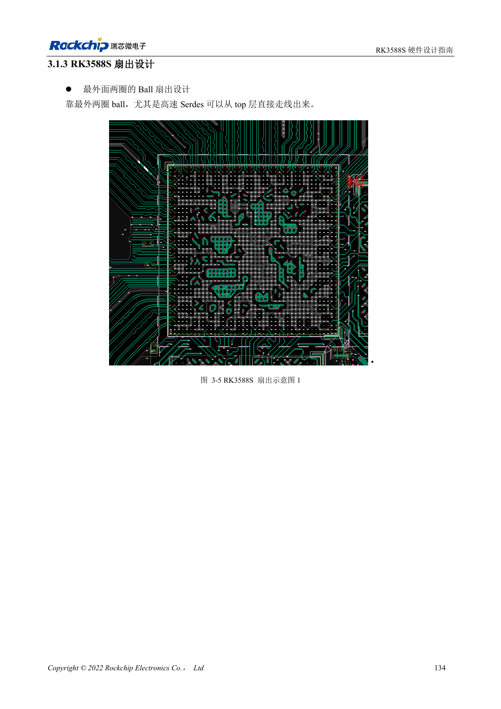

<!-- rk3588s-hardware-v12-20261109 -->

# RK3588S stackup and fanout: HDI versus through-hole

Based on the Chinese RK3588S Hardware Design Guide V1.2 (2023-12-14) for circuit and PCB review. CM7S carriers must follow module interface definitions; Sige7S supports software and peripheral evaluation. SoC capabilities are not a board connector list. Verify SDK/BSP, kernel, board revision, firmware and multiplexing. Values are source references, not ArmSoM hardware measurements.

**RK3588S Hardware Design Guide V1.2 (2023-12-14), CN** · §3.1–3.2

## Both references use second-order HDI

The RK3588S guide presents 10-layer and 8-layer second-order HDI, not the RK3588 8-layer through-hole example. Reference thickness is 1.6mm; keep signals adjacent to ground and the stack symmetric. Page 147 incorrectly calls the bottom of the eight-layer stack L9. Check the diagram and fabricator stack instead of copying that label.

## Separate BGA escape from carrier routing

The outer two ball rows can escape on the top layer; minimize transitions for fast interfaces. Actual width, microvias, buried vias and antipads depend on fabrication and impedance calculations. A CM7S carrier routes from module connectors rather than duplicating RK3588S BGA escape. Review the combined module, connector and carrier channel.

## Design parameters and review table

| Item | Source reference |
| --- | --- |
| Reference stackups | 10-layer / 8-layer second-order HDI |
| Example board thickness | 1.6mm |
| Routing length scope | PCB + vias + package |

## Source figures

No corresponding English design guide was found for this batch. All four editions use Chinese source screenshots with localized captions. Open an image for full resolution; the article text and parameter tables remain copyable. Page references are physical PDF pages.

Chinese original · PDF 147 · 3-1

Chinese original · PDF 148 · 3-3

Chinese original · PDF 149 · 3-5

## ArmSoM development path

CM7S supports custom carriers: first identify supplies, DDR and boot circuits already integrated in the module, then design outside its connectors. Sige7S provides a starting point for software and peripheral evaluation. For both products, verify exposed interfaces, pin assignments, levels, system images and cooling against the relevant revision. A chip reference schematic is not a product wiring diagram.

- [ArmSoM CM7S](https://www.armsom.org/cm7s) · [CM7S Docs](https://docs.armsom.org/armsom-cm7s)
- [ArmSoM Sige7S](https://www.armsom.org/sige7s) · [Sige7S Docs](https://docs.armsom.org/armsom-sige7s)

## Continue reading

- [RK3588S hardware design: 30 topics](/articles/rk3588s-hardware-design-series/)
- [RK3588S UART, SPI, CAN, I2C and PWM allocation](/articles/rk3588s-serial-control-hardware/)
- [RK3588S high-speed PCB: pads and vias above 8GT/s](/articles/rk3588s-high-speed-pcb-review/)
