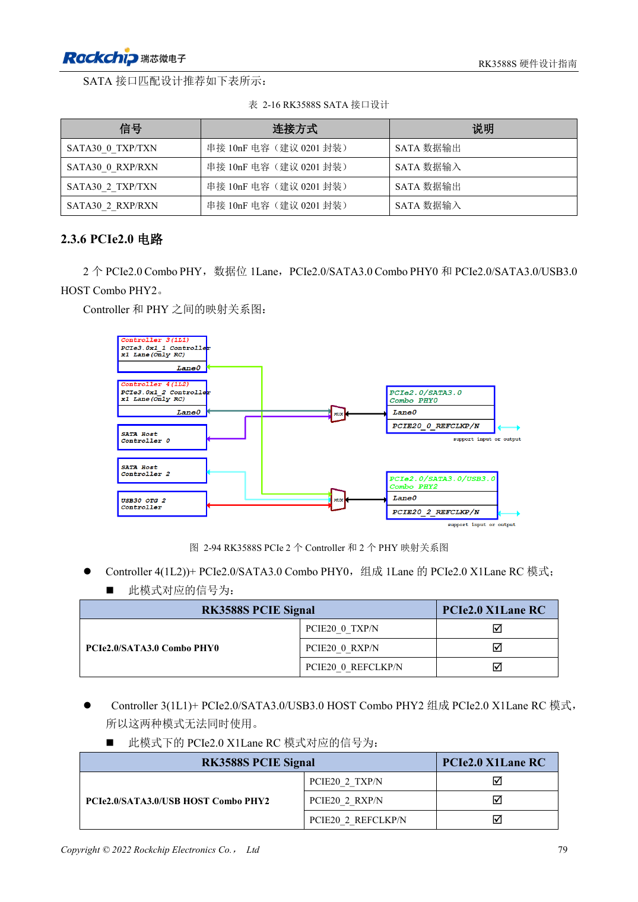
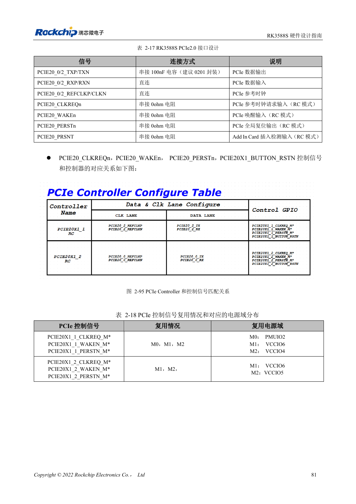

<!-- rk3588s-hardware-v12-20261109 -->

# RK3588S PCIe: lanes, reference clocks and supplies

Based on the Chinese RK3588S Hardware Design Guide V1.2 (2023-12-14) for circuit and PCB review. CM7S carriers must follow module interface definitions; Sige7S supports software and peripheral evaluation. SoC capabilities are not a board connector list. Verify SDK/BSP, kernel, board revision, firmware and multiplexing. Values are source references, not ArmSoM hardware measurements.

**RK3588S Hardware Design Guide V1.2 (2023-12-14), CN** · §2.3.6; §3.4.4

## Design for PCIe2.0 x1

The RK3588S chapter specifies two PCIe2.0 x1 RC controllers on PHY0/2, not the RK3588 PCIe3.0 x4 architecture. Page 95 retains a PCIe3.0 reference, and the page-94 statement about modes not operating together lacks clear scope. Follow the mapping diagram without promising concurrent ports; confirm the TRM and SDK. REFCLK defaults to output toward the EP.

## Control signals and the full channel

CLKREQn/WAKEn require functional pins from the same Mx group. PERSTn may use GPIO; a functional PERSTn must match the group. Standard slot control levels are 3.3V, so translate as required. Use 100nF coupling, 85Ω data and 100Ω REFCLK. Review module, connector and carrier together, then test cold boot, target speed, resume and sustained traffic.

## Design parameters and review table

| Item | Source reference |
| --- | --- |
| PCIe controllers | 2 × PCIe2.0 x1 RC |
| PCIe data impedance | 85Ω ±10% |
| REFCLK impedance | 100Ω ±10% |
| PCIe coupling | 100nF ±20% |
| Data / REFCLK intra-pair | <6mil / <12mil |
| Length / vias | <6in / recommended ≤2 |

## Source figures

No corresponding English design guide was found for this batch. All four editions use Chinese source screenshots with localized captions. Open an image for full resolution; the article text and parameter tables remain copyable. Page references are physical PDF pages.

Chinese original · PDF 94 · 2-94

Chinese original · PDF 96 · 2-95

## ArmSoM development path

CM7S supports custom carriers: first identify supplies, DDR and boot circuits already integrated in the module, then design outside its connectors. Sige7S provides a starting point for software and peripheral evaluation. For both products, verify exposed interfaces, pin assignments, levels, system images and cooling against the relevant revision. A chip reference schematic is not a product wiring diagram.

- [ArmSoM CM7S](https://www.armsom.org/cm7s) · [CM7S Docs](https://docs.armsom.org/armsom-cm7s)
- [ArmSoM Sige7S](https://www.armsom.org/sige7s) · [Sige7S Docs](https://docs.armsom.org/armsom-sige7s)

## Continue reading

- [RK3588S hardware design: 30 topics](/articles/rk3588s-hardware-design-series/)
- [RK3588S SATA: three controllers and shared PHYs](/articles/rk3588s-sata-hardware-design/)
- [RK3588S cameras: CSI, D/C PHY and CIF planning](/articles/rk3588s-camera-hardware-design/)
