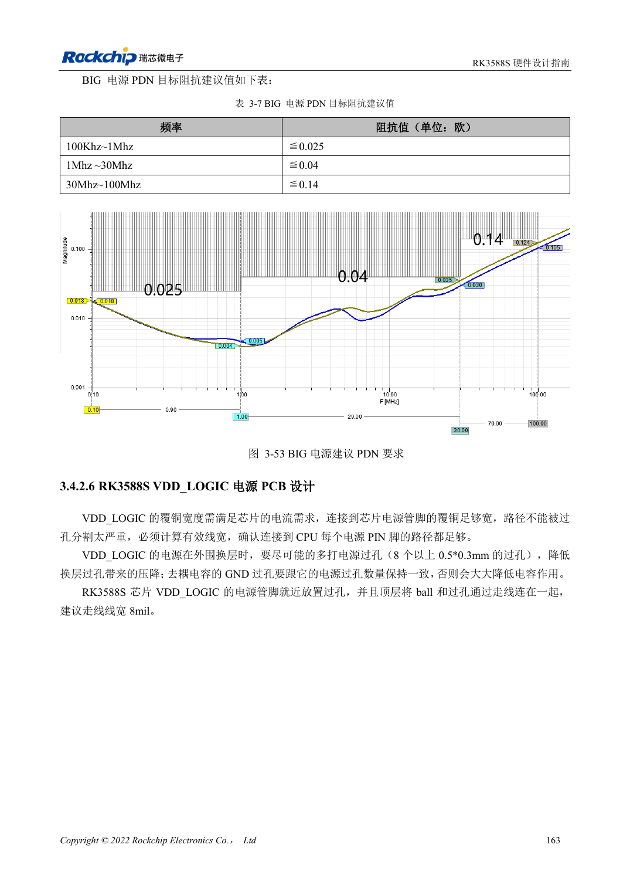

<!-- rk3588s-hardware-v12-20261109 -->

# RK3588S power PCB and PDN: copper, returns and decoupling

Based on the Chinese RK3588S Hardware Design Guide V1.2 (2023-12-14) for circuit and PCB review. CM7S carriers must follow module interface definitions; Sige7S supports software and peripheral evaluation. SoC capabilities are not a board connector list. Verify SDK/BSP, kernel, board revision, firmware and multiplexing. Values are source references, not ArmSoM hardware measurements.

**RK3588S Hardware Design Guide V1.2 (2023-12-14), CN** · §3.4.2

## Capacitor count is not enough

Ground via count on high-current Buck input/output capacitors should match positive-side vias. Inspect effective copper width and bottlenecks after via perforation; avoid thermal-relief necks on critical power connections. RK806 placement balances short power paths with heat distribution rather than simply minimizing distance.

## Check impedance by frequency band

Table 3-7 sets frequency-dependent BIG PDN targets, not one universal capacitor value. Models need regulator, planes, vias, package and capacitor ESR/ESL. These are reference recommendations, not measured ArmSoM results. Measure droop and ringing during load steps and correlate with temperature, clocks and errors.

## Design parameters and review table

| Item | Source reference |
| --- | --- |
| BIG PDN 100kHz–1MHz | ≤0.025Ω |
| BIG PDN 1–30MHz | ≤0.04Ω |
| BIG PDN 30–100MHz | ≤0.14Ω |
| Reference via current (<1V) | 0.5A; source 0.5×0.3mm via example |

## Source figures

No corresponding English design guide was found for this batch. All four editions use Chinese source screenshots with localized captions. Open an image for full resolution; the article text and parameter tables remain copyable. Page references are physical PDF pages.

Chinese original · PDF 178 · 3-53

## ArmSoM development path

CM7S supports custom carriers: first identify supplies, DDR and boot circuits already integrated in the module, then design outside its connectors. Sige7S provides a starting point for software and peripheral evaluation. For both products, verify exposed interfaces, pin assignments, levels, system images and cooling against the relevant revision. A chip reference schematic is not a product wiring diagram.

- [ArmSoM CM7S](https://www.armsom.org/cm7s) · [CM7S Docs](https://docs.armsom.org/armsom-cm7s)
- [ArmSoM Sige7S](https://www.armsom.org/sige7s) · [Sige7S Docs](https://docs.armsom.org/armsom-sige7s)

## Continue reading

- [RK3588S hardware design: 30 topics](/articles/rk3588s-hardware-design-series/)
- [RK3588S high-speed PCB: pads and vias above 8GT/s](/articles/rk3588s-high-speed-pcb-review/)
- [RK3588S thermal design: reference resistance and system validation](/articles/rk3588s-thermal-hardware-design/)
