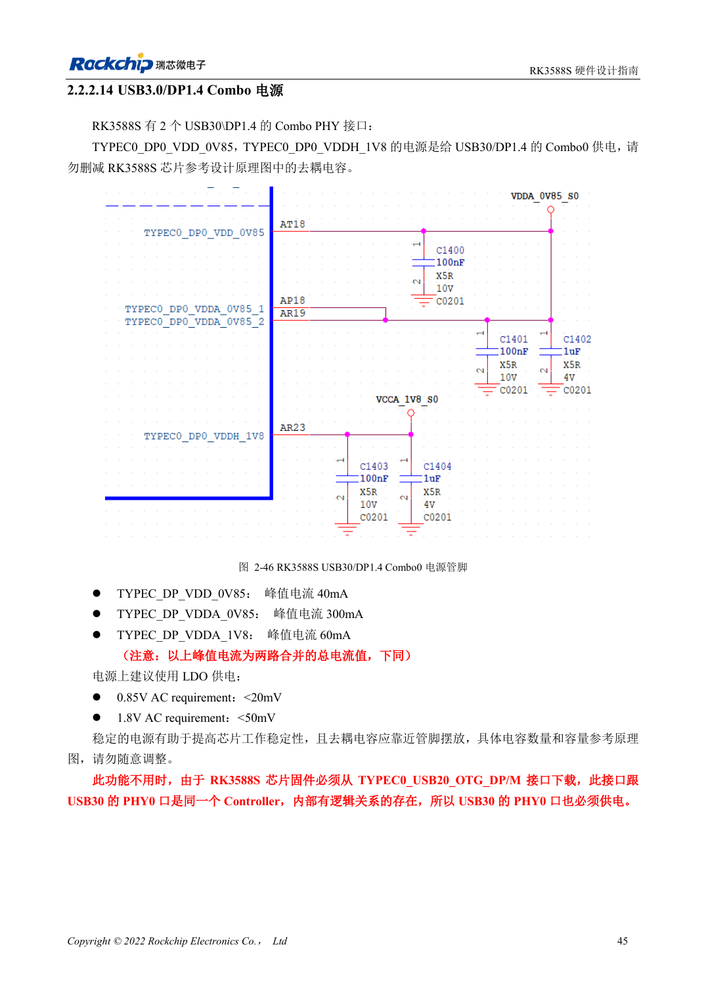
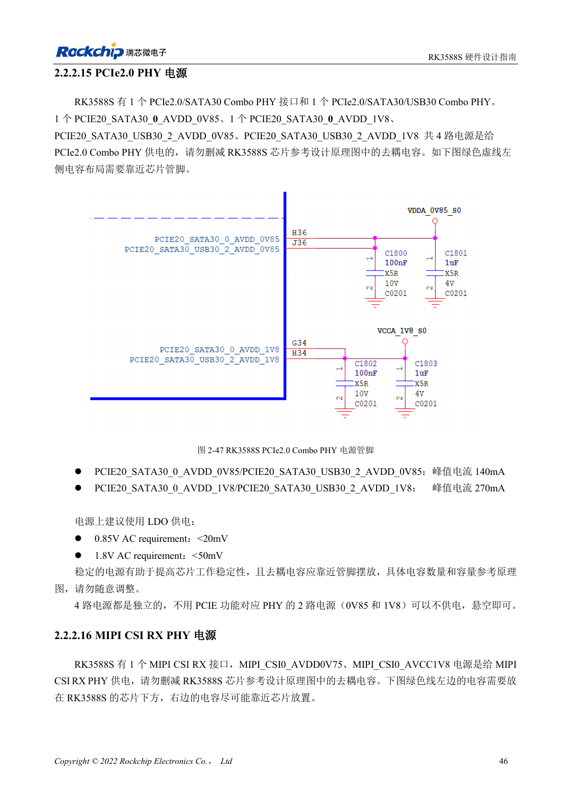

<!-- rk3588s-hardware-v12-20261109 -->

# RK3588S rails: startup requirements and unused PHYs

Based on the Chinese RK3588S Hardware Design Guide V1.2 (2023-12-14) for circuit and PCB review. CM7S carriers must follow module interface definitions; Sige7S supports software and peripheral evaluation. SoC capabilities are not a board connector list. Verify SDK/BSP, kernel, board revision, firmware and multiplexing. Values are source references, not ArmSoM hardware measurements.

**RK3588S Hardware Design Guide V1.2 (2023-12-14), CN** · §2.2.1–2.2.2

## Unused functions do not imply removable rails

Table 2-9 requires initial supplies for CPU, GPU, NPU, VDENC, DDR, PMU, SARADC, OTP, EMMCIO, VCCIO2, USB2 PHY and TYPEC0. Record startup, running, sleep, load, ripple and decoupling per rail. Software power-down does not waive initial supply requirements.

## Check each Combo PHY

RK3588S provides PCIe2.0/SATA3.0 PHY0 and PCIe2.0/SATA3.0/USB3.0 PHY2, each with 0.85V and 1.8V rails. The source permits an unused PHY to remain unpowered only after its SATA/USB functions are also excluded. TYPEC0 has a separate mandatory startup supply requirement. MIPI supply names and peak-current text are inconsistent; cross-check the schematic.

## Design parameters and review table

| Item | Source reference |
| --- | --- |
| PCIe2.0 analog ripple | 0.85V: <20mV; 1.8V: <50mV |
| PHY supplies | PHY0 / PHY2: 0.85V + 1.8V |
| Mandatory startup | TYPEC0_DP0; USB2 PHY; table 2-9 |

## Source figures

No corresponding English design guide was found for this batch. All four editions use Chinese source screenshots with localized captions. Open an image for full resolution; the article text and parameter tables remain copyable. Page references are physical PDF pages.

Chinese original · PDF 60 · 2-46

Chinese original · PDF 61 · 2-47

## ArmSoM development path

CM7S supports custom carriers: first identify supplies, DDR and boot circuits already integrated in the module, then design outside its connectors. Sige7S provides a starting point for software and peripheral evaluation. For both products, verify exposed interfaces, pin assignments, levels, system images and cooling against the relevant revision. A chip reference schematic is not a product wiring diagram.

- [ArmSoM CM7S](https://www.armsom.org/cm7s) · [CM7S Docs](https://docs.armsom.org/armsom-cm7s)
- [ArmSoM Sige7S](https://www.armsom.org/sige7s) · [Sige7S Docs](https://docs.armsom.org/armsom-sige7s)

## Continue reading

- [RK3588S hardware design: 30 topics](/articles/rk3588s-hardware-design-series/)
- [RK3588S boot and recovery: Maskrom, JTAG and UART](/articles/rk3588s-boot-debug-hardware/)
- [RK3588S power sequencing: RESETn and S0/S3](/articles/rk3588s-power-sequencing-design/)
