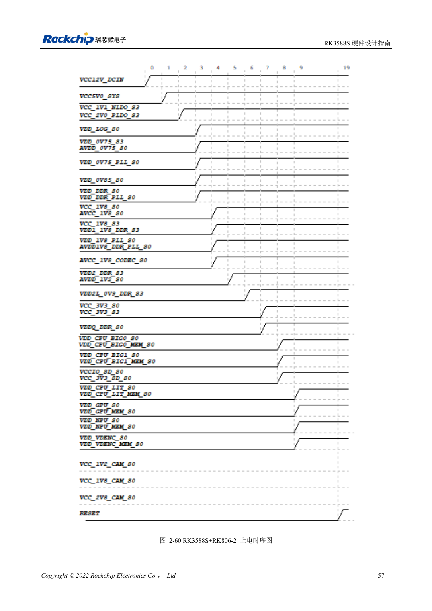

<!-- rk3588s-hardware-v12-20261109 -->

# RK3588S power sequencing: RESETn and S0/S3

Based on the Chinese RK3588S Hardware Design Guide V1.2 (2023-12-14) for circuit and PCB review. CM7S carriers must follow module interface definitions; Sige7S supports software and peripheral evaluation. SoC capabilities are not a board connector list. Verify SDK/BSP, kernel, board revision, firmware and multiplexing. Values are source references, not ArmSoM hardware measurements.

**RK3588S Hardware Design Guide V1.2 (2023-12-14), CN** · §2.1.10.3; §2.2.1.2–2.2.1.3

## Explicit sequences take priority

A lower-voltage-first principle does not replace explicit orders such as MIPI_D/C_PHY_VDD → 1.8V → 1.2V. Use the particular power tree, not numerical sorting. Release RESETn ≥1ms after the final rail stabilizes while meeting shared peripheral requirements. On shutdown assert RESETn before removing supplies.

## Test sleep and back-powering

The fixed 1.8V and selectable-voltage pins of a domain must both belong to S0 or both S3. Measure cold start, warm reset, sleep and shutdown, checking back-power from USB, HDMI and external controllers. Module carriers follow module input and enable requirements rather than recreating internal SoC supplies.

## Design parameters and review table

| Item | Source reference |
| --- | --- |
| Reset release | ≥1ms after final rail stable |
| Power-down | RESETn low → supplies off |
| MIPI D/C reference | VDD → 1.8V → 1.2V |

## Source figures

No corresponding English design guide was found for this batch. All four editions use Chinese source screenshots with localized captions. Open an image for full resolution; the article text and parameter tables remain copyable. Page references are physical PDF pages.

Chinese original · PDF 72 · 2-60

## ArmSoM development path

CM7S supports custom carriers: first identify supplies, DDR and boot circuits already integrated in the module, then design outside its connectors. Sige7S provides a starting point for software and peripheral evaluation. For both products, verify exposed interfaces, pin assignments, levels, system images and cooling against the relevant revision. A chip reference schematic is not a product wiring diagram.

- [ArmSoM CM7S](https://www.armsom.org/cm7s) · [CM7S Docs](https://docs.armsom.org/armsom-cm7s)
- [ArmSoM Sige7S](https://www.armsom.org/sige7s) · [Sige7S Docs](https://docs.armsom.org/armsom-sige7s)

## Continue reading

- [RK3588S hardware design: 30 topics](/articles/rk3588s-hardware-design-series/)
- [RK3588S rails: startup requirements and unused PHYs](/articles/rk3588s-power-rail-planning/)
- [RK3588S and RK806: single and dual PMIC power trees](/articles/rk3588s-rk806-pmic-design/)
