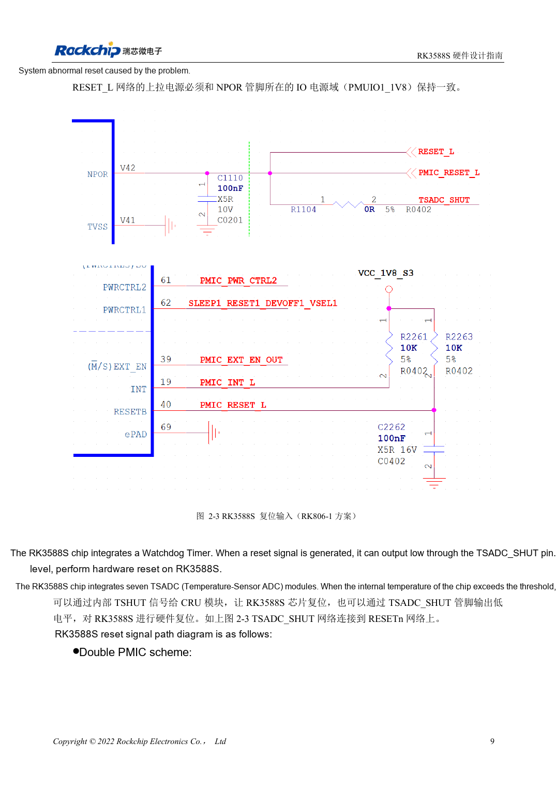
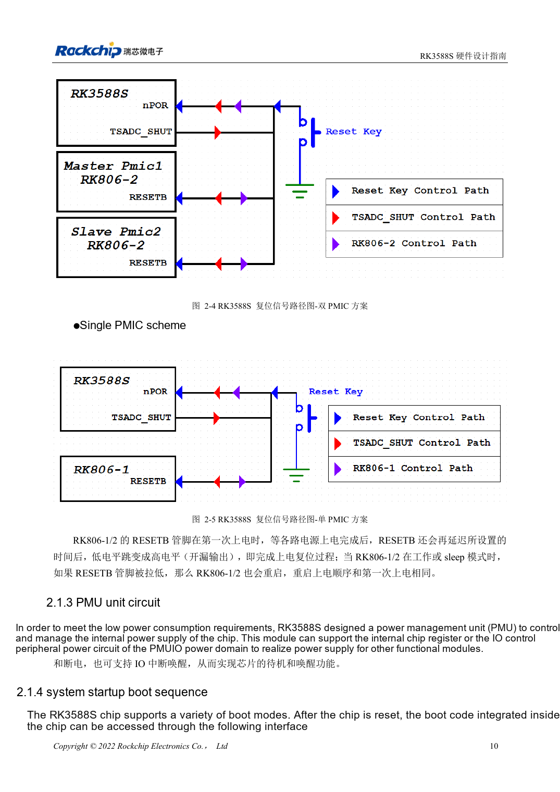

<!-- rk3588s-hardware-v12-20261109 -->

# RK3588S reset, watchdog and thermal protection

Based on the Chinese RK3588S Hardware Design Guide V1.2 (2023-12-14) for circuit and PCB review. CM7S carriers must follow module interface definitions; Sige7S supports software and peripheral evaluation. SoC capabilities are not a board connector list. Verify SDK/BSP, kernel, board revision, firmware and multiplexing. Values are source references, not ArmSoM hardware measurements.

**RK3588S Hardware Design Guide V1.2 (2023-12-14), CN** · §2.1.2; §3.4.1

## Pulse width is separate from startup delay

NPOR_u at V42 is active low. The guide specifies 100 cycles of 24MHz and also at least 4μs; 100/24MHz≈4.167μs, so exactly 4.000μs is insufficient. Place 100nF near the pin and pull up to PMUIO1_1V8. Waiting ≥1ms after the last rail stabilizes before releasing reset is a separate requirement.

## Validate the whole reset network

RK806-1/2 releases RESETB after startup delay; pulling it low during operation or sleep repeats power sequencing. The watchdog and seven TSADC temperature modules also participate in reset protection. Observe RESETn, rails and UART together. Check button → TVS → 100Ω → filter → CPU/PMIC, keeping reset away from DC/DC, metal connectors and edges.

## Design parameters and review table

| Item | Source reference |
| --- | --- |
| NPOR_u | V42; active low |
| Minimum reset | 100 cycles @24MHz ≈4.167μs |
| Filter capacitor | 100nF |
| Pull-up | PMUIO1_1V8 |

## Source figures

No corresponding English design guide was found for this batch. All four editions use Chinese source screenshots with localized captions. Open an image for full resolution; the article text and parameter tables remain copyable. Page references are physical PDF pages.

Chinese original · PDF 24 · 2-3

Chinese original · PDF 25 · 2-5

## ArmSoM development path

CM7S supports custom carriers: first identify supplies, DDR and boot circuits already integrated in the module, then design outside its connectors. Sige7S provides a starting point for software and peripheral evaluation. For both products, verify exposed interfaces, pin assignments, levels, system images and cooling against the relevant revision. A chip reference schematic is not a product wiring diagram.

- [ArmSoM CM7S](https://www.armsom.org/cm7s) · [CM7S Docs](https://docs.armsom.org/armsom-cm7s)
- [ArmSoM Sige7S](https://www.armsom.org/sige7s) · [Sige7S Docs](https://docs.armsom.org/armsom-sige7s)

## Continue reading

- [RK3588S hardware design: 30 topics](/articles/rk3588s-hardware-design-series/)
- [RK3588S clocks: 24MHz, 32kHz and layout](/articles/rk3588s-clock-hardware-design/)
- [RK3588S boot and recovery: Maskrom, JTAG and UART](/articles/rk3588s-boot-debug-hardware/)
