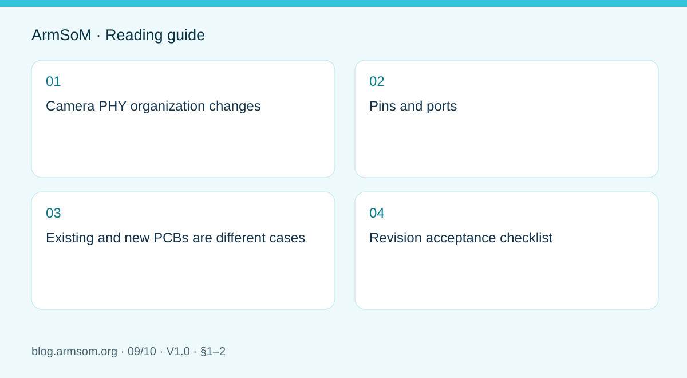
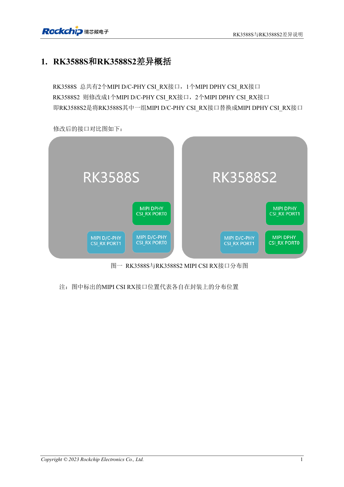
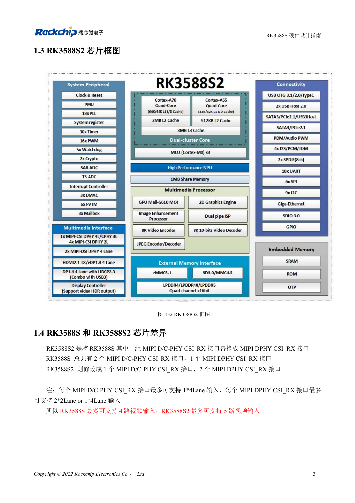
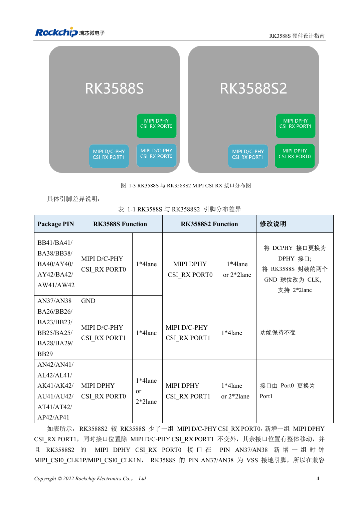

# RK3588S versus RK3588S2: what to check before a hardware revision

## Scope and sources

This is a task-focused engineering guide, not a page-by-page translation of the complete PDF. Source examples are not ArmSoM measurements. Check voltages, pins, SDK/BSP and kernel against the actual board revision.

**Rockchip:** `RK3588S与RK3588S2差异说明_V1.0_20231214_CN.pdf` · V1.0 · §1–2

## Camera PHY organization changes

Chapter 1 lists two MIPI D/C-PHY CSI_RX interfaces and one DPHY interface for RK3588S. RK3588S2 changes this to one D/C-PHY and two DPHY interfaces. This is a change of type and placement, not simply another identical port.

Identify the sensor's D-PHY or C-PHY mode, lane arrangement and connector mapping. Software port names cannot be carried over blindly. CM7s documentation specifies RK3588S; this note does not turn it into an S2 product.

## Pins and ports

| Item | RK3588S | RK3588S2 |
| --- | --- | --- |
| Original D/C-PHY CSI_RX PORT0 position | D/C-PHY, 1×4 lane | DPHY CSI_RX PORT0, 1×4 or 2×2 lane |
| AN37/AN38 | GND | New MIPI_CSI0_CLK1P/MIPI_CSI0_CLK1N |
| D/C-PHY CSI_RX PORT1 | Original interface | Function unchanged |
| Original DPHY CSI_RX PORT0 position | PORT0 | Renamed DPHY CSI_RX PORT1 |

The change from ground balls to clock functions at AN37/AN38 is essential. Review every ball in the original table rather than deciding from a port name alone.

## Existing and new PCBs are different cases

Chapter 2 calls for Rockchip's compatibility patch and interface remapping when fitting RK3588S2 to an existing RK3588S PCB. New S2 designs should use the new reference design, for which the note states up to five cameras.

Five is not a CM7s connector promise or proof of arbitrary resolution, frame-rate and ISP concurrency. The note does not supply a patch filename, BSP commit or complete concurrency limits. Obtain the implementation matching the project's software version.

## Revision acceptance checklist

1. Identify chip marking, PCB and module revisions.
2. Compare balls, PHYs, sensor modes and populated connections.
3. Check the compatibility patch, device-tree ports, clocks and reset.
4. Test one camera, then the intended combination, frame loss and recovery.
5. Record hardware revision and image checksum in production.

No chip replacement or camera-concurrency test was performed for this article.

## Source illustration

Chinese original; no matching English figure was found in the supplied materials. Reference design, not an ArmSoM board schematic.

`RK3588S与RK3588S2差异说明_V1.0_20231214_CN.pdf` · PDF p. 6.

## Products and development resources

- **CM7s** — [Product page](https://www.armsom.org/cm7s) · [Documentation](https://docs.armsom.org/armsom-cm7s)

## Continue this series

- [RK3576 hardware bring-up: minimum system and first-power checks](/articles/rk3576-hardware-bringup/)
- [ArmSoM CM5 carrier-board checklist: power, boot and interface planning](/articles/019-cm5-carrier-production/)
- [RK3576 high-speed interfaces: review schematics and PCB together](/articles/rk3576-high-speed-interface-design/)
- [RK3588S hardware design: from a reference circuit to a CM7s carrier](/articles/rk3588s-cm7s-carrier-design/)
- [RK3588 edge-AI hardware: plan power, cooling and expansion together](/articles/rk3588-edge-ai-hardware-design/)
- [RK3588 high-speed PCB review: stackup, impedance and routing](/articles/rk3588-high-speed-pcb-review/)
- [RK3506 industrial HMI hardware: choosing a CM1 or Forge1 development path](/articles/rk3506-industrial-hmi-hardware/)
- [RK3308 hardware variants: compatibility checks for P2 Pro audio projects](/articles/rk3308-hardware-variant-compatibility/)
- [Rockchip prototype to production: process requirements and test records](/articles/rockchip-hardware-production-checklist/)

<!-- rk3588s-hardware-v12-20261109 -->

## RK3588S versus RK3588S2: camera PHYs and compatibility

Based on the Chinese RK3588S Hardware Design Guide V1.2 (2023-12-14) for circuit and PCB review. CM7S carriers must follow module interface definitions; Sige7S supports software and peripheral evaluation. SoC capabilities are not a board connector list. Verify SDK/BSP, kernel, board revision, firmware and multiplexing. Values are source references, not ArmSoM hardware measurements.

**RK3588S Hardware Design Guide V1.2 (2023-12-14), CN** · §1.3–1.4

## Camera input is the main distinction

RK3588S has two D/C Combo receivers and one dedicated DPHY receiver; RK3588S2 has one D/C Combo and two dedicated DPHY receivers. The guide illustrates up to four versus five cameras. These are reference combinations, not connector counts or proof that an ArmSoM BSP supports every combination.

## Recheck pins and software

Table 1-1 changes AN37 and AN38 from RK3588S GND to RK3588S2 camera clocks. The guide calls for a compatibility patch when using S2 on an existing S design; it is not unconditional drop-in compatibility. Check chip marking, board revision, actual nets, sensors and SDK, then validate capture and sleep.

## Design parameters and review table

| Item | Source reference |
| --- | --- |
| RK3588S RX | 2 × D/C Combo + 1 × DPHY |
| RK3588S2 RX | 1 × D/C Combo + 2 × DPHY |
| Changed balls | AN37 / AN38 |
| Source camera combinations | RK3588S: ≤4; RK3588S2: ≤5 |

## Source figures

No corresponding English design guide was found for this batch. All four editions use Chinese source screenshots with localized captions. Open an image for full resolution; the article text and parameter tables remain copyable. Page references are physical PDF pages.

Chinese original · PDF 18 · 1-2

Chinese original · PDF 19 · 1-3

## ArmSoM development path

CM7S supports custom carriers: first identify supplies, DDR and boot circuits already integrated in the module, then design outside its connectors. Sige7S provides a starting point for software and peripheral evaluation. For both products, verify exposed interfaces, pin assignments, levels, system images and cooling against the relevant revision. A chip reference schematic is not a product wiring diagram.

- [ArmSoM CM7S](https://www.armsom.org/cm7s) · [CM7S Docs](https://docs.armsom.org/armsom-cm7s)
- [ArmSoM Sige7S](https://www.armsom.org/sige7s) · [Sige7S Docs](https://docs.armsom.org/armsom-sige7s)

## Continue reading

- [RK3588S hardware design: 30 topics](/articles/rk3588s-hardware-design-series/)
- [RK3588S cameras: CSI, D/C PHY and CIF planning](/articles/rk3588s-camera-hardware-design/)
- [RK3588S HDMI TX: FRL, TMDS and compatibility circuits](/articles/rk3588s-hdmi-tx-hardware-design/)
