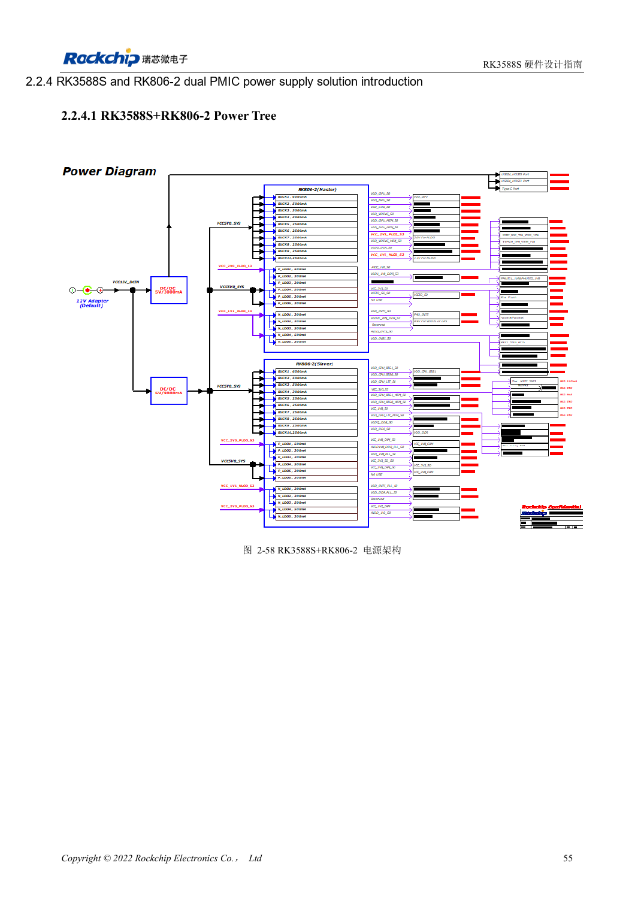
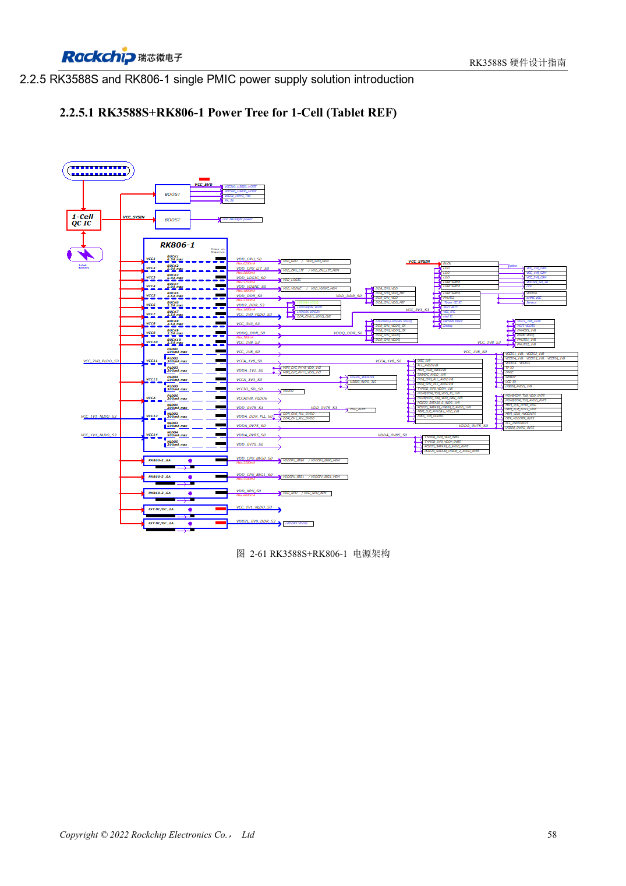

<!-- rk3588s-hardware-v12-20261109 -->

# RK3588S and RK806: single and dual PMIC power trees

Based on the Chinese RK3588S Hardware Design Guide V1.2 (2023-12-14) for circuit and PCB review. CM7S carriers must follow module interface definitions; Sige7S supports software and peripheral evaluation. SoC capabilities are not a board connector list. Verify SDK/BSP, kernel, board revision, firmware and multiplexing. Values are source references, not ArmSoM hardware measurements.

**RK3588S Hardware Design Guide V1.2 (2023-12-14), CN** · §2.2.3–2.2.5

## Select the complete reference

Dual RK806-2 and single RK806-1 plus external supplies are distinct architectures, not a design with one chip removed. Migrate output allocation, defaults, sequencing, control bus, sleep and reset together. The PMIC 2.7–5.5V input is not an ArmSoM board input specification.

## Synchronization and layout

EXT_EN assigns master/slave; SYNC/SYNC_CLK synchronize the dual design, with VDC/PWRON/RESET connected as shown. A single PMIC uses master mode with SYNC/SYNC_CLK open. Prioritize high-current paths and capacitor ground loops while managing heat concentration. Maximum current is not a continuous rating at every temperature.

## Design parameters and review table

| Item | Source reference |
| --- | --- |
| RK806 input | 2.7–5.5V |
| Package | 7×7mm QFN68 |
| Dual reference | RK806-2 |
| Single reference | RK806-1 + external supplies |

## Source figures

No corresponding English design guide was found for this batch. All four editions use Chinese source screenshots with localized captions. Open an image for full resolution; the article text and parameter tables remain copyable. Page references are physical PDF pages.

Chinese original · PDF 70 · 2-58

Chinese original · PDF 73 · 2-61

## ArmSoM development path

CM7S supports custom carriers: first identify supplies, DDR and boot circuits already integrated in the module, then design outside its connectors. Sige7S provides a starting point for software and peripheral evaluation. For both products, verify exposed interfaces, pin assignments, levels, system images and cooling against the relevant revision. A chip reference schematic is not a product wiring diagram.

- [ArmSoM CM7S](https://www.armsom.org/cm7s) · [CM7S Docs](https://docs.armsom.org/armsom-cm7s)
- [ArmSoM Sige7S](https://www.armsom.org/sige7s) · [Sige7S Docs](https://docs.armsom.org/armsom-sige7s)

## Continue reading

- [RK3588S hardware design: 30 topics](/articles/rk3588s-hardware-design-series/)
- [RK3588S power sequencing: RESETn and S0/S3](/articles/rk3588s-power-sequencing-design/)
- [RK3588S DDR circuits: LPDDR4/4X/5 and capacity](/articles/rk3588s-ddr-circuit-design/)
