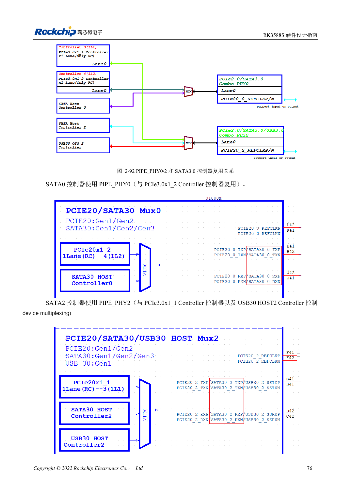
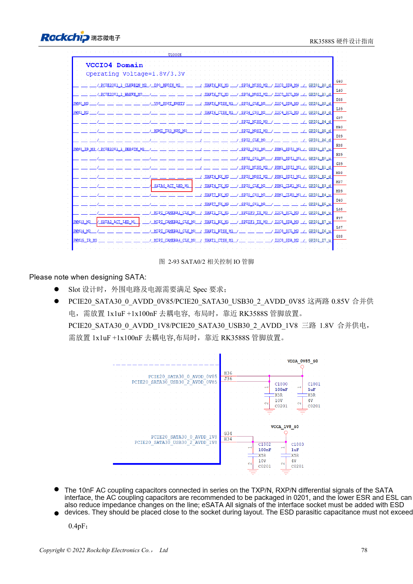

<!-- rk3588s-hardware-v12-20261109 -->

# RK3588S SATA: three controllers and shared PHYs

Based on the Chinese RK3588S Hardware Design Guide V1.2 (2023-12-14) for circuit and PCB review. CM7S carriers must follow module interface definitions; Sige7S supports software and peripheral evaluation. SoC capabilities are not a board connector list. Verify SDK/BSP, kernel, board revision, firmware and multiplexing. Values are source references, not ArmSoM hardware measurements.

**RK3588S Hardware Design Guide V1.2 (2023-12-14), CN** · §2.3.5; §3.4.7

## Draw the mux matrix first

The two RK3588S SATA controllers use PIPE_PHY0 and PIPE_PHY2, shared with PCIe2.0; PHY2 also serves USB3 HOST2. The guide lists 1.5/3/6Gbps and Port Multiplier, not a guarantee that CM7S or Sige7S exposes both ports. Determine available channels from product documentation before choosing connectors and BSP settings.

## Validate signals and drive power separately

The reference uses 10nF in both TX and RX, preferably 0201; do not copy PCIe capacitors. SATA_CP_DET, MP_SWITCH and CP_POD are shared control resources, so hot-plug requires deliberate design. Supply and test drive spin-up current externally; check sustained writes, errors, hot-plug and power-loss recovery.

## Design parameters and review table

| Item | Source reference |
| --- | --- |
| SATA coupling | 10nF ±20%; TX and RX |
| Differential target | 100Ω ±10%; source fallback 90Ω ±10% |
| Length / intra-pair | <6in / <6mil |
| Recommended via count | Recommended ≤2 |

## Source figures

No corresponding English design guide was found for this batch. All four editions use Chinese source screenshots with localized captions. Open an image for full resolution; the article text and parameter tables remain copyable. Page references are physical PDF pages.

Chinese original · PDF 91 · 2-92

Chinese original · PDF 93 · 2-93

## ArmSoM development path

CM7S supports custom carriers: first identify supplies, DDR and boot circuits already integrated in the module, then design outside its connectors. Sige7S provides a starting point for software and peripheral evaluation. For both products, verify exposed interfaces, pin assignments, levels, system images and cooling against the relevant revision. A chip reference schematic is not a product wiring diagram.

- [ArmSoM CM7S](https://www.armsom.org/cm7s) · [CM7S Docs](https://docs.armsom.org/armsom-cm7s)
- [ArmSoM Sige7S](https://www.armsom.org/sige7s) · [Sige7S Docs](https://docs.armsom.org/armsom-sige7s)

## Continue reading

- [RK3588S hardware design: 30 topics](/articles/rk3588s-hardware-design-series/)
- [RK3588S USB and Type-C: controllers, PHYs and recovery](/articles/rk3588s-usb-typec-hardware-design/)
- [RK3588S PCIe: lanes, reference clocks and supplies](/articles/rk3588s-pcie-hardware-design/)
