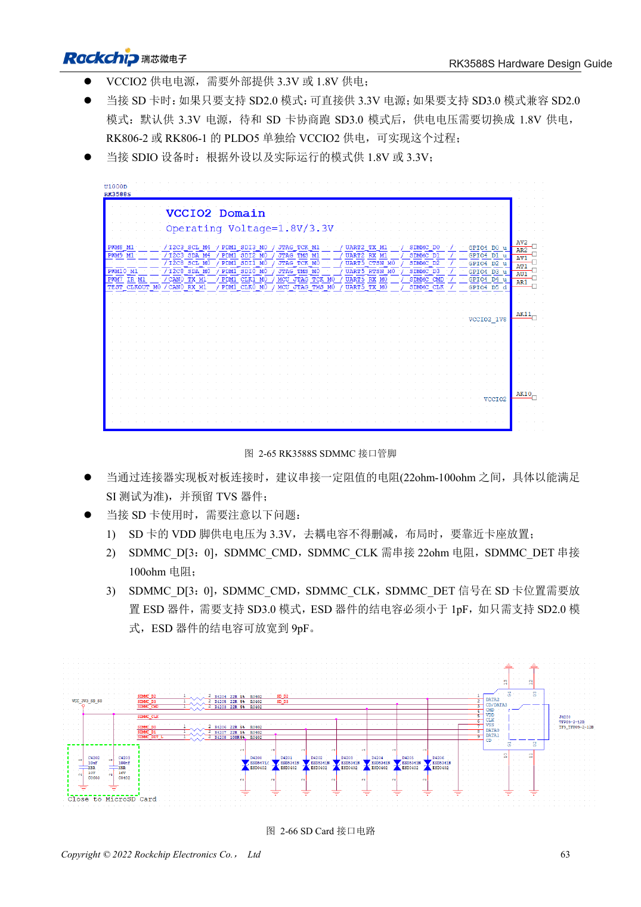

<!-- rk3588s-hardware-v12-20261109 -->

# RK3588S SDMMC and SDIO Wi-Fi: voltage switching and protection

Based on the Chinese RK3588S Hardware Design Guide V1.2 (2023-12-14) for circuit and PCB review. CM7S carriers must follow module interface definitions; Sige7S supports software and peripheral evaluation. SoC capabilities are not a board connector list. Verify SDK/BSP, kernel, board revision, firmware and multiplexing. Values are source references, not ArmSoM hardware measurements.

**RK3588S Hardware Design Guide V1.2 (2023-12-14), CN** · §2.3.1; §3.4.13–3.4.14; §3.4.19

## Separate card power from IO voltage

SD card VDD is 3.3V. Switching VCCIO2 to 1.8V after SD3.0 negotiation does not mean switching card power to 1.8V. SDMMC/JTAG boot selection also depends on SDMMC_DET. The reference uses 22Ω on data/CMD/CLK, 100Ω on DET and decoupling plus ESD near the socket.

## Wi-Fi also needs clock and RF review

Check module IO, UART/PCM direction and 32.768kHz amplitude; reserve antenna π matching. Select crystal loading for the module; the guide gives 10ppm room-temperature tolerance for Wi-Fi. SD3.0 protection capacitance must be <1pF, so ESD additions must not arbitrarily load the bus. Test connection, throughput, sleep/wake and power cycles.

## Design parameters and review table

| Item | Source reference |
| --- | --- |
| SD card VDD | 3.3V |
| SD3.0 ESD capacitance | <1pF |
| SD2.0-only ESD reference | ≤9pF |
| Data/CMD/CLK; DET | 22Ω; 100Ω |
| PCB impedance / length | 50Ω ±10% / <4in |
| Clock-data mismatch | <120mil |

## Source figures

No corresponding English design guide was found for this batch. All four editions use Chinese source screenshots with localized captions. Open an image for full resolution; the article text and parameter tables remain copyable. Page references are physical PDF pages.

Chinese original · PDF 78 · 2-66

## ArmSoM development path

CM7S supports custom carriers: first identify supplies, DDR and boot circuits already integrated in the module, then design outside its connectors. Sige7S provides a starting point for software and peripheral evaluation. For both products, verify exposed interfaces, pin assignments, levels, system images and cooling against the relevant revision. A chip reference schematic is not a product wiring diagram.

- [ArmSoM CM7S](https://www.armsom.org/cm7s) · [CM7S Docs](https://docs.armsom.org/armsom-cm7s)
- [ArmSoM Sige7S](https://www.armsom.org/sige7s) · [Sige7S Docs](https://docs.armsom.org/armsom-sige7s)

## Continue reading

- [RK3588S hardware design: 30 topics](/articles/rk3588s-hardware-design-series/)
- [RK3588S FSPI Flash: boot, supply and matching](/articles/rk3588s-fspi-boot-hardware/)
- [RK3588S USB and Type-C: controllers, PHYs and recovery](/articles/rk3588s-usb-typec-hardware-design/)
