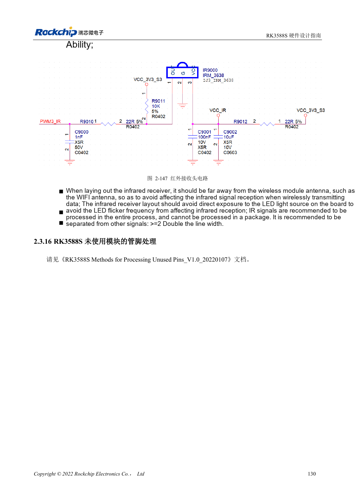

<!-- rk3588s-hardware-v12-20261109 -->

# RK3588S UART, SPI, CAN, I2C and PWM allocation

Based on the Chinese RK3588S Hardware Design Guide V1.2 (2023-12-14) for circuit and PCB review. CM7S carriers must follow module interface definitions; Sige7S supports software and peripheral evaluation. SoC capabilities are not a board connector list. Verify SDK/BSP, kernel, board revision, firmware and multiplexing. Values are source references, not ArmSoM hardware measurements.

**RK3588S Hardware Design Guide V1.2 (2023-12-14), CN** · §2.3.11–2.3.15

## Do not mix mux groups

M0/M1/M2 locations for UART, SPI, CAN and I2C are mux choices, not additional independent controllers. Select a complete supported signal group and verify its supply domain. SPI2 is assigned to the PMIC by default and should not be casually repurposed. CAN requires an external transceiver; SoC TX/RX are not differential bus wires.

## Validate each peripheral protocol

The I2C pull-up reference is 2.2kΩ; actual values depend on bus load and voltage. HDMI DDC is dedicated. V1.2 specifies CAN2.0B at 1Mbps, not a CAN FD claim. Check UART baud/flow control, SPI mode/chip select, I2C edges and CAN transceiver levels, then sleep and reset, retaining measurement records.

## Design parameters and review table

| Item | Source reference |
| --- | --- |
| UART / general SPI | 10 / 5 controllers |
| CAN source scope | 3 controllers; CAN2.0B; 1Mbps |
| I2C reference | Up to 400Kbit/s; 2.2kΩ pull-up |
| PWM source count | 4 controllers ×4 channels |

## Source figures

No corresponding English design guide was found for this batch. All four editions use Chinese source screenshots with localized captions. Open an image for full resolution; the article text and parameter tables remain copyable. Page references are physical PDF pages.

Chinese original · PDF 145 · 2-147

## ArmSoM development path

CM7S supports custom carriers: first identify supplies, DDR and boot circuits already integrated in the module, then design outside its connectors. Sige7S provides a starting point for software and peripheral evaluation. For both products, verify exposed interfaces, pin assignments, levels, system images and cooling against the relevant revision. A chip reference schematic is not a product wiring diagram.

- [ArmSoM CM7S](https://www.armsom.org/cm7s) · [CM7S Docs](https://docs.armsom.org/armsom-cm7s)
- [ArmSoM Sige7S](https://www.armsom.org/sige7s) · [Sige7S Docs](https://docs.armsom.org/armsom-sige7s)

## Continue reading

- [RK3588S hardware design: 30 topics](/articles/rk3588s-hardware-design-series/)
- [RK3588S GPIO and SARADC: domains and button inputs](/articles/rk3588s-gpio-saradc-hardware/)
- [RK3588S stackup and fanout: HDI versus through-hole](/articles/rk3588s-pcb-stackup-fanout/)
