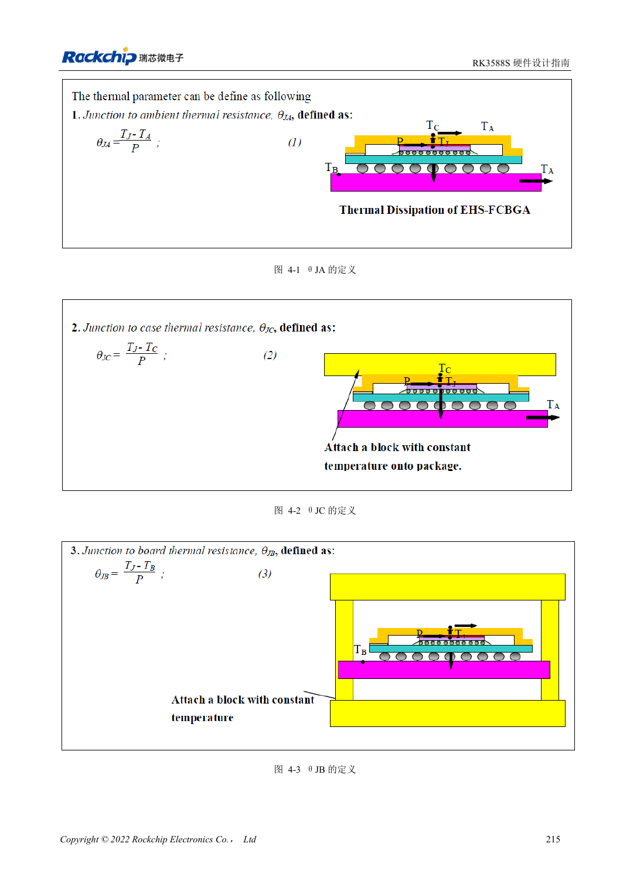

<!-- rk3588s-hardware-v12-20261109 -->

# RK3588S thermal design: reference resistance and system validation

Based on the Chinese RK3588S Hardware Design Guide V1.2 (2023-12-14) for circuit and PCB review. CM7S carriers must follow module interface definitions; Sige7S supports software and peripheral evaluation. SoC capabilities are not a board connector list. Verify SDK/BSP, kernel, board revision, firmware and multiplexing. Values are source references, not ArmSoM hardware measurements.

**RK3588S Hardware Design Guide V1.2 (2023-12-14), CN** · §4

## Simulation is not module temperature rise

Table 4-1 comes from a specified package and JEDEC finite-element PCB model: 200×140mm, 1.6mm, ten layers, no heatsink. Do not apply it directly to CM7S, a CM7S carrier or a Sige7S enclosure. θJA, θJB and θJC use different reference points and are not interchangeable heatsink inputs.

## Validate thermal paths and protection

Check die-to-interface, heatsink, enclosure and ambient paths, mounting pressure and electrical isolation. The 20–50mm RK3588S/RK806 spacing is a board reference, not an instruction to modify module internals. Test sustained workload, frequency, temperature and application latency with the actual BSP thermal policy; disabling protection does not demonstrate performance.

## Design parameters and review table

| Item | Source reference |
| --- | --- |
| Source θJA / θJB / θJC | 8.2 / 3.7 / 0.01 °C/W; simulation |
| Source PCB | 200×140mm; 1.6mm; 10 layers |
| PMIC–SoC reference spacing | RK3588S–RK806: 20–50mm |

## Source figures

No corresponding English design guide was found for this batch. All four editions use Chinese source screenshots with localized captions. Open an image for full resolution; the article text and parameter tables remain copyable. Page references are physical PDF pages.

Chinese original · PDF 230 · 4-1

## ArmSoM development path

CM7S supports custom carriers: first identify supplies, DDR and boot circuits already integrated in the module, then design outside its connectors. Sige7S provides a starting point for software and peripheral evaluation. For both products, verify exposed interfaces, pin assignments, levels, system images and cooling against the relevant revision. A chip reference schematic is not a product wiring diagram.

- [ArmSoM CM7S](https://www.armsom.org/cm7s) · [CM7S Docs](https://docs.armsom.org/armsom-cm7s)
- [ArmSoM Sige7S](https://www.armsom.org/sige7s) · [Sige7S Docs](https://docs.armsom.org/armsom-sige7s)

## Continue reading

- [RK3588S hardware design: 30 topics](/articles/rk3588s-hardware-design-series/)
- [RK3588S power PCB and PDN: copper, returns and decoupling](/articles/rk3588s-power-pcb-pdn-design/)
- [RK3588S ESD and EMI: interface protection and return paths](/articles/rk3588s-esd-emi-hardware-design/)
