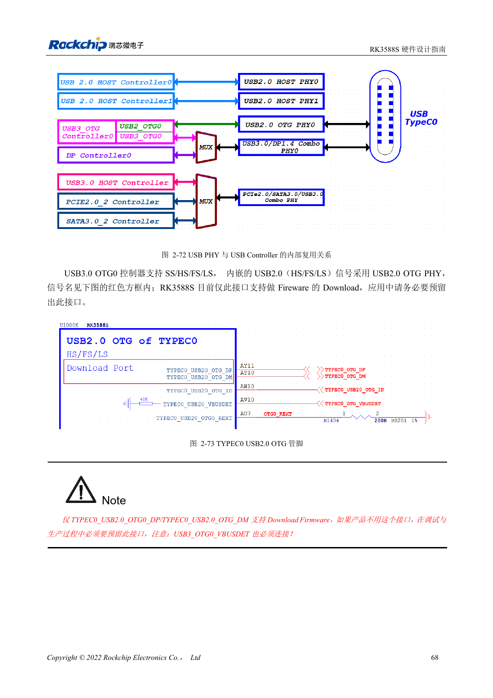
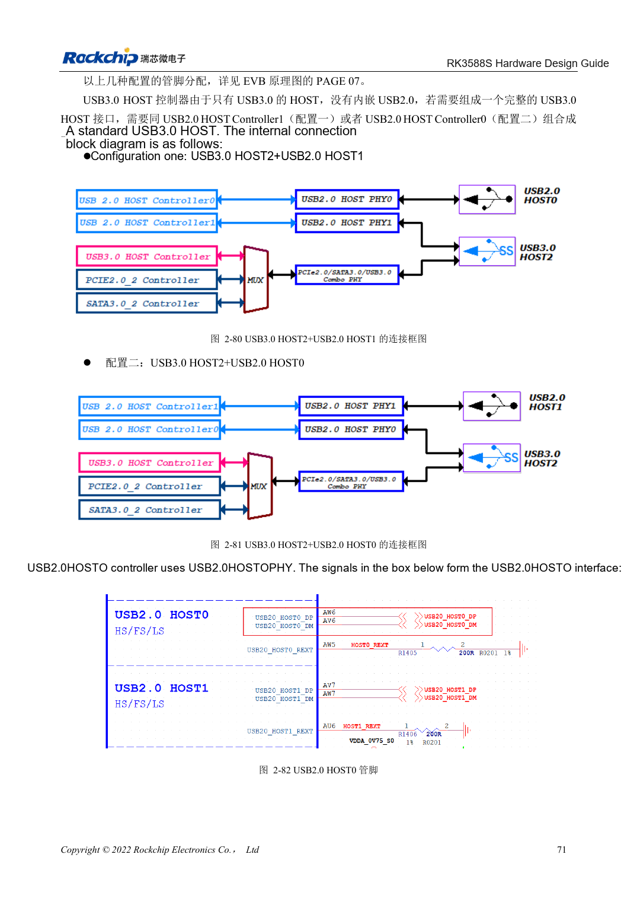

<!-- rk3588s-hardware-v12-20261109 -->

# RK3588S USB and Type-C: controllers, PHYs and recovery

Based on the Chinese RK3588S Hardware Design Guide V1.2 (2023-12-14) for circuit and PCB review. CM7S carriers must follow module interface definitions; Sige7S supports software and peripheral evaluation. SoC capabilities are not a board connector list. Verify SDK/BSP, kernel, board revision, firmware and multiplexing. Values are source references, not ArmSoM hardware measurements.

**RK3588S Hardware Design Guide V1.2 (2023-12-14), CN** · §2.3.4; §3.4.8–3.4.9

## Separate controllers from ports

RK3588S has one USB3 OTG, one USB3 HOST and two USB2 HOST controllers. The standalone USB3 HOST lacks USB2 and must pair with a USB2 HOST for a complete port. Preserve USB2 OTG0 download and VBUSDET. Review USB3/DP allocation, both plug orientations and the external CC controller together.

## Validate power roles and the full channel

USB3 HOST2 shares resources with SATA/PCIe; do not count all three as simultaneously available. Check VBUS source/sink roles, back-power protection, connectors and cables. Validate USB2 recovery, then USB3 enumeration, sustained transfer, hot-plug and both Type-C orientations. Carrier length budgets include module and connectors.

## Two ESD capacitance limits

The circuit text on page 90 specifies ≤0.3pF, while PCB page 221 specifies ≤0.2pF. Keep both source limits visible and use the stricter ≤0.2pF budget for component review, including pad, connector and device parasitics in validation. This is not a claim that any selected part is already qualified.

## Design parameters and review table

| Item | Source reference |
| --- | --- |
| USB2 differential | 90Ω ±10%; intra-pair <20mil |
| USB3 differential | 90Ω ±10%; intra-pair <6mil |
| USB3 length / vias | <6in; recommended ≤2 |
| USB3 ESD capacitance | ≤0.2pF |

## Source figures

No corresponding English design guide was found for this batch. All four editions use Chinese source screenshots with localized captions. Open an image for full resolution; the article text and parameter tables remain copyable. Page references are physical PDF pages.

Chinese original · PDF 83 · 2-72

Chinese original · PDF 86 · 2-80

## ArmSoM development path

CM7S supports custom carriers: first identify supplies, DDR and boot circuits already integrated in the module, then design outside its connectors. Sige7S provides a starting point for software and peripheral evaluation. For both products, verify exposed interfaces, pin assignments, levels, system images and cooling against the relevant revision. A chip reference schematic is not a product wiring diagram.

- [ArmSoM CM7S](https://www.armsom.org/cm7s) · [CM7S Docs](https://docs.armsom.org/armsom-cm7s)
- [ArmSoM Sige7S](https://www.armsom.org/sige7s) · [Sige7S Docs](https://docs.armsom.org/armsom-sige7s)

## Continue reading

- [RK3588S hardware design: 30 topics](/articles/rk3588s-hardware-design-series/)
- [RK3588S SDMMC and SDIO Wi-Fi: voltage switching and protection](/articles/rk3588s-sdmmc-sdio-wifi-design/)
- [RK3588S SATA: three controllers and shared PHYs](/articles/rk3588s-sata-hardware-design/)
