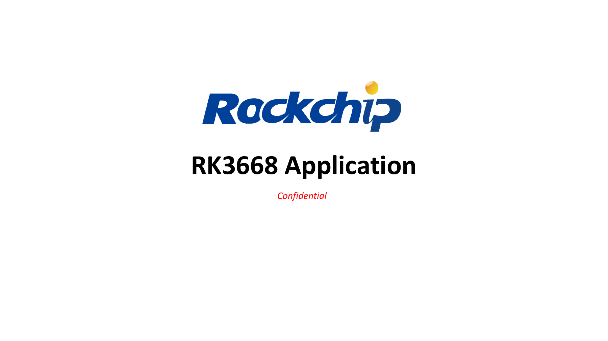
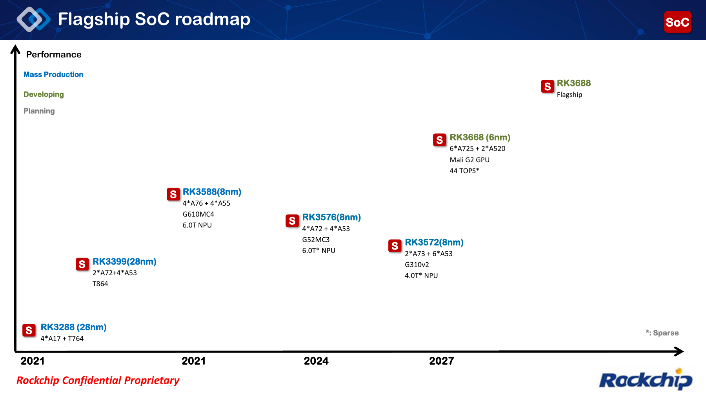
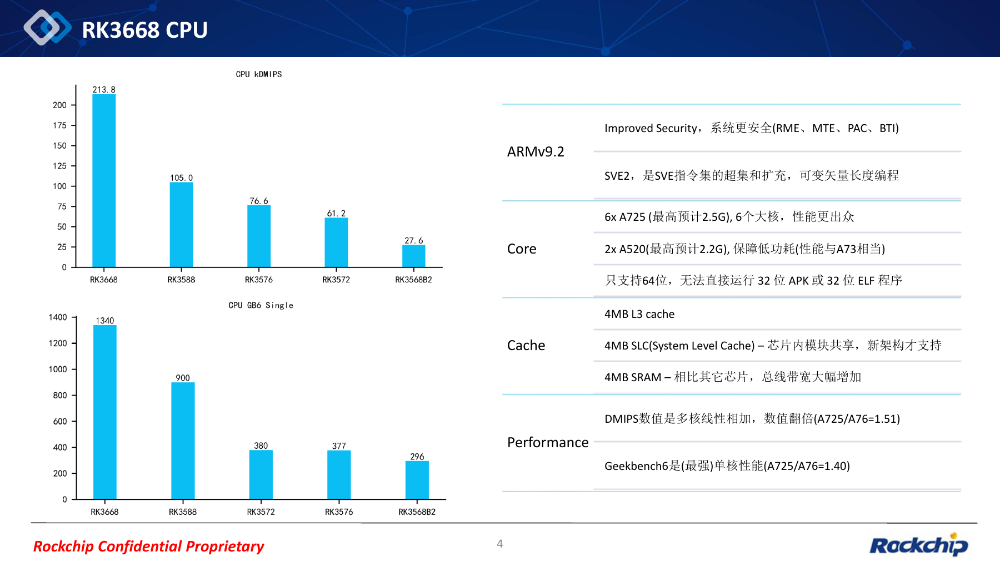
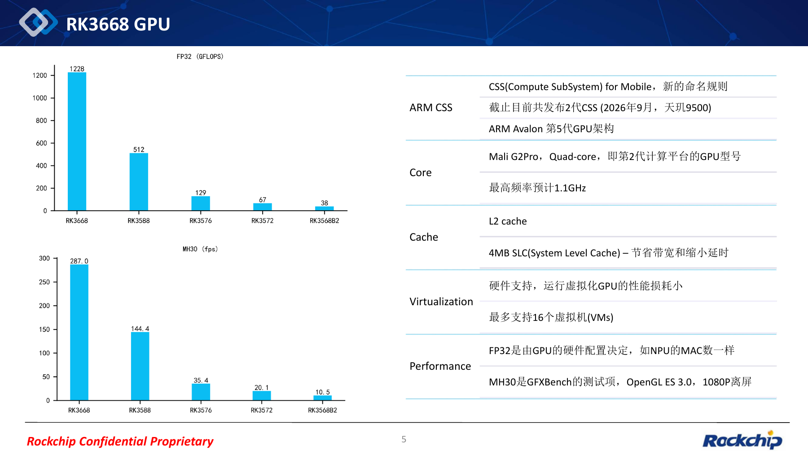
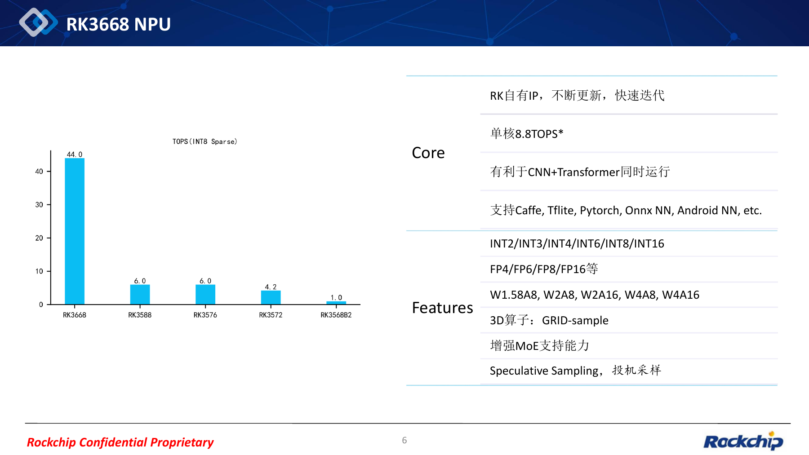
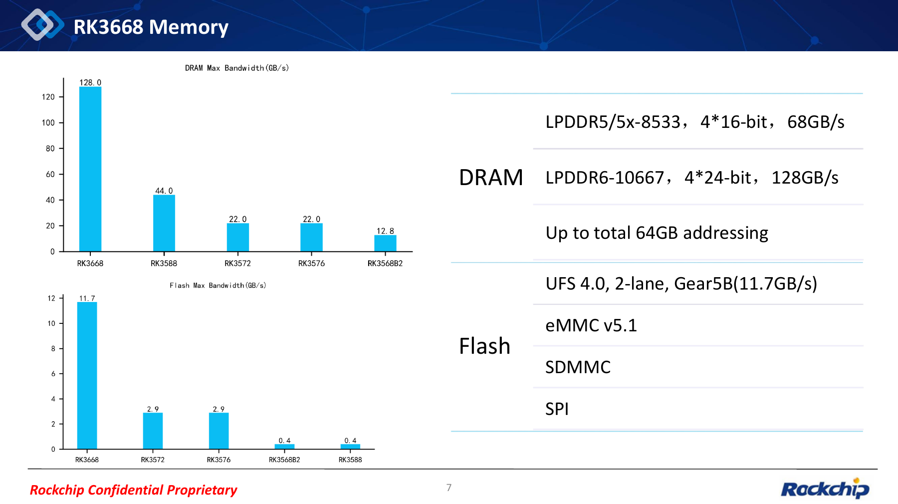
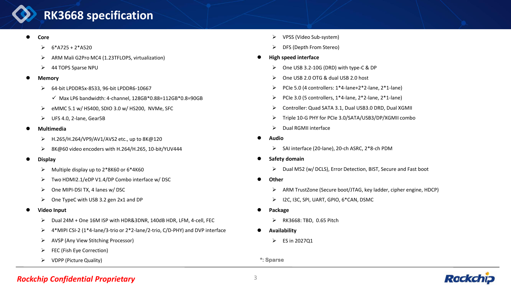
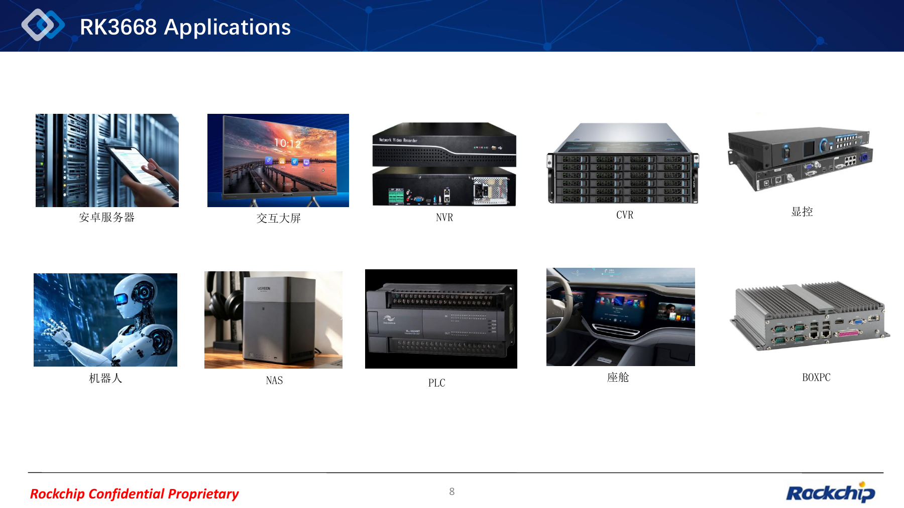
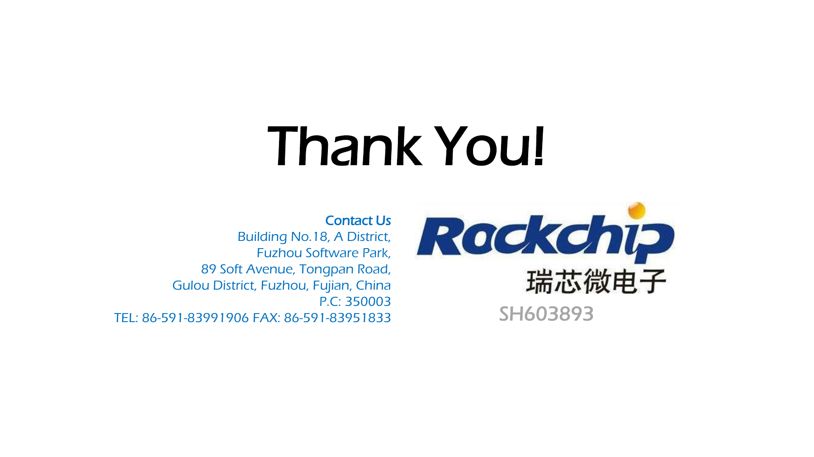

RK3668 combines general-purpose processing, on-device AI, video, display and high-speed expansion in one proposed platform. The RK3668 Application deck shows Rockchip’s direction for a new flagship SoC and provides useful input for future ArmSoM hardware planning.

This article follows the supplied **REL02 PDF, dated 2026-10-09 in its filename, with 9 pages**. Every original page is included as a clear image; click it to enlarge. The unchanged PDF is downloadable below. The source mixes Chinese and English, so all four articles use the same source images with localized explanations and captions. **Charts are source figures, not ArmSoM measurements. Expected clocks, engineering-sample timing and interface plans are not final production specifications.**

*Source PDF page 1: Cover: RK3668 Application.*

## 1. Roadmap: keep RK3668 and RK3688 separate

Page 2 identifies RK3668 as a 6nm platform with 6× Cortex-A725 + 2× Cortex-A520, Mali G2 GPU and a 44 TOPS sparse NPU. RK3688 appears separately as a later flagship plan. **RK3668 specifications must not be relabeled as RK3688 specifications.**

Page 3 gives **Q1 2027** for engineering samples (ES). This is a planning milestone, not a mass-production date or an ArmSoM product launch. Package details remain TBD, with pitch marked 0.65 and no final package dimensions. Historical platform shorthand in the roadmap should be checked against each model’s own documentation when selecting hardware.

*Source PDF page 2: Flagship SoC roadmap.*

## 2. CPU and GPU: software migration matters as much as compute

The Armv9.2 CPU combines six Cortex-A725 cores at an **expected maximum 2.5GHz** and two Cortex-A520 cores at an **expected 2.2GHz**. The deck lists SVE2 and RME, MTE, PAC and BTI security features, plus 4MB L3, 4MB SLC and 4MB SRAM.

**64-bit-only execution** is a key migration constraint: the source says 32-bit APKs and ELF programs cannot run directly. Inventory Android applications, proprietary libraries, peripheral services and algorithm dependencies before migration. A hardware security feature also does not establish that a particular SDK enables it by default.

The GPU is Mali G2 Pro MC4 at an **expected maximum 1.1GHz**. Hardware-assisted virtualization is listed for up to 16 VMs. That limit is not a per-instance performance promise; drivers, scheduling and concurrent workloads need validation. FP32 throughput and GFXBench MH30 are different metrics.

|Metric in source|RK3668|RK3588|
|---|---|---|
|CPU kDMIPS|213.8|105.0|
|Geekbench 6 single-core|1340|900|
|GPU FP32 (GFLOPS)|1228|512|
|GFXBench MH30 (fps)|287.0|144.4|

The CPU chart is labeled **kDMIPS**, not plain DMIPS. The source describes the multicore number as a linear sum and GB6 as single-core. MH30 is OpenGL ES 3.0 at 1080P offscreen. Full test platforms and operating conditions are absent, so these numbers are not product-performance guarantees.

*Source PDF page 4: CPU architecture and performance comparisons.*

*Source PDF page 5: GPU configuration, performance and virtualization.*

## 3. NPU: retain the INT8 Sparse qualification

The page 6 chart explicitly says **TOPS (INT8 Sparse)** and shows 44.0 for RK3668. The text separately lists 8.8 TOPS per core and concurrent CNN/Transformer workloads. Division alone does not establish the internal core organization, and sparse throughput should not be compared directly with unlike measurement conventions.

Integer formats include INT2/INT3/INT4/INT6/INT8/INT16; floating-point formats include FP4/FP6/FP8/FP16. Listed combinations are W1.58A8, W2A8, W2A16, W4A8 and W4A16. Features include 3D GRID-sample, enhanced MoE support and speculative sampling. Software names include Caffe, TFLite, PyTorch, ONNX NN and Android NN.

These are useful directions for vision/language pipelines, robotics perception and edge inference. The deck does not establish support for a particular model, quantized accuracy, context length, tokens/s or sustained power. Test conversion, operator coverage, memory use and end-to-end latency with the relevant SDK and samples.

*Source PDF page 6: NPU formats, features and sparse throughput.*

## 4. Memory and storage: 128 GB/s is a stated specification

Page 7 lists LPDDR5/5X-8533, 4×16-bit and 68 GB/s; LPDDR6-10667, 4×24-bit and 128 GB/s; and up to 64GB addressing. **Addressability is not a promise that every board carries 64GB RAM.**

Page 3 separately lists 64-bit LPDDR5x-8533 and 96-bit LPDDR6-10667, followed by `128GB*0.88=112GB*0.8=90GB`. This differs from page 7’s nominal-bandwidth presentation. The coefficients are not fully explained; none of 90, 112 or 128 is treated here as measured application bandwidth.

Storage includes UFS 4.0, two lanes, Gear5B (11.7 GB/s), eMMC 5.1, SDMMC and SPI. The overview also names NVMe, SFC, eMMC HS400 and “SDIO 3.0 w/ HS200”. The latter wording is retained in the source image; its mode association requires formal interface documentation rather than an editorial correction. UFS headline bandwidth is not sustained filesystem throughput.

*Source PDF page 7: Memory and storage bandwidth.*

## 5. Multimedia, expansion and the safety domain

The dense overview is summarized by design area below. The complete wording remains visible in the page 3 image.

|Block|Capabilities in source|
|---|---|
|Decode|H.265/H.264/VP9/AV1/AVS2 etc.; up to 8K@120|
|Encode|H.264/H.265; up to 8K@60; 10-bit/YUV444|
|Display|Up to 2×8K60 or 6×4K60; two HDMI2.1/eDP1.4/DP combos with DSC; one 4-lane MIPI-DSI TX with DSC; Type-C + DP|
|Video input|Dual 24MP + one 16MP ISP; HDR, 3DNR, 140dB HDR, LFM, 4-cell, FEC; 4×MIPI CSI-2, C/D-PHY and DVP|
|Image blocks|AVSP stitching, FEC fisheye correction, VDPP picture quality, VPSS video subsystem, DFS stereo depth|
|Expansion|PCIe 5.0/3.0; 4×SATA3.1, dual USB3.0 DRD, dual XGMII, 3×10G combo PHY, dual RGMII|
|USB|1×USB3.2-10G DRD with Type-C/DP; 1×USB2.0 OTG; 2×USB2.0 host|
|Audio|SAI (20-lane in source), 20-ch ASRC, 2×8-ch PDM|
|Safety domain|Dual M52 with DCLS, error detection, BIST, secure and fast boot|
|Security and other I/O|Arm TrustZone, secure boot/JTAG, key ladder, cipher engine, HDCP; I2C/I3C/SPI/UART/GPIO, 6×CAN, DSMC|

PCIe 5.0 says “4 controllers” but also lists `1*4-lane+2*2-lane, 2*1-lane`, leaving the total and breakdown ambiguous. PCIe 3.0 says five controllers with 1×4, 2×2 and 2×1. **Do not add all lanes, controllers and combo PHYs to claim simultaneously available board interfaces.** Pin multiplexing, lane combinations and concurrency tables are still needed.

Likewise, 8K decoding, encoding and multiple displays are separately stated limits, not proof that all formats, outputs and AI tasks can operate at their maximum simultaneously. Safety-domain features do not establish a functional-safety certification level.

*Source PDF page 3: RK3668 specification overview.*

## 6. Turning ten application directions into engineering projects

Page 8 lists Android servers, interactive displays, NVR, CVR, display control, robots, NAS, PLC, cockpits and BOX PCs. The following is engineering analysis, not a list of delivered products:

| Scenario | Capabilities to evaluate | Checks before productization |
| --- | --- | --- |
| Android servers, BOX PCs | Multicore CPU, GPU virtualization, multiple instances | 64-bit dependencies, resources per instance, images and sustained load |
| Robotics | ISP, stereo depth, NPU, CAN | Sensor synchronization, model accuracy and control-path latency |
| NVR, CVR | Video input, codecs and AI | Real concurrent channels, bitrates, storage bandwidth and thermals |
| Interactive displays, display control | Multiple outputs and image/video processing | Resolution combinations, multiplexing, display latency and drivers |
| NAS | PCIe, SATA, networking and memory | Available PHYs, storage combinations, network throughput and power |
| PLC, smart cockpit | Safety domain, CAN and general peripherals | Real-time behavior, fault handling, software and certification requirements |

Start with the application bottleneck. A NAS needs more than a PCIe generation number: networking and SATA may share resources. A robot needs more than TOPS: capture-to-control latency matters.

*Source PDF page 8: Ten application directions.*

## 7. ArmSoM product planning

ArmSoM plans to follow RK3668 closely and advance related products as soon as samples, SDK support and hardware validation make productization feasible. This deck does not establish ArmSoM model names, form factors, memory configurations, exposed interfaces, pricing or launch dates.

Useful preparation today includes a 64-bit dependency inventory, model/operator lists, camera/display/storage requirements and power/thermal targets. Follow the [ArmSoM website](https://www.armsom.org/) and [documentation](https://docs.armsom.org/) for product information. The earlier [RK3668 outlook](/zh/articles/rockchip-rk3668-outlook/) provides Chinese-language background; this article adds original pages and the downloadable source for direct inspection.

## 8. Download the original PDF

<a href="/downloads/rk3668/RK3668-SoC-Application-REL02-20261009.pdf" download>Download the original RK3668 Application REL02 PDF (9 pages, approximately 1.41 MB)</a>

The file is unchanged, retaining its layout, charts and original markings. Screenshots also preserve the original mixed-language content; they are not claimed as translated source images. This article provides interpretation and application analysis. Actual designs still require a formal datasheet, hardware guide and SDK support.

*Source PDF page 9: Original closing slide.*
