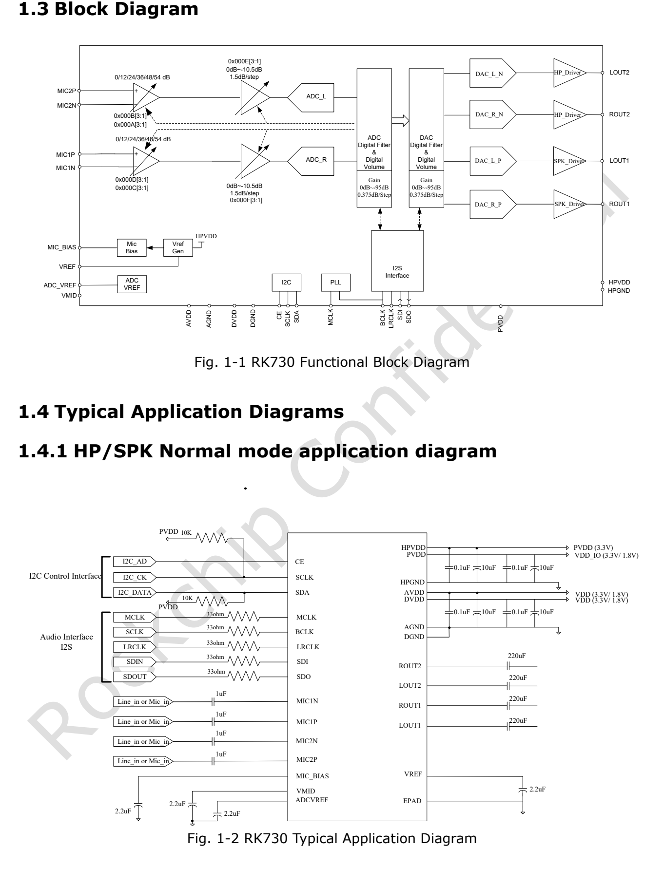

This task-focused guide explains the source with key specifications, limitations and original figures. It is not a page-by-page translation or a complete pin/register manual. Vendor examples are not ArmSoM measurements. Check the actual board revision, schematic, SDK/BSP, kernel and drivers before applying them; no new hardware validation was performed for this article.

**Primary source：** `Rockchip RK730 Datasheet V1.0-20241118.pdf` · PDF 46 pages.

## Establish the codec-to-board relationship first

RK730 integrates two ADC channels, two DAC channels, microphone amplification and headphone drivers. It is a reference option for RK3506-family audio designs, but this article does not establish that every CM1 or Forge1 revision contains RK730. Identify the fitted codec, exposed SAI/I2S interface, control bus, voltage and BSP driver before planning an extension.

*RK730 block diagram and normal-output application — Original English figure. `Rockchip RK730 Datasheet V1.0-20241118.pdf`, PDF p. 9.*

## Read the specifications as a signal chain

| Block | V1.0 source parameter | Engineering interpretation |
| --- | --- | --- |
| ADC | 24-bit; 8–192kHz; SNR 100dB; typical THD+N −95dB | Microphone, supplies and layout affect system noise |
| Microphone gain | Up to +54dB; differential/pseudo-differential input | Match input amplitude before allocating analogue and digital gain |
| DAC | 24-bit; 8–192kHz; SNR 98dB; THD+N −85dB | These are not specifications for an external amplifier and loudspeaker system |
| Headphone output | 50mW into 32Ω; 100mW into 16Ω | Keep the load condition with the power figure |
| Differential output | Up to 4.8Vpp with a 3.3V supply | Differential loading is not a single-ended ground-referenced connection |
| Control / data | I2C up to 400kHz; I2S/PCM audio | Control communication does not prove correct audio clocks or data |

The feature list on p. 8 gives ADC dynamic range as 100dB, while the analogue table on p. 14 gives 101dB with different detail. This guide follows the feature list without merging them into a measured result. Earlier RK3506 presentation figures also do not override this later datasheet.

## Four supplies and their return paths

`PVDD` powers digital I/O, `DVDD` the digital core, `AVDD` the analogue circuitry and `HPVDD` the headphone output. Recommended conditions list 1.62–3.6V with typical 1.8/3.3V for the first three, and 3.0–3.6V with typical 3.3V for HPVDD. Similar names do not make the domains interchangeable.

The reference circuit includes VREF, VMID, ADCVREF and MIC_BIAS connections. Review decoupling, return paths, analogue routing and output loads together with the actual BOM and driver initialization requirements. An application diagram is not a substitute for a complete design review.

## Configure clocking and sample rate together

The PLL normally uses `MCLK`, with `BCLK` also available as a source. Page 16 lists 48k, 44.1k and 32k sample-rate families. Host SAI/I2S master/slave mode, BCLK, LRCLK, valid bits and slots must agree with the codec. When audio is silent, examine clocks and routes before mixer volume.

The table prints `2.822MHz` for a BCLK reference and identifies BCLK as the source for `24MHz`. These source values are retained rather than silently replaced with familiar audio-clock values. Confirm those combinations against updated chip/BSP information before use.

## After I2C becomes reachable

The source selects `0x16`/`0x17` by tying CE low/high. Check the driver's address convention; do not shift or rewrite the value by assumption. Then verify power and clocks, ADC/DAC routes, mute state, input gain and output mode. No unverified board-level register-write script is supplied here.

Mono ADC replication and side-tone mixing are available. For an intercom, identify monitoring, echo-reference and speaker-loopback paths explicitly. A mixer feature is not a complete acoustic echo-cancellation algorithm.

*RK730 differential-output reference circuit — Original English figure. `Rockchip RK730 Datasheet V1.0-20241118.pdf`, PDF p. 10.*

## Source ambiguities in differential mode

The p. 17 text connects the right load between `ROUT2` and `Rout2`, while the diagram includes ROUT1/ROUT2. Page 13 marks the I2C clock pin as output `O`, with SCL/SCLK naming differences. These inconsistencies remain recorded. Confirm the formal revision and reference schematic before wiring; do not follow contradictory text literally.

## Validation for CM1 and Forge1 projects

First establish whether the hardware actually uses RK730 and obtain matching audio drivers and device-tree configuration. Test playback, capture, full duplex, sample-rate changes and suspend/resume in sequence. Under simultaneous networking, display and storage load, record noise, distortion, pops and dropped samples. Product links help select the host platform; they do not establish codec compatibility.

## Products and development resources

- **CM1** — [Product](https://www.armsom.org/cm1) · [Documentation](https://docs.armsom.org/armsom-cm1)
- **Forge1** — [Product](https://www.armsom.org/forge1) · [Documentation](https://docs.armsom.org/armsom-forge1)

<!-- datasheet-series-20261110 -->

## Datasheet series and original PDF

- [RK730 overview](/articles/rk730-audio-codec-design/)
- [RK730 package, pinout and supplies: a QFN28 audio Codec](/articles/rk730-package-power-pinout/)
- [RK730 clocks and audio paths: PLL, I2S, sidetone and I2C](/articles/rk730-clocks-audio-i2c/)
- [RK730 register reference: 65 addresses, resets and control groups](/articles/rk730-register-map-reference/)
- [RK730 startup and shutdown: power, ADC recording and DAC playback](/articles/rk730-power-adc-dac-sequences/)
- [Download the complete original PDF](/assets/datasheet-series-20261110/Rockchip-RK730-Datasheet-V1.0-20241118.pdf)

<!-- datasheet-related-20261110 -->
## Other chip datasheets

These links support cross-platform reading; electrical conditions and pins are not interchangeable.

- [RK3506B](/articles/rk3506b-datasheet-v10/)
- [RK3576](/articles/rk3576-datasheet-v10/)
- [RK3588](/articles/rk3588-datasheet-v14/)
- [RK3528](/articles/rk3528-datasheet-v10/)
- [RK3568](/articles/rk3568-datasheet-v12/)
