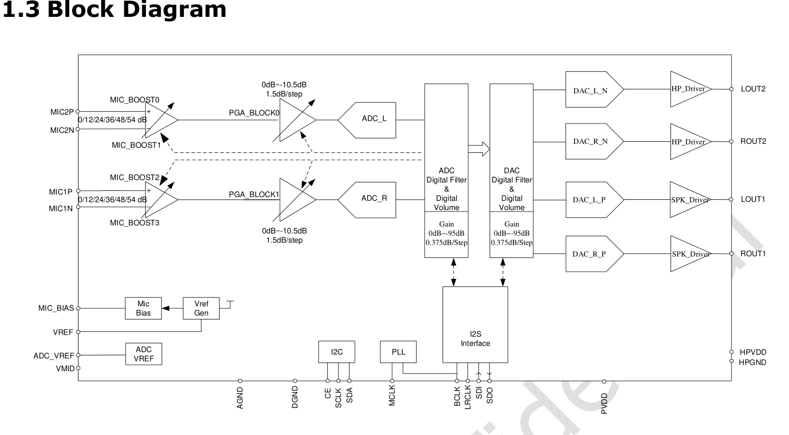
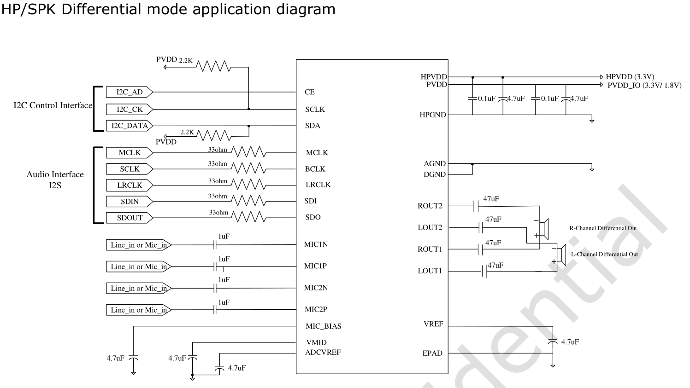

Updated against RK730 Datasheet V1.2. Parameters are vendor specifications, not ArmSoM hardware measurements. Match silicon revision, board connections, SDK/BSP and driver. All figures come from the supplied English original.

*RK730 audio codec design: microphones, I2S clocks and differential outputs*

## Establish the codec-to-board relationship first

RK730 integrates two ADC channels, two DAC channels, microphone amplification and headphone drivers. It is a reference option for RK3506-family audio designs, but this article does not establish that every CM1 or Forge1 revision contains RK730. Identify the fitted codec, exposed SAI/I2S interface, control bus, voltage and BSP driver before planning an extension.

## Read the specifications as a signal chain

| Block | V1.0 source parameter | Engineering interpretation |
| --- | --- | --- |
| ADC | 24-bit; 8–192kHz; SNR 100dB; typical THD+N −95dB | Microphone, supplies and layout affect system noise |
| Microphone gain | Up to +54dB; differential/pseudo-differential input | Match input amplitude before allocating analogue and digital gain |
| DAC | 24-bit; 8–192kHz; SNR 98dB; THD+N −85dB | These are not specifications for an external amplifier and loudspeaker system |
| Headphone output | 50mW into 32Ω; 100mW into 16Ω | Keep the load condition with the power figure |
| Differential output | Up to 4.8Vpp with a 3.3V supply | Differential loading is not a single-ended ground-referenced connection |
| Control / data | I2C up to 400kHz; I2S/PCM audio | Control communication does not prove correct audio clocks or data |

The feature list on p. 8 gives ADC dynamic range as 100dB, while the analogue table on p. 14 gives 101dB with different detail. This guide follows the feature list without merging them into a measured result. Earlier RK3506 presentation figures also do not override this later datasheet.

## External supplies and NC pins in V1.2

In V1.2, `PVDD` supplies digital I/O and generates the digital core supply internally. `HPVDD` powers the headphone output and generates the analog core supply. Recommended PVDD is 1.62–3.6 V, typically 1.8/3.3 V; HPVDD is 3.0–3.6 V, typically 3.3 V. **Pins 2 and 17 are now NC and must float, as must pin 9.** Do not retain the V1.0 DVDD/AVDD wiring. Decouple VREF, VMID and ADCVREF as shown in the reference circuit; they are not general-purpose supply outputs.

## Updated PLL selection and remaining ambiguity

V1.2 Table 4-2 explicitly assigns the 24 MHz input for `1001–1011` to **MCLK**; this page has been corrected accordingly. `0110/0111/1000` use BCLK at 3.072/2.822/2.048 MHz. The descriptions of 0x6–0x8 in `CODEC_SYSPLL_3[7:4]` also changed. The new document still prints 2.822 MHz for `0111`; retain that value and verify the driver and clocks rather than assuming 2.8224 MHz. `1111` has no valid selection. The 48 kHz family lists 12/24/48/96/192 kHz; the 44.1 kHz family lists 11.025/22.05/44.1/88.2/176.4 kHz; the 32 kHz family lists 8/16/32/64/128 kHz.

## After I2C becomes reachable

The source selects `0x16`/`0x17` by tying CE low/high. Check the driver's address convention; do not shift or rewrite the value by assumption. Then verify power and clocks, ADC/DAC routes, mute state, input gain and output mode. No unverified board-level register-write script is supplied here.

Mono ADC replication and side-tone mixing are available. For an intercom, identify monitoring, echo-reference and speaker-loopback paths explicitly. A mixer feature is not a complete acoustic echo-cancellation algorithm.

## Reference circuit and revision checks

This update uses RK730 Datasheet V1.2 (2025-08-08, 47 pages). Several reference-circuit values changed: pull-ups from 10 kΩ to 2.2 kΩ, selected 10 µF decoupling capacitors to 4.7 µF, output coupling from 220 µF to 47 µF, and selected 2.2 µF reference capacitors to 4.7 µF. Apply the new drawing node by node, not a blanket replacement on other boards. The old differential-output paragraph with a repeated ROUT2 name is absent from the new revision. Pin 28 SCL still has direction O in the new table and needs checking against the actual control interface.

## Validation for CM1 and Forge1 projects

First establish whether the hardware actually uses RK730 and obtain matching audio drivers and device-tree configuration. Test playback, capture, full duplex, sample-rate changes and suspend/resume in sequence. Under simultaneous networking, display and storage load, record noise, distortion, pops and dropped samples. Product links help select the host platform; they do not establish codec compatibility.

## Products and development resources

- **CM1** — [Product](https://www.armsom.org/cm1) · [Documentation](https://docs.armsom.org/armsom-cm1)
- **Forge1** — [Product](https://www.armsom.org/armsom-forge1) · [Documentation](https://docs.armsom.org/armsom-forge1)

<!-- datasheet-series-20261110 -->

## Related RK730 articles

- [RK730 overview](/articles/rk730-audio-codec-design/)
- [RK730 package, pinout and supplies: a QFN28 audio Codec](/articles/rk730-package-power-pinout/)
- [RK730 clocks and audio paths: PLL, I2S, sidetone and I2C](/articles/rk730-clocks-audio-i2c/)
- [RK730 register reference: 65 addresses, resets and control groups](/articles/rk730-register-map-reference/)
- [RK730 startup and shutdown: power, ADC recording and DAC playback](/articles/rk730-power-adc-dac-sequences/)

<!-- datasheet-related-20261110 -->
## Other chip datasheets

These links support cross-platform reading; electrical conditions and pins are not interchangeable.

- [RK3506B](/articles/rk3506b-datasheet-v10/)
- [RK3576](/articles/rk3576-datasheet-v10/)
- [RK3588](/articles/rk3588-datasheet-v14/)
- [RK3528](/articles/rk3528-datasheet-v10/)
- [RK3568](/articles/rk3568-datasheet-v12/)
