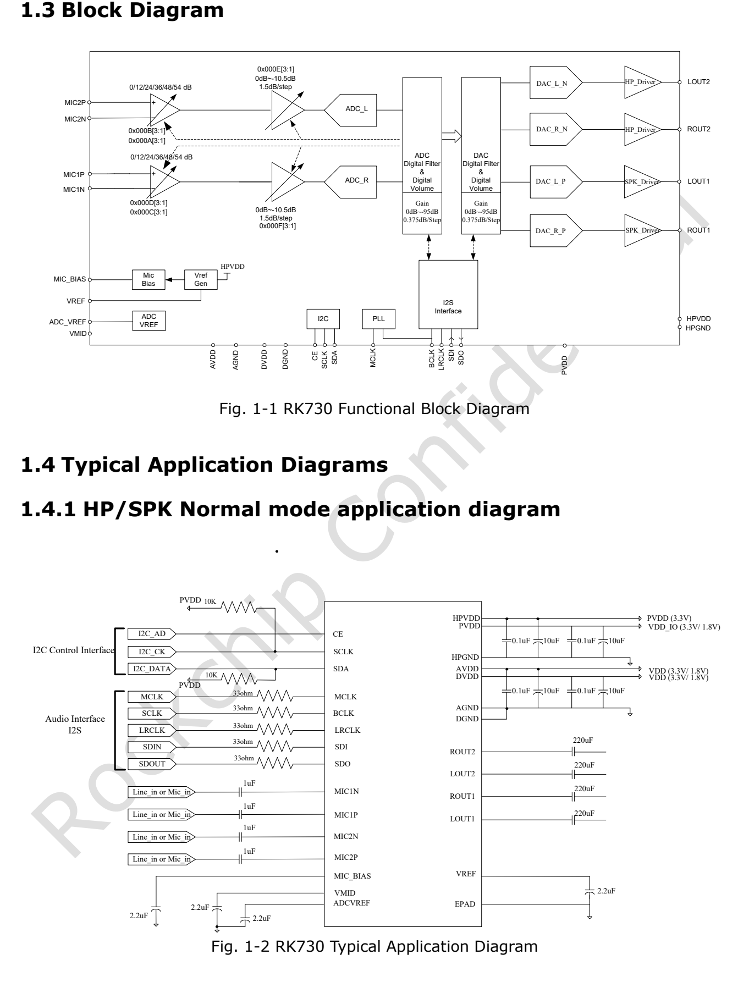
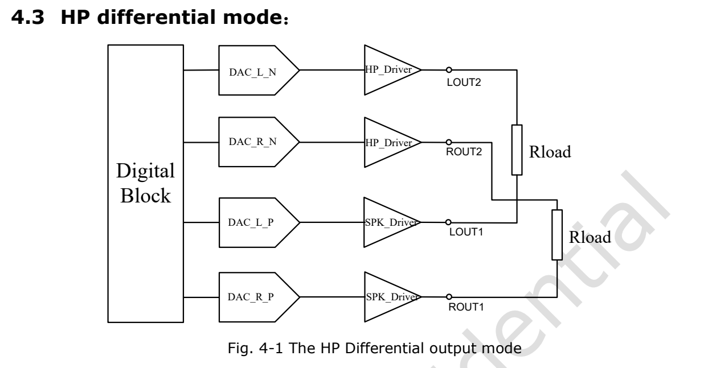
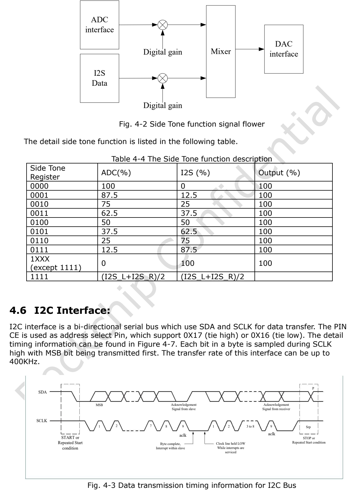

This article uses the specified datasheet revision. Values are vendor specifications, not ArmSoM measurements; no new hardware validation was performed. Check the actual silicon revision, board schematic, SDK/BSP, kernel and drivers. The explanations and editable tables assist reading; consult the original PDF for the complete specification and bit definitions not expanded here.

**RK730 · Rockchip RK730 Datasheet V1.0-20241118.pdf · PDF 16–19.**

*Original English figure, source PDF p. 9.*

## Establish clock ownership first

Draw the MCLK, BCLK, LRCLK, SDI and SDO directions before programming the Codec. Clock ownership, sample-rate family, data width and slot width must agree. An I2C response does not prove correct audio clocks. For silence, check power and clocks before digital mute, channel enables and analog routing.

## PLL selection table

| 4-bit selection | Reference MHz | Sample-rate family | Source |
|---|---|---|---|
| 0000 | 12.288 | 48 kHz | MCLK |
| 0001 | 12.288 | 44.1 kHz | MCLK |
| 0010 | 12.288 | 32 kHz | MCLK |
| 0011 | 12 | 48 kHz | MCLK |
| 0100 | 12 | 44.1 kHz | MCLK |
| 0101 | 12 | 32 kHz | MCLK |
| 0110 | 3.072 | 48 kHz | BCLK |
| 0111 | 2.822 | 44.1 kHz | BCLK |
| 1000 | 2.048 | 32 kHz | BCLK |
| 1001 | 24 | 48 kHz | BCLK |
| 1010 | 24 | 44.1 kHz | BCLK |
| 1011 | 24 | 32 kHz | BCLK |
| 1100 | 6.144 | 48 kHz | MCLK |
| 1101 | 11.2896 | 44.1 kHz | MCLK |
| 1110 | 8.192 | 32 kHz | MCLK |
| 1111 | — | — | — |

## Two PLL entries to preserve

Entry 0111 says 2.822 MHz, not silently corrected to 2.8224 MHz. Entries 1001–1011 explicitly name BCLK at 24 MHz, not MCLK. Entry 1111 has no valid selection in the source. A rate family is not proof of arbitrary Fs in every mode; reconcile the table with the driver and measured clocks.

## ADC replication and sidetone mixing

| Item | Specification / source note |
|---|---|
| ADC 00 | L → L; R → R |
| ADC 01 | L → L/R |
| ADC 10 | R → L/R |
| ADC 11 | L ↔ R |
| Sidetone 0000 | ADC 100% / I2S 0% |
| Sidetone 0001 | ADC 87.5% / I2S 12.5% |
| Sidetone 0010 | ADC 75% / I2S 25% |
| Sidetone 0011 | ADC 62.5% / I2S 37.5% |
| Sidetone 0100 | ADC 50% / I2S 50% |
| Sidetone 0101 | ADC 37.5% / I2S 62.5% |
| Sidetone 0110 | ADC 25% / I2S 75% |
| Sidetone 0111 | ADC 12.5% / I2S 87.5% |
| Sidetone 1XXX (≠1111) | ADC 0% / I2S 100% |
| Sidetone 1111 | (I2S_L + I2S_R) / 2 |

## Differential output and source drawing

ADC replication applies only to the ADC path. The differential drawing pairs ROUT1/ROUT2 and LOUT1/LOUT2, while its prose repeats “ROUT2 and Rout2”; do not wire from that repeated name. Check the 1111 mixing row against the original columns and driver rather than inferring extra analog paths.

*Original English figure, source PDF p. 17.*

## I2C address selection

Addresses use 7-bit notation with the R/W bit separate. CE selects the bus slave address; register offsets are a different address layer. Do not treat 0x16/0x17 as register indices. I2C is limited to 400 kbit/s. Verify host I/O levels and pull-up domain, and coordinate with the kernel driver before manual access.

| Item | Specification / source note |
|---|---|
| CE = 0 | 0x16 |
| CE = 1 | 0x17 |

## Additional source figures

*Original English figure, source PDF p. 18.*

## ArmSoM products and application limits

CM1 and Forge1 are platform references for audio peripheral designs. This article does not claim an onboard RK730 or verified drop-in driver support. First check whether the required I2S, I2C, clocks and voltage levels are exposed.

- [CM1](https://www.armsom.org/cm1) · [Docs](https://docs.armsom.org/armsom-cm1)
- [Forge1](https://www.armsom.org/forge1) · [Docs](https://docs.armsom.org/armsom-forge1)

## Datasheet series and original PDF

- [RK730 overview](/articles/rk730-audio-codec-design/)
- [RK730 package, pinout and supplies: a QFN28 audio Codec](/articles/rk730-package-power-pinout/)
- [RK730 clocks and audio paths: PLL, I2S, sidetone and I2C](/articles/rk730-clocks-audio-i2c/)
- [RK730 register reference: 65 addresses, resets and control groups](/articles/rk730-register-map-reference/)
- [RK730 startup and shutdown: power, ADC recording and DAC playback](/articles/rk730-power-adc-dac-sequences/)
- [Download the complete original PDF](/assets/datasheet-series-20261110/Rockchip-RK730-Datasheet-V1.0-20241118.pdf)
