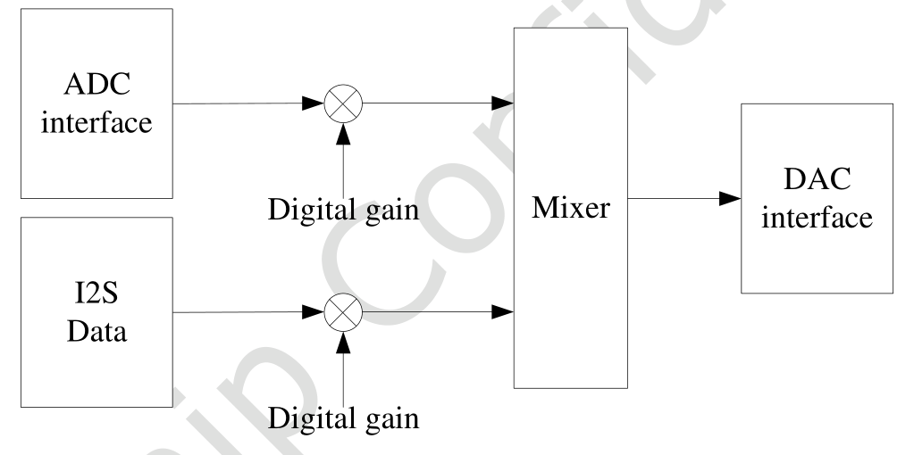
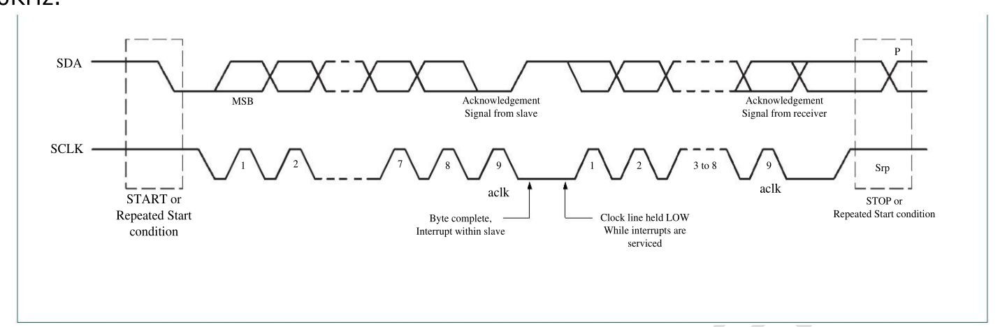
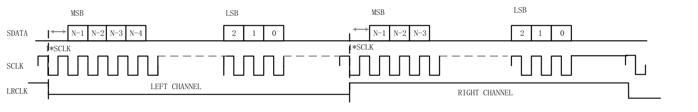
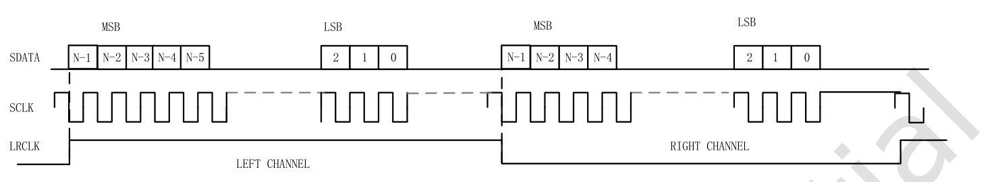
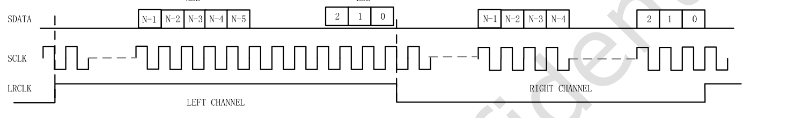
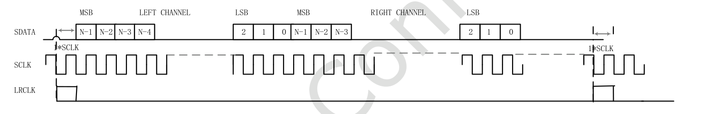
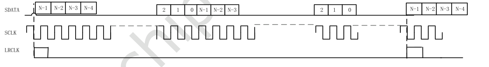

Updated against RK730 Datasheet V1.2. Parameters are vendor specifications, not ArmSoM hardware measurements. Match silicon revision, board connections, SDK/BSP and driver. All figures come from the supplied English original.

*RK730 clocks and audio paths: PLL, I2S, sidetone and I2C*

## Establish clock ownership first

Draw the MCLK, BCLK, LRCLK, SDI and SDO directions before programming the Codec. Clock ownership, sample-rate family, data width and slot width must agree. An I2C response does not prove correct audio clocks. For silence, check power and clocks before digital mute, channel enables and analog routing.

## PLL selection table

| 4-bit selection | Reference MHz | Sample-rate family | Source |
|---|---|---|---|
| 0000 | 12.288 | 48 kHz | MCLK |
| 0001 | 12.288 | 44.1 kHz | MCLK |
| 0010 | 12.288 | 32 kHz | MCLK |
| 0011 | 12 | 48 kHz | MCLK |
| 0100 | 12 | 44.1 kHz | MCLK |
| 0101 | 12 | 32 kHz | MCLK |
| 0110 | 3.072 | 48 kHz | BCLK |
| 0111 | 2.822 | 44.1 kHz | BCLK |
| 1000 | 2.048 | 32 kHz | BCLK |
| 1001 | 24 | 48 kHz | MCLK |
| 1010 | 24 | 44.1 kHz | MCLK |
| 1011 | 24 | 32 kHz | MCLK |
| 1100 | 6.144 | 48 kHz | MCLK |
| 1101 | 11.2896 | 44.1 kHz | MCLK |
| 1110 | 8.192 | 32 kHz | MCLK |
| 1111 | — | — | — |

## Updated PLL selection and remaining ambiguity

V1.2 Table 4-2 explicitly assigns the 24 MHz input for `1001–1011` to **MCLK**; this page has been corrected accordingly. `0110/0111/1000` use BCLK at 3.072/2.822/2.048 MHz. The descriptions of 0x6–0x8 in `CODEC_SYSPLL_3[7:4]` also changed. The new document still prints 2.822 MHz for `0111`; retain that value and verify the driver and clocks rather than assuming 2.8224 MHz. `1111` has no valid selection. The 48 kHz family lists 12/24/48/96/192 kHz; the 44.1 kHz family lists 11.025/22.05/44.1/88.2/176.4 kHz; the 32 kHz family lists 8/16/32/64/128 kHz.

## ADC replication and sidetone mixing

| Item | Specification / source note |
|---|---|
| ADC 00 | L → L; R → R |
| ADC 01 | L → L/R |
| ADC 10 | R → L/R |
| ADC 11 | L ↔ R |
| Sidetone 0000 | ADC 100% / I2S 0% |
| Sidetone 0001 | ADC 87.5% / I2S 12.5% |
| Sidetone 0010 | ADC 75% / I2S 25% |
| Sidetone 0011 | ADC 62.5% / I2S 37.5% |
| Sidetone 0100 | ADC 50% / I2S 50% |
| Sidetone 0101 | ADC 37.5% / I2S 62.5% |
| Sidetone 0110 | ADC 25% / I2S 75% |
| Sidetone 0111 | ADC 12.5% / I2S 87.5% |
| Sidetone 1XXX (≠1111) | ADC 0% / I2S 100% |
| Sidetone 1111 | (I2S_L + I2S_R) / 2 |

## Sidetone signal path

*Digital mixing of ADC and I2S*

## I2C address selection

Addresses use 7-bit notation with the R/W bit separate. CE selects the bus slave address; register offsets are a different address layer. Do not treat 0x16/0x17 as register indices. I2C is limited to 400 kbit/s. Verify host I/O levels and pull-up domain, and coordinate with the kernel driver before manual access.

| Item | Specification / source note |
|---|---|
| CE = 0 | 0x16 |
| CE = 1 | 0x17 |

*I2C data-transfer timing*

## SPI and five digital-audio timing diagrams

V1.2 adds an SPI slave-controller description: low SPI_CSn selects the interface, the host generates SPI_CLK, and SPI_DIN is sampled on the rising edge. A write contains three 8-bit words: the 7-bit chip address plus R/W bit, register address and register data. No complete SPI mux mapping to the 28-pin table is provided, so interface names alone must not be used to infer wiring. Confirm the actual device and reference circuit first. Audio formats are I2S, left justified, right justified and DSP/PCM, with PCM A/B timing. Use the diagrams to check frame edges, first-bit delay relative to LRCLK and valid data width.

*SPI*

*I2S*

*Left justified*

*Right justified*

*DSP/PCM A*

*DSP/PCM B*

## ArmSoM products and application limits

CM1 and Forge1 are platform references for audio peripheral designs. This article does not claim an onboard RK730 or verified drop-in driver support. First check whether the required I2S, I2C, clocks and voltage levels are exposed.

- [CM1](https://www.armsom.org/cm1) · [Docs](https://docs.armsom.org/armsom-cm1)
- [Forge1](https://www.armsom.org/armsom-forge1) · [Docs](https://docs.armsom.org/armsom-forge1)

## Related RK730 articles

- [RK730 overview](/articles/rk730-audio-codec-design/)
- [RK730 package, pinout and supplies: a QFN28 audio Codec](/articles/rk730-package-power-pinout/)
- [RK730 clocks and audio paths: PLL, I2S, sidetone and I2C](/articles/rk730-clocks-audio-i2c/)
- [RK730 register reference: 65 addresses, resets and control groups](/articles/rk730-register-map-reference/)
- [RK730 startup and shutdown: power, ADC recording and DAC playback](/articles/rk730-power-adc-dac-sequences/)
