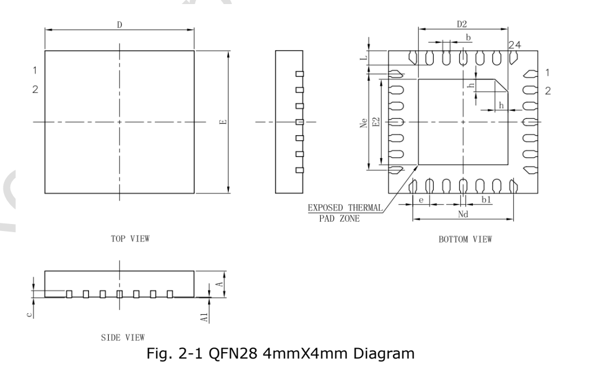
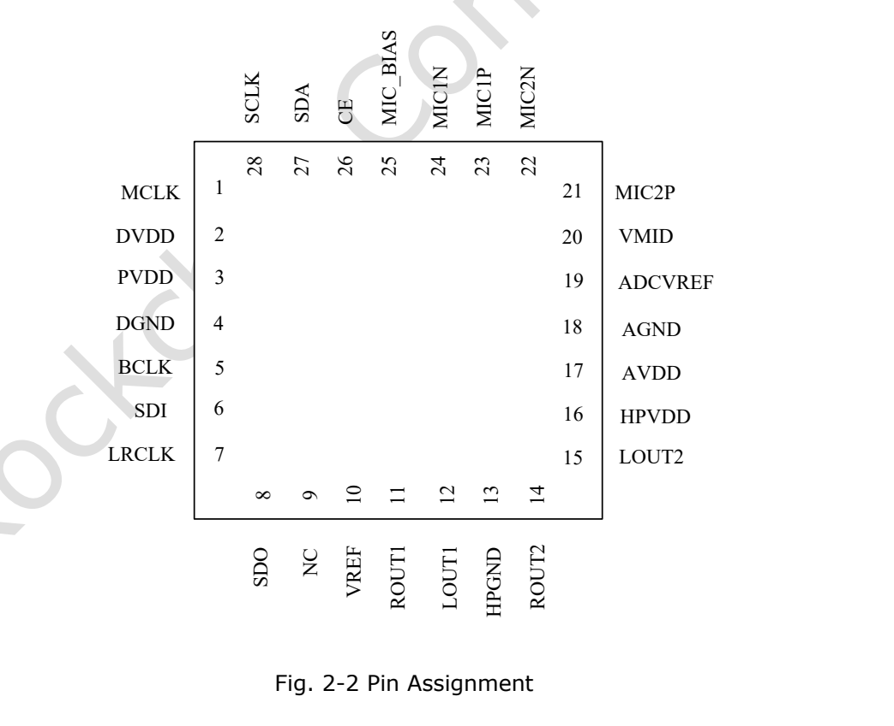

This article uses the specified datasheet revision. Values are vendor specifications, not ArmSoM measurements; no new hardware validation was performed. Check the actual silicon revision, board schematic, SDK/BSP, kernel and drivers. The explanations and editable tables assist reading; consult the original PDF for the complete specification and bit definitions not expanded here.

**RK730 · Rockchip RK730 Datasheet V1.0-20241118.pdf · PDF 7–15.**

*Original English figure, source PDF p. 11.*

## Audio capability and scope

RK730 is an external audio Codec with dual ADCs, dual DACs and headphone outputs. Integration depends on I2S/I2C, supplies, clocks and drivers, not only the host SoC. Maximum output power, dynamic range and distortion have different test conditions and are not one combined operating point.

| Item | Specification / source note |
|---|---|
| ADC / DAC | 2 / 2 · 24 bit · 8–192 kHz |
| Output power | 50 mW / 32 Ω; 100 mW / 16 Ω |
| Differential output | 4.8 Vpp at 3.3 V supply |
| Microphone gain | ≤54 dB |

## Package dimensions (mm)

| Symbol | Min / Typ / Max or source value |
|---|---|
| Package | QFN28 · 4 × 4 mm · 0.45 mm pitch |
| A | 0.70 / 0.75 / 0.80 |
| A1 | 0 / 0.02 / 0.05 |
| b | 0.15 / 0.20 / 0.25 |
| b1 | 0.14 REF |
| c | 0.18 / 0.20 / 0.25 |
| D / E | 3.90 / 4.00 / 4.10 |
| D2 / E2 | 2.30 / 2.40 / 2.50 |
| e | 0.45 BSC |
| Ne / Nd | 2.70 BSC |
| L | 0.35 / 0.40 / 0.45 |
| h | 0.30 / 0.35 / 0.40 |

## Complete pin table

| Number | Name | Source direction | Function |
|---|---|---|---|
| 1 | MCLK | I | Master clock input |
| 2 | DVDD | Supply | Digital supply |
| 3 | PVDD | Supply | Digital I/O supply |
| 4 | DGND | Supply | Digital ground |
| 5 | BCLK | I/O | Bit clock |
| 6 | SDI | I | Audio data input |
| 7 | LRCLK | I/O | Left/right clock |
| 8 | SDO | O | Audio data output |
| 9 | NC |  | No connection |
| 10 | VREF | O | Reference voltage |
| 11 | ROUT1 | O | Right output 1 |
| 12 | LOUT1 | O | Left output 1 |
| 13 | HPGND | Supply | Headphone ground |
| 14 | ROUT2 | O | Right output 2 |
| 15 | LOUT2 | O | Left output 2 |
| 16 | HPVDD | Supply | Headphone supply |
| 17 | AVDD | Supply | Analog supply |
| 18 | AGND | Supply | Analog ground |
| 19 | ADCVREF | O | ADC reference |
| 20 | VMID | O | Midpoint reference |
| 21 | MIC2P | I | Microphone 2 positive |
| 22 | MIC2N | I | Microphone 2 negative |
| 23 | MIC1P | I | Microphone 1 positive |
| 24 | MIC1N | I | Microphone 1 negative |
| 25 | MIC_BIAS | O | Microphone bias |
| 26 | CE | I | I2C address selection |
| 27 | SDA | I/O | I2C data |
| 28 | SCL | O | I2C clock; source says O, verify |
| EPAD | EPAD | Supply | Exposed pad to ground |

## Supplies and temperature

PVDD powers digital I/O and DVDD powers the digital core; similar names do not justify identical assumptions. HPVDD is recommended at 3.3 V, while the source allows 1.8/3.3 V for the other three rails. Treat reference pins per the vendor circuit, not as general peripheral power outputs.

| Item | Specification / source note |
|---|---|
| PVDD / DVDD / AVDD | Min 1.62 V · Typ 1.8 / 3.3 V · Max 3.6 V |
| HPVDD | Min 3.0 V · Typ 3.3 V · Max 3.6 V |
| Absolute supply/input range | −0.3…3.6 V |
| Source operating-temperature entry | −40…85 °C |
| Storage temperature | −65…150 °C |

## Audio test conditions and source discrepancies

ADC dynamic range is 100 dB in the feature list and 101 dB A-weighted in the electrical table. Preserve the latter’s conditions rather than silently merging them. Pin 28 is named SCL with direction O in the table, while the interface description calls it the I2C clock; verify direction against the actual design and current documentation. These quality figures are vendor data, not CM1 or Forge1 measurements.

| Item | Specification / source note |
|---|---|
| ADC | Full scale 1 Vrms; SNR 100 dB; dynamic range 101 dB A-weighted; THD −95 dB typ; input 20 kΩ |
| ADC filter | Passband 0.4917 Fs; stopband 0.5479 Fs; ripple 0.05 dB; attenuation 100 dB |
| DAC normal | 1 Vrms; SNR 98 dB; dynamic range 100 dB; THD −85 dB |
| DAC differential | 2 Vrms; SNR 98 dB; dynamic range 103 dB; THD −88 dB |

## Additional source figures

*Original English figure, source PDF p. 12.*

## ArmSoM products and application limits

CM1 and Forge1 are platform references for audio peripheral designs. This article does not claim an onboard RK730 or verified drop-in driver support. First check whether the required I2S, I2C, clocks and voltage levels are exposed.

- [CM1](https://www.armsom.org/cm1) · [Docs](https://docs.armsom.org/armsom-cm1)
- [Forge1](https://www.armsom.org/forge1) · [Docs](https://docs.armsom.org/armsom-forge1)

## Datasheet series and original PDF

- [RK730 overview](/articles/rk730-audio-codec-design/)
- [RK730 package, pinout and supplies: a QFN28 audio Codec](/articles/rk730-package-power-pinout/)
- [RK730 clocks and audio paths: PLL, I2S, sidetone and I2C](/articles/rk730-clocks-audio-i2c/)
- [RK730 register reference: 65 addresses, resets and control groups](/articles/rk730-register-map-reference/)
- [RK730 startup and shutdown: power, ADC recording and DAC playback](/articles/rk730-power-adc-dac-sequences/)
- [Download the complete original PDF](/assets/datasheet-series-20261110/Rockchip-RK730-Datasheet-V1.0-20241118.pdf)
