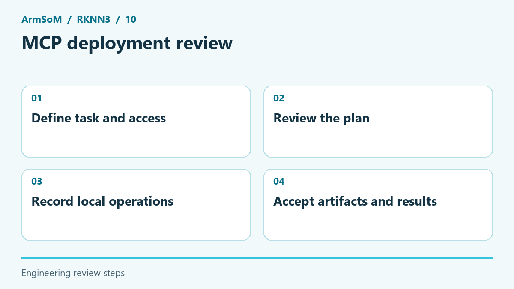

Natural language can make tools easier to use, but engineering delivery still requires a traceable plan, inputs and acceptance criteria. Treat RKNN3 MCP as workflow assistance rather than accepting “deployment succeeded” as sufficient evidence.

> This is an original technical interpretation and implementation guide based on official documentation. This workflow has not been verified on ArmSoM hardware. Match the target chip, SDK, Runtime, driver and firmware before deployment.

[](/assets/rknn3-v120/rknn3-v010-mcp-deployment-en.svg)

*Original ArmSoM workflow illustration; it does not represent hardware test results. Open the image for its vector version.*

## Separate the service from the executor

The V0.1.0 guide assigns knowledge, planning, parameter checks and task-state management to the MCP Server. Model processing and board operations run through the client Agent in the local or work-server environment. The guide states that the MCP Server does not directly read client files or execute client programs.

Assess both the service and what the Agent's tools actually send, read and execute. A server-side boundary does not prove that the complete workflow can never transmit data.

## Give the Agent a concrete task

This editorial requirements template does not execute commands:

```text
Target chip and board revision:
SDK, Runtime and firmware versions:
Model path and checksum:
Input shapes and preprocessing:
Required output and quality threshold:
Allowed directories and device access:
Actions requiring human approval:
Evidence required for completion:
```

Clear goals and boundaries help expose unsupported models, missing dependencies and unnecessary access before execution.

## Use reviewable checkpoints

| Stage | Review |
| --- | --- |
| Analysis | Model, platform and environment fit |
| Planning | Intended changes and artifacts |
| Execution | Commands, logs, return values and files |
| Verification | Accuracy, device results and remaining work |
| Handover | Locations, versions and recovery procedure |

A completed tool call is not a completed project. File creation, successful conversion, device execution and application acceptance are different outcomes.

## Understand access before connecting

The documented endpoint is `https://rknn-mcp.rock-chips.com/mcp`, using Streamable HTTP. This article did not connect to it, configure an Agent, upload a model or authorize device access.

Prepare matching tools and begin with a bounded model-analysis task. Supply board connection information only when the selected work actually needs device validation.

## Make recovery evidence-based

Preserve the last successful stage, artifact checksums, environment record and unresolved issues. Verify those records before resuming instead of reusing stale results. For an ArmSoM project, reproducible device behavior and application criteria determine acceptance, not simply reaching the final automation step.

## Plan an ArmSoM-based project

If an ArmSoM board is being considered as the application host, start with the product information for [Sige7](https://www.armsom.org/sige7), [Sige5](https://www.armsom.org/sige5) and [CM5](https://www.armsom.org/cm5). Check interfaces, power, OS image and drivers for the actual board and carrier revision. These are host-selection references, not a plug-and-play compatibility claim for RK182X modules. The integrated NPUs in RK3588 / RK3576 use the corresponding RKNN Toolkit2 stack; selecting one of these hosts does not move its internal NPU to RKNN3.

Related interface and module documentation: [RK182X M.2](/articles/rk182x-m2-module-guide/) · [RK182X SO-DIMM](/articles/rk182x-sodimm-module-datasheet/) · [RK3572 Datasheet V1.0](/articles/rk3572-datasheet-v10/)

## Official documentation and version

Based on official repository snapshot `141883c8e11b0`, checked on 2026-11-14. Consult the source for complete interfaces, parameters and restrictions. This article is not a replacement for the manual or a reproduction of the full PDF.

- <a href="https://github.com/airockchip/rknn3-toolkit/blob/141883c8e11b05ef4cca4a69d8a7572c4d855191/doc/EN/09_RKNN3_MCP_QuickStart_V0.1.0.pdf">Official English PDF (V0.1.0)</a>
- <a href="https://github.com/airockchip/rknn3-toolkit/blob/141883c8e11b05ef4cca4a69d8a7572c4d855191/doc/CN/09_RKNN3_MCP_%E5%BF%AB%E9%80%9F%E5%85%A5%E9%97%A8_V0.1.0.pdf">Official Chinese PDF (V0.1.0)</a>
- [All official documents](https://github.com/airockchip/rknn3-toolkit/tree/main/doc)

## Reading order

- [Series overview](/articles/rknn3-v120-platform-guide/)
- Previous: [RKNN3 MoE export: validate routed experts before the full model](/articles/rknn3-v120-moe-export/)
