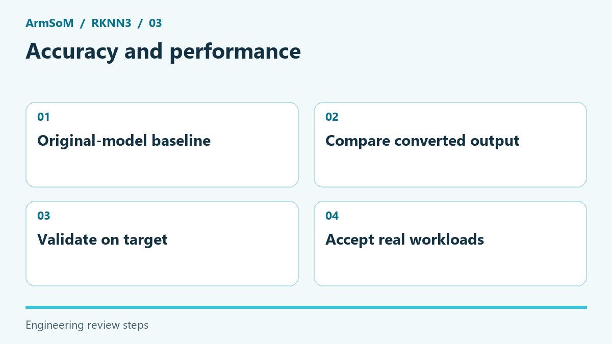

Successful conversion proves that artifacts were produced. It does not establish correct answers, acceptable latency or stable long-running operation. Define acceptance criteria before optimizing, otherwise a faster run may conceal lost accuracy or increasing memory use.

> This is an original technical interpretation and implementation guide based on official documentation. This workflow has not been verified on ArmSoM hardware. Match the target chip, SDK, Runtime, driver and firmware before deployment.

[](/assets/rknn3-v120/rknn3-v120-accuracy-performance-en.svg)

*Original ArmSoM workflow illustration; it does not represent hardware test results. Open the image for its vector version.*

## Preserve a trustworthy reference

The development guide covers conversion, quantization, evaluation and deployment, alongside KV Cache, LoRA and PagedAttention. For an engineering baseline, freeze the original model and preprocessing, then compare converted artifacts on the same test set.

For vision, retain both the source image and the preprocessed tensor. For language, preserve text, templates, tokenizer configuration and generation conditions. A filename alone can hide changes in color order, resizing or prompting.

## Give each objective its own threshold

| Dimension | Useful evidence | Insufficient evidence |
| --- | --- | --- |
| Accuracy | Application metric and failure distribution | One attractive screenshot |
| Latency | Initial, steady-state and tail latency | Only the fastest run |
| Memory | Peak and repeated-run behavior | One reading after startup |

Thresholds come from the application. Interactive systems prioritize waiting time; detection pipelines must also consider missed events and queued work. One metric cannot represent every product requirement.

## Change one major variable at a time

Compare the original model, an unquantized conversion, a quantized conversion and device results in stages. When accuracy changes, first prove the inputs match, then identify the earliest meaningful divergence.

Different wording from a generative model is not automatically a failure. Prepare factual questions, output-format requirements, long prompts and invalid inputs, with an explicit scoring method. Include failed cases rather than selecting only impressive answers.

## Measure the complete request

Record capture, preprocessing, queueing, inference and postprocessing separately. Improving inference alone may not resolve slow user responses. Stages in an asynchronous pipeline can overlap; measurements from different windows cannot simply be added.

An editorial result-record template:

```text
case_id,model_sha256,input_sha256,run_mode,
load_ms,queue_ms,inference_ms,end_to_end_ms,
peak_memory_mb,quality_score,error
```

Fill it with measured results, not anticipated scores.

## Regress after optimization

Keep a fixed regression set and add field samples. Recheck accuracy, resource cleanup and recovery after changing quantization, cache policy or concurrency. Documentation capabilities and examples are not ArmSoM product measurements. No hardware benchmark was performed for this article.

## Plan an ArmSoM-based project

If an ArmSoM board is being considered as the application host, start with the product information for [Sige7](https://www.armsom.org/sige7), [Sige5](https://www.armsom.org/sige5) and [CM5](https://www.armsom.org/cm5). Check interfaces, power, OS image and drivers for the actual board and carrier revision. These are host-selection references, not a plug-and-play compatibility claim for RK182X modules. The integrated NPUs in RK3588 / RK3576 use the corresponding RKNN Toolkit2 stack; selecting one of these hosts does not move its internal NPU to RKNN3.

Related interface and module documentation: [RK182X M.2](/articles/rk182x-m2-module-guide/) · [RK182X SO-DIMM](/articles/rk182x-sodimm-module-datasheet/) · [RK3572 Datasheet V1.0](/articles/rk3572-datasheet-v10/)

## Official documentation and version

Based on official repository snapshot `141883c8e11b0`, checked on 2026-11-14. Consult the source for complete interfaces, parameters and restrictions. This article is not a replacement for the manual or a reproduction of the full PDF.

- <a href="https://github.com/airockchip/rknn3-toolkit/blob/141883c8e11b05ef4cca4a69d8a7572c4d855191/doc/EN/02_RKNN3_SDK_Development_Guide_V1.2.0.pdf">Official English PDF (V1.2.0)</a>
- <a href="https://github.com/airockchip/rknn3-toolkit/blob/141883c8e11b05ef4cca4a69d8a7572c4d855191/doc/CN/02_RKNN3_SDK_%E5%BC%80%E5%8F%91%E6%8C%87%E5%8D%97_V1.2.0.pdf">Official Chinese PDF (V1.2.0)</a>
- [All official documents](https://github.com/airockchip/rknn3-toolkit/tree/main/doc)

## Reading order

- [Series overview](/articles/rknn3-v120-platform-guide/)
- Previous: [RKNN3 first deployment: from environment checks to reproducible inference](/articles/rknn3-v120-first-deployment/)
- Next: [RKNN3 Toolkit Python: make model-conversion scripts traceable](/articles/rknn3-v120-toolkit-python-workflow/)
