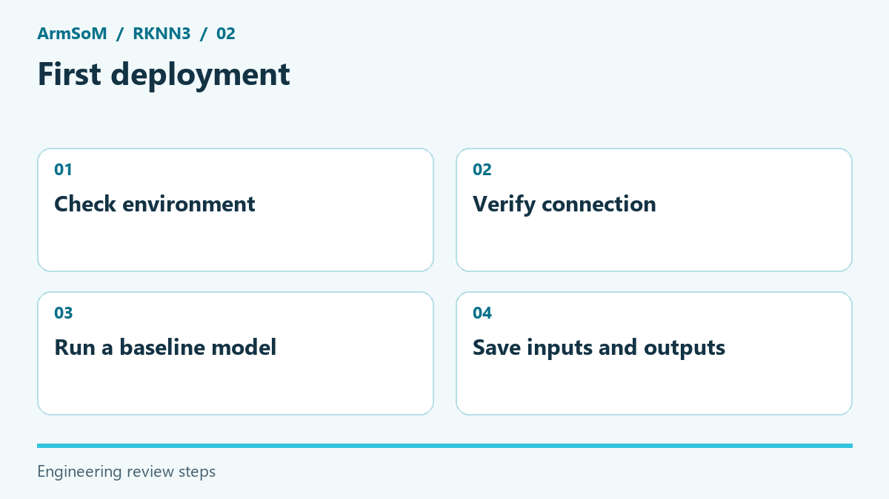

A first deployment should have a precise goal: obtain a verifiable output for a known input with identified software and transport. Establish that minimal path before adding cameras, containers, business services or multiple models.

> This is an original technical interpretation and implementation guide based on official documentation. This workflow has not been verified on ArmSoM hardware. Match the target chip, SDK, Runtime, driver and firmware before deployment.

[](/assets/rknn3-v120/rknn3-v120-first-deployment-en.svg)

*Original ArmSoM workflow illustration; it does not represent hardware test results. Open the image for its vector version.*

## Identify three locations

Record the conversion computer, the host running the application and the chip doing inference. In a coprocessor system these need not be the same device. “Linux” or “Windows” alone is insufficient: include OS version, CPU architecture, Python ABI and library locations.

The quick-start guide separates RK182X and RK3572 paths, and distinguishes development-board hosts from PC hosts. Its macOS USB-host instructions do not establish support for Toolkit board evaluation. Check the macOS Toolkit capability boundary separately in its API reference.

## Prepare a reproducibility handover

| Item | Evidence to preserve |
| --- | --- |
| Device identity | Board, hardware revision and target chip |
| Software identity | Image source, packages and model checksums |
| Connection | Port, cable and enumeration result |
| Correctness | Fixed input and expected result |
| Recovery | Failure log and recovery procedure |

Another engineer should be able to reproduce the result from this record. “It worked yesterday” cannot distinguish a changed cable from a changed image, model or Python environment.

## Record the environment before installation

These editorial commands only report the selected Python environment; they do not install software or connect to a board:

```bash
python -c "import sys, platform; print(sys.executable); print(sys.version); print(platform.platform()); print(platform.machine())"
python -m pip --version
python -m pip check
```

Save the output, then select packages matching the actual architecture, Python and release. Similar package names are not proof of compatibility. Avoid combining unrelated toolchains in one environment that has accumulated dependencies over time.

## Add one layer at a time

Check power and enumeration, then communication services, then the matching official example. Replace its input only after that baseline succeeds. Preserve the failing layer's logs instead of changing the Runtime, model and cable simultaneously.

When adding a camera, save one frame and compare it with offline input. When adding a network service, begin with a single request. This separates input-format problems from execution and scheduling problems.

## Preserve more than a successful screenshot

Keep commands, working directory, inputs, outputs and logs. Distinguish first-load behavior from subsequent runs and repeat after restarting the process. Reproducible operation is the prerequisite for useful optimization. This article does not report flashing, device inference or ArmSoM hardware compatibility tests.

## Plan an ArmSoM-based project

If an ArmSoM board is being considered as the application host, start with the product information for [Sige7](https://www.armsom.org/sige7), [Sige5](https://www.armsom.org/sige5) and [CM5](https://www.armsom.org/cm5). Check interfaces, power, OS image and drivers for the actual board and carrier revision. These are host-selection references, not a plug-and-play compatibility claim for RK182X modules. The integrated NPUs in RK3588 / RK3576 use the corresponding RKNN Toolkit2 stack; selecting one of these hosts does not move its internal NPU to RKNN3.

Related interface and module documentation: [RK182X M.2](/articles/rk182x-m2-module-guide/) · [RK182X SO-DIMM](/articles/rk182x-sodimm-module-datasheet/) · [RK3572 Datasheet V1.0](/articles/rk3572-datasheet-v10/)

## Official documentation and version

Based on official repository snapshot `141883c8e11b0`, checked on 2026-11-14. Consult the source for complete interfaces, parameters and restrictions. This article is not a replacement for the manual or a reproduction of the full PDF.

- <a href="https://github.com/airockchip/rknn3-toolkit/blob/141883c8e11b05ef4cca4a69d8a7572c4d855191/doc/EN/01_RKNN3_SDK_QuickStart_V1.2.0.pdf">Official English PDF (V1.2.0)</a>
- <a href="https://github.com/airockchip/rknn3-toolkit/blob/141883c8e11b05ef4cca4a69d8a7572c4d855191/doc/CN/01_RKNN3_SDK_%E5%BF%AB%E9%80%9F%E5%85%A5%E9%97%A8_V1.2.0.pdf">Official Chinese PDF (V1.2.0)</a>
- [All official documents](https://github.com/airockchip/rknn3-toolkit/tree/main/doc)

## Reading order

- [Series overview](/articles/rknn3-v120-platform-guide/)
- Next: [Validating RKNN3 models: accuracy, latency and memory in one acceptance plan](/articles/rknn3-v120-accuracy-performance/)
