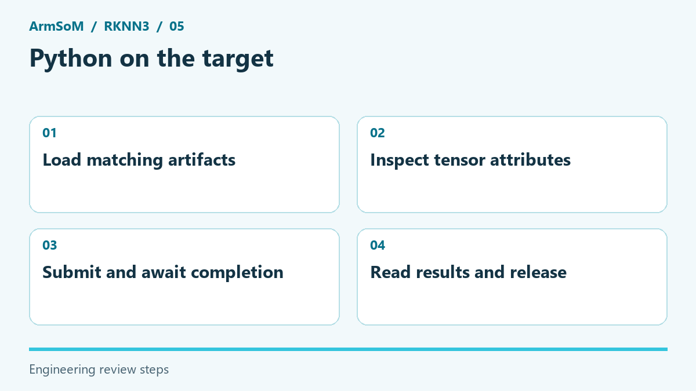

Python can connect inference to cameras, queues and prototypes, but a higher-level API does not remove device-memory, asynchronous-task or session-state concerns. Establish single-request behavior before introducing concurrency.

> This is an original technical interpretation and implementation guide based on official documentation. This workflow has not been verified on ArmSoM hardware. Match the target chip, SDK, Runtime, driver and firmware before deployment.

*Original ArmSoM workflow illustration; it does not represent hardware test results. Open the image for its vector version.*

## Lite runs converted models

The V1.2.0 reference describes `RKNN3Lite` as a Python interface for executing converted models with a matching Runtime. It addresses synchronous and asynchronous inference, tensor attributes, LLM Sessions, callbacks and memory lifetimes. Conversion belongs to Toolkit.

Importing a conversion package on a development computer does not establish a ready device environment. Verify the Python package, shared libraries and model-build identity separately.

## Validate inputs at the application boundary

Check dimensions, type, layout and batch meaning as data enters the application. Unconditionally casting every input can hide an upstream change and defer failure until inference.

| Boundary | Recommended check |
| --- | --- |
| Application input | Format, dimensions, missing values and origin |
| Model input | Tensor attributes, preprocessing and contiguity |
| Model output | Count, structure and invalid results |
| Business output | Thresholds, coordinates and text parsing |

Keep a known-good offline input to separate camera, decoder and networking behavior from model execution.

## Submission is not completion

The interface includes `inference_async`. A returned submission is distinct from completed computation: use the documented waiting contract before reading results or reclaiming objects used by the task. Callbacks also need defined lifetimes.

For a buffer pool, track each slot as free, in flight or ready for reading. Allow only valid transitions. Decide explicitly whether a full queue drops, blocks or rejects work rather than accumulating requests indefinitely.

## Map business conversations to Sessions

Maintain an explicit relationship between application conversations and Runtime Sessions. Define cleanup for cancellation, timeouts and user departure. Alternate requests between two conversations and verify that application state and callback objects do not cross. Memory reuse and session reuse require separate checks.

## Test beyond the successful prototype

Add empty inputs, wrong dimensions, cancellation and repeated task creation. Observe recovery, memory return and the next request's behavior. No device measurements are claimed here. An ArmSoM host integration still requires validation of the actual accelerator, image and Runtime.

## Plan an ArmSoM-based project

If an ArmSoM board is being considered as the application host, start with the product information for [Sige7](https://www.armsom.org/sige7), [Sige5](https://www.armsom.org/sige5) and [CM5](https://www.armsom.org/cm5). Check interfaces, power, OS image and drivers for the actual board and carrier revision. These are host-selection references, not a plug-and-play compatibility claim for RK182X modules. The integrated NPUs in RK3588 / RK3576 use the corresponding RKNN Toolkit2 stack; selecting one of these hosts does not move its internal NPU to RKNN3.

Related interface and module documentation: [RK182X M.2](/articles/rk182x-m2-module-guide/) · [RK182X SO-DIMM](/articles/rk182x-sodimm-module-datasheet/) · [RK3572 Datasheet V1.0](/articles/rk3572-datasheet-v10/)

## Official documentation and version

Based on official repository snapshot `141883c8e11b0`, checked on 2026-11-14. Consult the source for complete interfaces, parameters and restrictions. This article is not a replacement for the manual or a reproduction of the full PDF.

- <a href="https://github.com/airockchip/rknn3-toolkit/blob/141883c8e11b05ef4cca4a69d8a7572c4d855191/doc/EN/04_RKNN3_Toolkit_Lite_Python_API_Reference_V1.2.0.pdf">Official English PDF (V1.2.0)</a>
- <a href="https://github.com/airockchip/rknn3-toolkit/blob/141883c8e11b05ef4cca4a69d8a7572c4d855191/doc/CN/04_RKNN3_Toolkit_Lite_Python_API_%E5%8F%82%E8%80%83_V1.2.0.pdf">Official Chinese PDF (V1.2.0)</a>
- [All official documents](https://github.com/airockchip/rknn3-toolkit/tree/main/doc)

## Reading order

- [Series overview](/articles/rknn3-v120-platform-guide/)
- Previous: [RKNN3 Toolkit Python: make model-conversion scripts traceable](/articles/rknn3-v120-toolkit-python-workflow/)
- Next: [RKNN3 C Runtime: context, model, session and memory lifetimes](/articles/rknn3-v120-runtime-c-lifecycle/)
