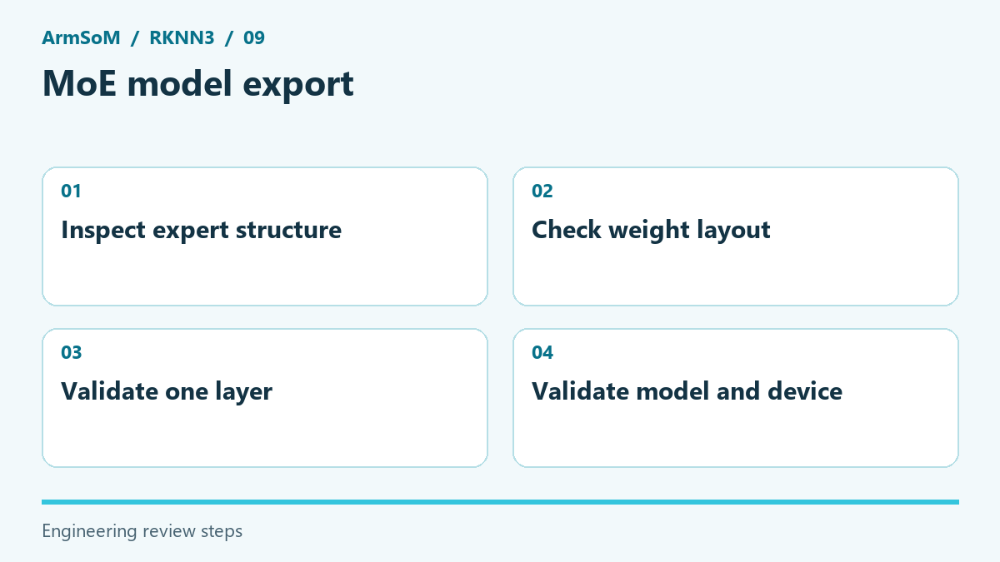

MoE separates the experts used for one computation from the total parameters stored. Edge deployment therefore needs more than an active-parameter count: weights, routing, caches and complete-model resources all matter.

> This is an original technical interpretation and implementation guide based on official documentation. This workflow has not been verified on ArmSoM hardware. Match the target chip, SDK, Runtime, driver and firmware before deployment.

*Original ArmSoM workflow illustration; it does not represent hardware test results. Open the image for its vector version.*

## Identify the export boundary

The V1.2.0 adaptation guide represents routed experts through `rknn::exUnifiedMoE`; the shared expert and combination remain outside that node. Its current batch constraint is 1, and matrix weights use `[in,out]`.

Confirm the original weight layout before deciding to transpose. Applying a transpose twice can corrupt a correct representation while still leaving apparently plausible dimensions.

## Separate structure from numerical evidence

| Review | Evidence |
| --- | --- |
| Structure | Experts, routing, inputs/outputs and combination point |
| Weights | Layout, packing, dtype and checksums |
| Numerical behavior | Reference outputs and error on identical inputs |
| Full model | Application outputs and quality metrics |

Structural review cannot detect every numerical error. A numerical test may not exercise every branch. Both forms of evidence are needed.

## Use a layer result to explain a model failure

Saving a fixed layer input is often more useful than keeping only the final generated answer. Decide whether the reference contains routed experts alone or the complete module, then compare equivalent outputs.

Inspect maximum error and its location alongside average error. If a few tokens diverge sharply, expand input coverage instead of letting an average hide local failures. Change layout, routing or quantization one at a time.

## Treat unsupported options explicitly

Section 3.2 marks `enable_moe_tc` as not implemented/unsupported, despite subsequently describing how it would be enabled. This article treats it as unavailable and retains the default disabled setting for initial evaluation.

A parameter name in documentation is not proof of a deliverable feature. Preserve version, capability status and verification results together.

## Continue toward product acceptance

After layer validation, measure full-model memory, startup, sustained inference and recovery. Establish results across input sizes rather than using one short prompt as proof for every context. No MoE conversion or measurement was performed here, and no model-capacity or generation-speed claim is made for ArmSoM products.

## Plan an ArmSoM-based project

If an ArmSoM board is being considered as the application host, start with the product information for [Sige7](https://www.armsom.org/sige7), [Sige5](https://www.armsom.org/sige5) and [CM5](https://www.armsom.org/cm5). Check interfaces, power, OS image and drivers for the actual board and carrier revision. These are host-selection references, not a plug-and-play compatibility claim for RK182X modules. The integrated NPUs in RK3588 / RK3576 use the corresponding RKNN Toolkit2 stack; selecting one of these hosts does not move its internal NPU to RKNN3.

Related interface and module documentation: [RK182X M.2](/articles/rk182x-m2-module-guide/) · [RK182X SO-DIMM](/articles/rk182x-sodimm-module-datasheet/) · [RK3572 Datasheet V1.0](/articles/rk3572-datasheet-v10/)

## Official documentation and version

Based on official repository snapshot `141883c8e11b0`, checked on 2026-11-14. Consult the source for complete interfaces, parameters and restrictions. This article is not a replacement for the manual or a reproduction of the full PDF.

- <a href="https://github.com/airockchip/rknn3-toolkit/blob/141883c8e11b05ef4cca4a69d8a7572c4d855191/doc/EN/08_RKNN3_MoE_ONNX_Export_And_Conversion_Guide_V1.2.0.pdf">Official English PDF (V1.2.0)</a>
- <a href="https://github.com/airockchip/rknn3-toolkit/blob/141883c8e11b05ef4cca4a69d8a7572c4d855191/doc/CN/08_RKNN3_moe%E7%BB%93%E6%9E%84%E5%AF%BC%E5%87%BA%E9%80%82%E9%85%8D%E8%AF%B4%E6%98%8E_V1.2.0.pdf">Official Chinese PDF (V1.2.0)</a>
- [All official documents](https://github.com/airockchip/rknn3-toolkit/tree/main/doc)

## Reading order

- [Series overview](/articles/rknn3-v120-platform-guide/)
- Previous: [RKNN3 operator checks: why a supported name is not enough](/articles/rknn3-v120-operator-audit/)
- Next: [RKNN3 MCP: make deployment work reviewable and recoverable](/articles/rknn3-v010-mcp-deployment/)
