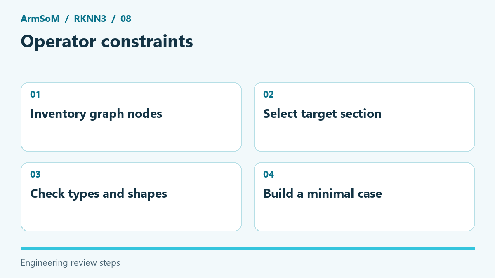

A common conversion mistake is assuming that an operator listed in a manual must work in every model. Deployment also depends on target hardware, data type, shapes, attribute combinations and which values are known during compilation.

> This is an original technical interpretation and implementation guide based on official documentation. This workflow has not been verified on ArmSoM hardware. Match the target chip, SDK, Runtime, driver and firmware before deployment.

[](/assets/rknn3-v120/rknn3-v120-operator-audit-en.svg)

*Original ArmSoM workflow illustration; it does not represent hardware test results. Open the image for its vector version.*

## Open the correct platform section

The V1.2.0 reference separates RK182X and RK3572. Entries describe types, dimensions and parameter restrictions, with implementation labels such as Subgraph, RegEmit, NRV, NRVReg and Runtime/Simulator. A documented path does not imply identical execution on every target.

Record the exact entry and SDK version, not just a screenshot of a supported-name list.

## Inventory graph nodes first

This editorial ONNX example reads structure without loading external weight data. It does not decide RKNN3 compatibility:

```python
from collections import Counter
import onnx

model = onnx.load("model.onnx", load_external_data=False)
counts = Counter((node.domain or "ai.onnx", node.op_type)
                 for node in model.graph.node)
for (domain, op_type), count in sorted(counts.items()):
    print(domain, op_type, count)
```

It requires ONNX. Use the output as a starting point for review, not an automatic support certificate.

## Review individual node instances

| Check | Question |
| --- | --- |
| Type | What are the input, weight and output types? |
| Shape | Are dimensions, batch and dynamic ranges defined? |
| Attributes | Is this particular combination restricted? |
| Constants | Are required values available at compilation? |
| Neighbors | Do transpose, broadcasting or fusion change constraints? |

Two nodes with the same operator name can have different shapes. Inspecting only the first occurrence may miss the failing case.

## Reduce to a reproducible problem

Keep the inputs and relationships needed around the failing node, then test whether a smaller graph reproduces the failure. If simplification removes it, document what changed and restore conditions incrementally.

For a private model, structural problems may be isolated with synthetic data of matching dimensions. Accuracy problems ultimately need real inputs or trustworthy reference outputs.

## Revalidate model rewrites

Replacing an operator requires behavioral comparison as well as another conversion. A successful build can still introduce copies, CPU work or numerical changes. Recheck correctness, end-to-end time and memory together. No RKNN3 compilation was performed here; the inventory script does not replace the official constraints reference.

## Plan an ArmSoM-based project

If an ArmSoM board is being considered as the application host, start with the product information for [Sige7](https://www.armsom.org/sige7), [Sige5](https://www.armsom.org/sige5) and [CM5](https://www.armsom.org/cm5). Check interfaces, power, OS image and drivers for the actual board and carrier revision. These are host-selection references, not a plug-and-play compatibility claim for RK182X modules. The integrated NPUs in RK3588 / RK3576 use the corresponding RKNN Toolkit2 stack; selecting one of these hosts does not move its internal NPU to RKNN3.

Related interface and module documentation: [RK182X M.2](/articles/rk182x-m2-module-guide/) · [RK182X SO-DIMM](/articles/rk182x-sodimm-module-datasheet/) · [RK3572 Datasheet V1.0](/articles/rk3572-datasheet-v10/)

## Official documentation and version

Based on official repository snapshot `141883c8e11b0`, checked on 2026-11-14. Consult the source for complete interfaces, parameters and restrictions. This article is not a replacement for the manual or a reproduction of the full PDF.

- <a href="https://github.com/airockchip/rknn3-toolkit/blob/141883c8e11b05ef4cca4a69d8a7572c4d855191/doc/EN/07_RKNN3_Supported_Operators_and_Constraints_Reference_V1.2.0.pdf">Official English PDF (V1.2.0)</a>
- <a href="https://github.com/airockchip/rknn3-toolkit/blob/141883c8e11b05ef4cca4a69d8a7572c4d855191/doc/CN/07_RKNN3_%E7%AE%97%E5%AD%90%E6%94%AF%E6%8C%81%E4%B8%8E%E7%BA%A6%E6%9D%9F%E5%8F%82%E8%80%83_V1.2.0.pdf">Official Chinese PDF (V1.2.0)</a>
- [All official documents](https://github.com/airockchip/rknn3-toolkit/tree/main/doc)

## Reading order

- [Series overview](/articles/rknn3-v120-platform-guide/)
- Previous: [RKLLM3 Server: a staged path from local inference to application APIs](/articles/rknn3-v120-rkllm-server/)
- Next: [RKNN3 MoE export: validate routed experts before the full model](/articles/rknn3-v120-moe-export/)
