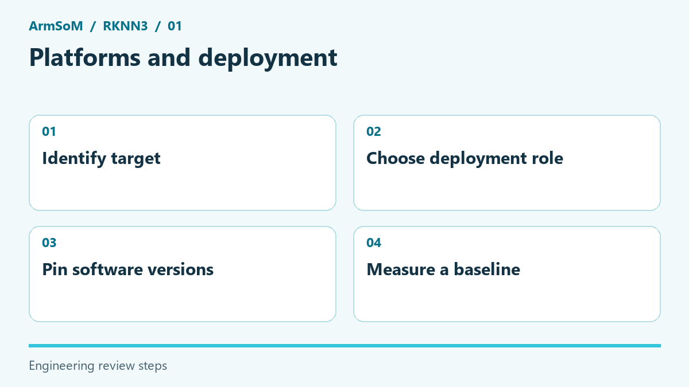

RKNN3 should be evaluated as part of a complete system: where the application runs, which chip performs inference, how data reaches it, and how a failure can be reproduced. For an ArmSoM project, a newer SDK number is not evidence that every Rockchip NPU can use it.

> This is an original technical interpretation and implementation guide based on official documentation. This workflow has not been verified on ArmSoM hardware. Match the target chip, SDK, Runtime, driver and firmware before deployment.

*Original ArmSoM workflow illustration; it does not represent hardware test results. Open the image for its vector version.*

## Separate the two system roles

The release notes describe RK1820/RK1828 coprocessor deployment and the integrated NPU in RK3572. The first requires a host and a working communication path; the second runs on the target SoC. RK3588/RK3576 integrated NPUs use Toolkit2. Using those chips as hosts for an external RK182X is a different design.

| Project | First decision |
| --- | --- |
| Use an existing board's NPU | Match the chip, software stack and image |
| Add an accelerator to a host | Verify wiring, power, driver and transport |
| Evaluate RK3572 | Identify the actual board revision and SDK |

## Read V1.2.0 through product requirements

This release covers MoE, PagedAttention, separate LoRA weight export and Grammar constraints. Treat these as evaluation directions, not substitutes for model, memory and response-time measurements.

For every proposed update, record the product problem it addresses, the input it needs, the acceptance criterion and the rollback route. A feature without a clear application requirement can wait. Introducing fewer variables makes failures easier to explain.

## Create a version record for an ArmSoM project

Record board and carrier revisions, image origin, kernel, Runtime, Toolkit, model checksums and test-data versions. Keep conversion and device environments as separate records. When replacing a host or rolling back an image, this helps distinguish model changes from library and hardware changes.

An official example running successfully is a useful baseline. Product readiness additionally requires representative inputs, recovery behavior, thermal checks and sustained operation.

## Use performance figures for selection

Vendor figures can identify candidates; your workload must establish the acceptance baseline. Fix input data, preprocessing, output length, concurrency and run duration. Record tail latency, peak memory and error rate as well as throughput. A single peak value cannot show whether work accumulates during continuous use.

## Follow the series in stages

Start with first deployment, then accuracy and performance. Choose Toolkit Lite or C Runtime according to the application, and add serving, operator checks, MoE or MCP when needed. Preserve reproducible inputs and results at each stage so later optimizations have a meaningful comparison.

## Plan an ArmSoM-based project

If an ArmSoM board is being considered as the application host, start with the product information for [Sige7](https://www.armsom.org/sige7), [Sige5](https://www.armsom.org/sige5) and [CM5](https://www.armsom.org/cm5). Check interfaces, power, OS image and drivers for the actual board and carrier revision. These are host-selection references, not a plug-and-play compatibility claim for RK182X modules. The integrated NPUs in RK3588 / RK3576 use the corresponding RKNN Toolkit2 stack; selecting one of these hosts does not move its internal NPU to RKNN3.

Related interface and module documentation: [RK182X M.2](/articles/rk182x-m2-module-guide/) · [RK182X SO-DIMM](/articles/rk182x-sodimm-module-datasheet/) · [RK3572 Datasheet V1.0](/articles/rk3572-datasheet-v10/)

## Official documentation and version

Based on official repository snapshot `141883c8e11b0`, checked on 2026-11-14. Consult the source for complete interfaces, parameters and restrictions. This article is not a replacement for the manual or a reproduction of the full PDF.

- <a href="https://github.com/airockchip/rknn3-toolkit/blob/141883c8e11b05ef4cca4a69d8a7572c4d855191/doc/EN/00_RKNN3_SDK_Release_Notes_V1.2.0.pdf">Official English PDF (V1.2.0)</a>
- <a href="https://github.com/airockchip/rknn3-toolkit/blob/141883c8e11b05ef4cca4a69d8a7572c4d855191/doc/CN/00_RKNN3_SDK_%E5%8F%91%E5%B8%83%E8%AF%B4%E6%98%8E_V1.2.0.pdf">Official Chinese PDF (V1.2.0)</a>
- [All official documents](https://github.com/airockchip/rknn3-toolkit/tree/main/doc)

## Reading order

| # | Topic |
| --- | --- |
| 01 | RKNN3 V1.2.0 platform guide: RK182X, RK3572 and ArmSoM deployment choices |
| 02 | [RKNN3 first deployment: from environment checks to reproducible inference](/articles/rknn3-v120-first-deployment/) |
| 03 | [Validating RKNN3 models: accuracy, latency and memory in one acceptance plan](/articles/rknn3-v120-accuracy-performance/) |
| 04 | [RKNN3 Toolkit Python: make model-conversion scripts traceable](/articles/rknn3-v120-toolkit-python-workflow/) |
| 05 | [RKNN3 Toolkit Lite: Python inference and asynchronous resource ownership](/articles/rknn3-v120-lite-python-inference/) |
| 06 | [RKNN3 C Runtime: context, model, session and memory lifetimes](/articles/rknn3-v120-runtime-c-lifecycle/) |
| 07 | [RKLLM3 Server: a staged path from local inference to application APIs](/articles/rknn3-v120-rkllm-server/) |
| 08 | [RKNN3 operator checks: why a supported name is not enough](/articles/rknn3-v120-operator-audit/) |
| 09 | [RKNN3 MoE export: validate routed experts before the full model](/articles/rknn3-v120-moe-export/) |
| 10 | [RKNN3 MCP: make deployment work reviewable and recoverable](/articles/rknn3-v010-mcp-deployment/) |
