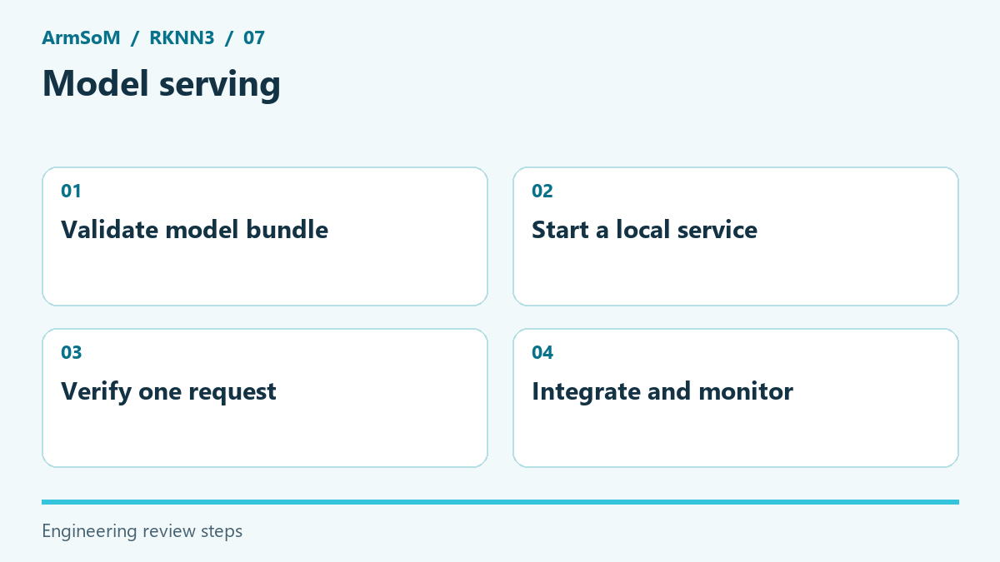

After a model runs locally, applications often need an API. Serving adds queues, conversation state, cancellation, timeouts and access control. An open port is not a complete deployment.

> This is an original technical interpretation and implementation guide based on official documentation. This workflow has not been verified on ArmSoM hardware. Match the target chip, SDK, Runtime, driver and firmware before deployment.

[](/assets/rknn3-v120/rknn3-v120-rkllm-server-en.svg)

*Original ArmSoM workflow illustration; it does not represent hardware test results. Open the image for its vector version.*

## Compatibility has a defined scope

RKLLM3 Server V1.2.0 provides an OpenAI-compatible chat interface and documents `/health`, `/v1/models` and `/v1/chat/completions`. It also covers multimodal input, LoRA, caching, Grammar and multiple cards. Specific models and parameters still need validation.

Clients should rely only on fields and behavior that have been tested. Check streaming, error responses, stopping conditions and parameter precedence instead of assuming another service's entire behavior transfers unchanged.

## Start with minimal service checks

Assuming a service is already listening locally on port 8080, these editorial checks are read-only:

```bash
curl --fail --max-time 10 http://127.0.0.1:8080/health
curl --fail --max-time 10 http://127.0.0.1:8080/v1/models
```

Use the actual configured address and port. Health does not prove answer correctness; follow with fixed requests that verify output structure and quality. No inference service was started while preparing this article.

## Validate four layers

| Layer | Evidence |
| --- | --- |
| Model | Complete artifacts and correct inputs/outputs |
| Service | Startup, health and failure logs |
| Protocol | Fields, streaming, timeouts and errors |
| Application | Answer quality, concurrency and recovery |

Identify any unverified layer explicitly so application integration does not depend on unexplained behavior below it.

## Test multimodal and structured output separately

Build format, size and content-type tests for image or audio input. For JSON output, validate meaning as well as structure: a valid object can still contain an incorrect answer. If a model requests a tool call, the business layer must control actual execution.

Begin with one model, one request and short input. Increase context, concurrency and model combinations only after baseline behavior is stable, monitoring queue time and peak memory.

## Define the ArmSoM integration handover

Record bind addresses, authentication entry points, logging, restart behavior and model-package versions. Apply the application's network access requirements before exposing the service. This is an architecture and acceptance guide, not a performance promise for an ArmSoM board.

## Plan an ArmSoM-based project

If an ArmSoM board is being considered as the application host, start with the product information for [Sige7](https://www.armsom.org/sige7), [Sige5](https://www.armsom.org/sige5) and [CM5](https://www.armsom.org/cm5). Check interfaces, power, OS image and drivers for the actual board and carrier revision. These are host-selection references, not a plug-and-play compatibility claim for RK182X modules. The integrated NPUs in RK3588 / RK3576 use the corresponding RKNN Toolkit2 stack; selecting one of these hosts does not move its internal NPU to RKNN3.

Related interface and module documentation: [RK182X M.2](/articles/rk182x-m2-module-guide/) · [RK182X SO-DIMM](/articles/rk182x-sodimm-module-datasheet/) · [RK3572 Datasheet V1.0](/articles/rk3572-datasheet-v10/)

## Official documentation and version

Based on official repository snapshot `141883c8e11b0`, checked on 2026-11-14. Consult the source for complete interfaces, parameters and restrictions. This article is not a replacement for the manual or a reproduction of the full PDF.

- <a href="https://github.com/airockchip/rknn3-toolkit/blob/141883c8e11b05ef4cca4a69d8a7572c4d855191/doc/EN/06_RKLLM3_Server_User_Guide_V1.2.0.pdf">Official English PDF (V1.2.0)</a>
- <a href="https://github.com/airockchip/rknn3-toolkit/blob/141883c8e11b05ef4cca4a69d8a7572c4d855191/doc/CN/06_RKLLM3_Server_%E4%BD%BF%E7%94%A8%E6%8C%87%E5%8D%97_V1.2.0.pdf">Official Chinese PDF (V1.2.0)</a>
- [All official documents](https://github.com/airockchip/rknn3-toolkit/tree/main/doc)

## Reading order

- [Series overview](/articles/rknn3-v120-platform-guide/)
- Previous: [RKNN3 C Runtime: context, model, session and memory lifetimes](/articles/rknn3-v120-runtime-c-lifecycle/)
- Next: [RKNN3 operator checks: why a supported name is not enough](/articles/rknn3-v120-operator-audit/)
