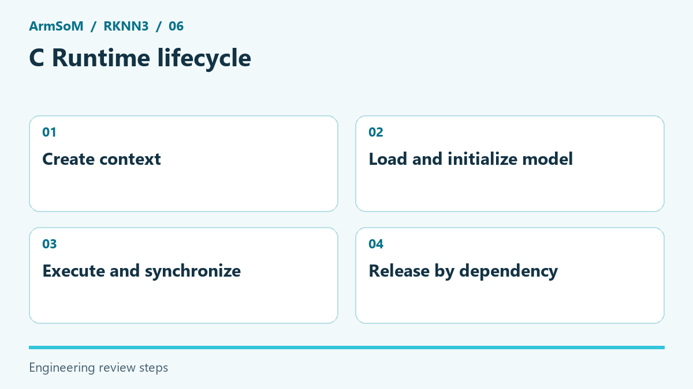

Long-running C/C++ integration needs explicit resource control. Knowing when an object can be released is as important as knowing how to launch inference. Model the Runtime as dependent resources rather than memorizing a sequence of calls.

> This is an original technical interpretation and implementation guide based on official documentation. This workflow has not been verified on ArmSoM hardware. Match the target chip, SDK, Runtime, driver and firmware before deployment.

*Original ArmSoM workflow illustration; it does not represent hardware test results. Open the image for its vector version.*

## Distinguish the objects

The V1.2.0 reference separates context creation, model loading, model initialization and LLM Sessions. Relevant names include `rknn3_init`, `rknn3_load_model_from_path`, `rknn3_model_init` and `rknn3_destroy`. Cacheable memory also has a synchronization contract through `rknn3_mem_sync`.

This is not a compilable program. Parameter structures, platform restrictions and return codes must match the installed headers and library.

## Give every resource an owner

| Resource | Question to resolve |
| --- | --- |
| Context | Who creates and finally destroys it? |
| Model | How are files, weights and failed initialization handled? |
| Session | What happens on completion, cancellation and reuse? |
| Buffer | Who allocates, accesses and reclaims it? |
| Callback | Does referenced state outlive the final invocation? |

During review, pair creation with an explicit release path. Discuss success, partial initialization and shutdown separately.

## Make dependencies visible in cleanup

Stop accepting work, account for active tasks, then release dependent resources. An object referenced by a possible callback cannot be destroyed yet. Multithreaded programs also need a designated shutdown owner to prevent competing error paths from freeing the same resource.

An owning C++ wrapper can organize cleanup, but its destructor timing does not automatically satisfy device-asynchronous completion requirements. Represent completion separately.

## Shared memory still requires coordination

Visibility, layout and ownership are different concerns. For intermittent incorrect results, examine CPU writes, device reads, output synchronization and CPU consumption as well as model accuracy. A fixed delay is not a reliable substitute for correct state management.

## Make failures recoverable and diagnosable

Record the operation stage, return value, model identity, device identity and request ID. Logs need not contain complete business data, but should identify a reproducible test case. After failure, verify that a subsequent initialization still works.

This integration discussion does not claim compiled or executed device-side C code, or direct compatibility with a particular ArmSoM board.

## Plan an ArmSoM-based project

If an ArmSoM board is being considered as the application host, start with the product information for [Sige7](https://www.armsom.org/sige7), [Sige5](https://www.armsom.org/sige5) and [CM5](https://www.armsom.org/cm5). Check interfaces, power, OS image and drivers for the actual board and carrier revision. These are host-selection references, not a plug-and-play compatibility claim for RK182X modules. The integrated NPUs in RK3588 / RK3576 use the corresponding RKNN Toolkit2 stack; selecting one of these hosts does not move its internal NPU to RKNN3.

Related interface and module documentation: [RK182X M.2](/articles/rk182x-m2-module-guide/) · [RK182X SO-DIMM](/articles/rk182x-sodimm-module-datasheet/) · [RK3572 Datasheet V1.0](/articles/rk3572-datasheet-v10/)

## Official documentation and version

Based on official repository snapshot `141883c8e11b0`, checked on 2026-11-14. Consult the source for complete interfaces, parameters and restrictions. This article is not a replacement for the manual or a reproduction of the full PDF.

- <a href="https://github.com/airockchip/rknn3-toolkit/blob/141883c8e11b05ef4cca4a69d8a7572c4d855191/doc/EN/05_RKNN3_Runtime_C_API_Reference_V1.2.0.pdf">Official English PDF (V1.2.0)</a>
- <a href="https://github.com/airockchip/rknn3-toolkit/blob/141883c8e11b05ef4cca4a69d8a7572c4d855191/doc/CN/05_RKNN3_Runtime_C_API_%E5%8F%82%E8%80%83_V1.2.0.pdf">Official Chinese PDF (V1.2.0)</a>
- [All official documents](https://github.com/airockchip/rknn3-toolkit/tree/main/doc)

## Reading order

- [Series overview](/articles/rknn3-v120-platform-guide/)
- Previous: [RKNN3 Toolkit Lite: Python inference and asynchronous resource ownership](/articles/rknn3-v120-lite-python-inference/)
- Next: [RKLLM3 Server: a staged path from local inference to application APIs](/articles/rknn3-v120-rkllm-server/)
