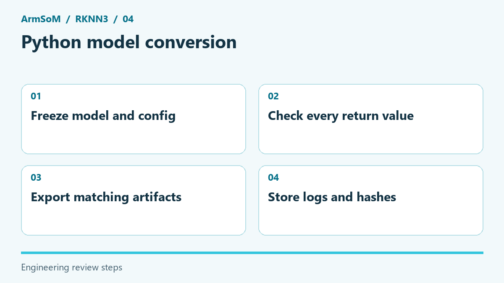

A conversion script is both a development tool and a delivery record. A maintained project must identify the inputs, configuration and software used, and the exact stage that failed.

> This is an original technical interpretation and implementation guide based on official documentation. This workflow has not been verified on ArmSoM hardware. Match the target chip, SDK, Runtime, driver and firmware before deployment.

[](/assets/rknn3-v120/rknn3-v120-toolkit-python-workflow-en.svg)

*Original ArmSoM workflow illustration; it does not represent hardware test results. Open the image for its vector version.*

## Do not infer imports from the SDK name

The V1.2.0 reference imports its class with `from rknn.api import RKNN`. The conversion path uses `config`, `load_onnx`, `build`, `export_rknn` and `release`. Exported `.rknn` and accompanying `.weight` files should be managed as one build's artifacts.

Similar Python namespaces make a wrong environment easy to overlook. Confirm the actual import location before debugging model configuration.

## Identify the environment used by the script

This editorial diagnostic is read-only and does not convert a model:

```python
import sys
from importlib.util import find_spec

print("python:", sys.executable)
spec = find_spec("rknn")
print("rknn:", None if spec is None else spec.origin)
```

Save its output with the installation record. Finding a module does not prove the correct version was installed or that a model will execute.

## Give each stage a verifiable result

| Stage | Record |
| --- | --- |
| Input | Model checksum, external weights and input definitions |
| Configuration | Target, preprocessing and quantization choices |
| Build | Return status, log and duration |
| Export | Matching files, sizes and checksums |
| Validation | Fixed inputs, outputs and reference comparison |

A failed stage must stop delivery. An old file left in an output directory is not evidence that the current build succeeded. Separate directories by build identifier and promote artifacts only after validation.

## Treat cleanup as part of interface design

Assign ownership of objects and temporary files. Failure paths should release acquired resources while preserving diagnostic logs. Do not swallow exceptions or treat the existence of an output file as a success criterion.

## Deliver an integration package

An ArmSoM integration handover should include the model configuration, target-environment requirements and fixed test samples. Record conversion completion separately from acceptance on a particular ArmSoM hardware revision. No SDK conversion was executed for this article; consult the versioned reference for full parameters, defaults and restrictions.

## Plan an ArmSoM-based project

If an ArmSoM board is being considered as the application host, start with the product information for [Sige7](https://www.armsom.org/sige7), [Sige5](https://www.armsom.org/sige5) and [CM5](https://www.armsom.org/cm5). Check interfaces, power, OS image and drivers for the actual board and carrier revision. These are host-selection references, not a plug-and-play compatibility claim for RK182X modules. The integrated NPUs in RK3588 / RK3576 use the corresponding RKNN Toolkit2 stack; selecting one of these hosts does not move its internal NPU to RKNN3.

Related interface and module documentation: [RK182X M.2](/articles/rk182x-m2-module-guide/) · [RK182X SO-DIMM](/articles/rk182x-sodimm-module-datasheet/) · [RK3572 Datasheet V1.0](/articles/rk3572-datasheet-v10/)

## Official documentation and version

Based on official repository snapshot `141883c8e11b0`, checked on 2026-11-14. Consult the source for complete interfaces, parameters and restrictions. This article is not a replacement for the manual or a reproduction of the full PDF.

- <a href="https://github.com/airockchip/rknn3-toolkit/blob/141883c8e11b05ef4cca4a69d8a7572c4d855191/doc/EN/03_RKNN3_Toolkit_Python_API_Reference_V1.2.0.pdf">Official English PDF (V1.2.0)</a>
- <a href="https://github.com/airockchip/rknn3-toolkit/blob/141883c8e11b05ef4cca4a69d8a7572c4d855191/doc/CN/03_RKNN3_Toolkit_Python_API_%E5%8F%82%E8%80%83_V1.2.0.pdf">Official Chinese PDF (V1.2.0)</a>
- [All official documents](https://github.com/airockchip/rknn3-toolkit/tree/main/doc)

## Reading order

- [Series overview](/articles/rknn3-v120-platform-guide/)
- Previous: [Validating RKNN3 models: accuracy, latency and memory in one acceptance plan](/articles/rknn3-v120-accuracy-performance/)
- Next: [RKNN3 Toolkit Lite: Python inference and asynchronous resource ownership](/articles/rknn3-v120-lite-python-inference/)
