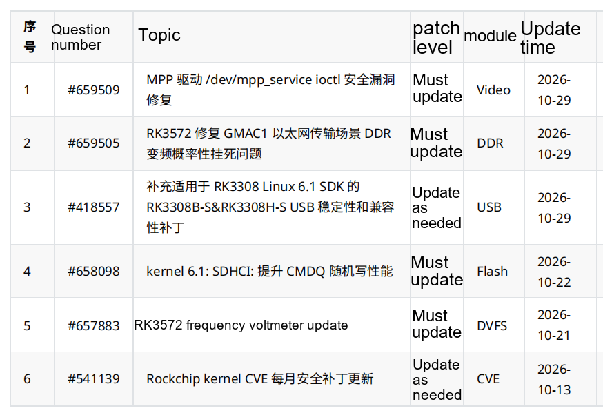

This October 2026 Rockchip patch list covers video-driver security, RK3572 DDR and frequency/voltage configuration, RK3308 USB, Linux 6.1 storage and kernel security maintenance. For an ArmSoM project, the useful next step is to match each record to the actual chip, SDK/BSP and software baseline before planning integration and validation.

This brief combines the original six-entry list with the descriptions, history and attachment listings checked in the authenticated Rockchip Redmine on **2026-11-06**. **It is not a complete monthly catalogue or confirmation that all ArmSoM images include the fixes.** Dates in the table retain the original bulletin dates; issue start dates, attachment dates and later updates are distinguished below. Vendor test results are attributed to their source. The engineering recommendations have not been hardware-validated by ArmSoM for this article.

## 1. The six records

| Issue | Topic in the supplied list | Listed level | Module | Updated |
| --- | --- | --- | --- | --- |
| [#659509](https://redmine.rock-chips.com/issues/659509) | Security fix for the MPP driver `/dev/mpp_service` ioctl interface | Mandatory update | Video | 2026-10-29 |
| [#659505](https://redmine.rock-chips.com/issues/659505) | RK3572: fix intermittent hangs during DDR frequency changes in GMAC1 Ethernet transfer scenarios | Mandatory update | DDR | 2026-10-29 |
| [#418557](https://redmine.rock-chips.com/issues/418557) | Add applicability to the RK3308 Linux 6.1 SDK for RK3308B-S & RK3308H-S USB stability and compatibility patches | Update as needed | USB | 2026-10-29 |
| [#658098](https://redmine.rock-chips.com/issues/658098) | kernel 6.1: SDHCI CMDQ random-write performance improvement | Mandatory update | Flash | 2026-10-22 |
| [#657883](https://redmine.rock-chips.com/issues/657883) | RK3572 frequency/voltage table update | Mandatory update | DVFS | 2026-10-21 |
| [#541139](https://redmine.rock-chips.com/issues/541139) | Rockchip kernel monthly CVE security patch update | Update as needed | CVE | 2026-10-13 |

“Mandatory” is the source list's classification for an **applicable baseline**, not permission to install the same patch on every Rockchip board. “As needed” still requires an applicability and security review.

## 2. MPP: the original 17 fixes have become 19

[#659509](https://redmine.rock-chips.com/issues/659509) concerns `drivers/video/rockchip/mpp/` on `kernel: develop-6.1`. The issue identifies out-of-bounds reads/writes, use-after-free (UAF)/double-free, arbitrary kernel writes and cross-process information disclosure through userspace ioctl access to `/dev/mpp_service`. It does not establish a remote attack path or provide a CVE identifier or CVSS score.

The original description lists 17 fixes. **The 2026-11-04 history adds two, bringing the current total to 19**: `4e950a32a45f7` fixes out-of-bounds access in `mpp_check_req()`; `531cdbdcfe94` fixes an overly strict offset-bound check in fd translate. Checking only the original 17 is therefore insufficient. Selecting only the two additions without dependency review is not a complete integration plan either.

The changes cover input bounds, session/DMA lifetimes, type confusion and procfs permissions. The issue says normal userspace behavior remains unchanged while invalid inputs are rejected with `-EINVAL` / `-EOPNOTSUPP`. Rockchip reports successful Jenkins builds without new warnings beyond existing ones. That is build evidence, not a complete ArmSoM video-workload regression result.

Listed SDKs include multiple RK3576, RK3588 and RK3566/3568 Linux 6.1 and Android branches. Match the actual driver and BSP rather than relying on the broad chip list. History explicitly removes RK3572/RK3572S from this issue; their presence elsewhere in the bulletin does not make them affected here. For CM5/Sige5 and RK3588-family projects, check the corresponding BSP. Updating the userspace MPP library alone cannot prove that the kernel fix is present.

Recommended regression covers real encoding/decoding workloads, start/stop, process exit/restart, long runs and diagnostic tools that rely on procfs. These are engineering recommendations.

## 3. RK3572: coordinate BL31 V1.15 and the voltage-table update

[#659505](https://redmine.rock-chips.com/issues/659505) identifies an access-path conflict during GMAC1 traffic and DDR frequency transitions on RK3572/RK3572S, potentially causing a black screen and system hang. The fix is in `rkbin: master` and requires **BL31 V1.15 or later**, with Change-Id `I34c7b43db47b2fa8c763154969c2f79c9140adde`. Attachments list the V1.15 update patch and `rk3572_bl31_v1.15.elf`. Rockchip reports normal test operation without a duration or workload matrix.

[#657883](https://redmine.rock-chips.com/issues/657883) targets `kernel: develop-6.12` and `rkbin: master`. Some chips lack sufficient stability margin with the old frequency/voltage tables. Listed attachments cover CPU/GPU/NPU OPPs, DMC OPPs, supply settings and ISP devfreq/OPP support, plus BL31 V1.14. The test field says “pass”; it does not provide power or performance improvements.

**Do not downgrade firmware that satisfies the GMAC1 fix merely because the earlier voltage-table issue includes V1.14.** Have the BSP maintainer confirm a compatible V1.15-or-newer combination containing the required changes. Do not arbitrarily mix kernel, device-tree and firmware versions. Attachment code was not reviewed for this article, and filenames do not establish voltage values or complete dependencies.

Listed SDKs include RK3572 Linux 6.12 and several Android SDKs. For ArmSoM’s [RK3572 platform plans](/articles/rockchip-rk3572-armsom-zero-preview/), recommended checks cover sustained GMAC1 traffic, load transitions, DDR scaling, cold starts and temperature conditions with serial logs. A short throughput test does not establish that an intermittent hang is fixed.

## 4. RK3308 USB: October adds a Linux 6.1-specific package

[#418557](https://redmine.rock-chips.com/issues/418557) is a long-running issue dating to 2023. It describes USB stability and compatibility problems after extended operation on RK3308B-S/RK3308H-S. Software checks the DP/DM linestate and adjusts abnormal levels to enable a successful high-speed handshake. The recorded test passed on an RK3308B-S EVB, not an ArmSoM P2 Pro.

On **2026-10-29**, the issue added `RK3308B-S&RK3308H-S_USB_Compatible_Linux6.1_SDK_Patch_V1.0.0_20261013.zip` and RK3308 Linux 6.1 SDK applicability. October 13 in the filename and October 29 as upload date are distinct fields. Older description/repository fields still reference Linux 4.4, while history also covers Linux 5.10. Do not apply an old package to 6.1 on that basis.

The bulletin labels this “as needed”; the detail page’s update-level field is empty. We retain the bulletin classification and note the difference. Earlier updates concern OTG gadget disconnect events, hot-plug initialization and HOST suspend/resume; select the package for the actual SDK.

[P2 Pro documentation](https://docs.armsom.org/armsom-p2pro) identifies RK3308B-S, making this relevant to review, but integration depends on the image, branch and existing fixes. Suggested tests cover enumeration, repeated hot-plug, sustained transfer, suspend/resume and gadget disconnect notifications with the actual peripherals.

## 5. SDHCI and CVEs: read the benchmark and month correctly

[#658098](https://redmine.rock-chips.com/issues/658098) targets `rk/kernel: develop-6.1-android14` and `develop-6.1`, with Change-Id `I5f8cfd9d62228e62fd0ad71d7b69698d80b21f80`. Some eMMC devices return only one ready SLOT per CMDQ query, making a long polling interval detrimental to random writes. The fix reduces that interval.

Rockchip reports RK3576 results of **160 MB/s to 200 MB/s** for some multi-queue eMMC devices and **19 MB/s to 70 MB/s** for devices without multi-queue support. These are specific vendor results, not ArmSoM measurements or guarantees for all storage devices. A complete test configuration is absent. The bulletin date is 2026-10-22, whereas the issue start and attachment dates are 2025-09-10: inclusion in October does not mean first development in October.

[#541139](https://redmine.rock-chips.com/issues/541139) maintains monthly CVE lists for `kernel: 4.19/5.10/6.1/6.12`. Markdown attachments map CVEs to commits and patch links. **The latest attachment visible during this check is `2026-09.md`, uploaded 2026-10-13, not `2026-10.md`.** Its history comment says August, conflicting with the filename. We retain the filename and flag the mismatch rather than silently selecting a month. The screenshot’s module is CVE; the detail page’s Component is System.

The approximately 575 KB CVE attachment has not been audited entry by entry for this article. We do not claim every CVE affects ArmSoM or equate this list with the MPP issue. Assess code, configuration, exposed functionality and backports individually. “As needed” does not mean applicable security fixes can be ignored.

## 6. Keep a traceable update record

Record board and hardware revision, SoC, image name and checksum, SDK/BSP branch, kernel version, patch source and commit identifier, test results and recovery image. These commands only read running-system information; **their output does not prove a security fix is present**:

```sh
uname -a
cat /etc/os-release
cat /proc/device-tree/model
```

Some systems lack `/etc/os-release` or the device-tree node; `model` may have no trailing newline. Two images with the same kernel version string can contain different backports. Consult build records and maintainer guidance.

Use the sequence: establish applicability, obtain matching patches and dependencies, integrate on test devices, run application regression, then deploy in stages with rollback available. Providing the baseline and issue numbers when contacting ArmSoM helps identify the relevant image or BSP update. The contact buttons on this page are available for enquiries; no fix-delivery date for any model is implied.

## Source list and reading notes



The original image remains in Chinese, with a copyable table in each language. All six issue links lead to the checked official records; details and attachments may require Redmine access. This review covered descriptions, history and attachment names, not line-by-line patch-code audits, patch execution or hardware application/testing. Obtain packages through the official channel for the matching SDK; this article does not host them.
