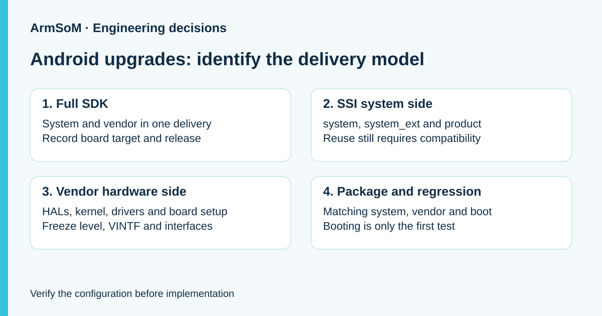

**When asking which Android version a Rockchip chip can run, also ask whether the delivery is a full SDK or separately delivered system and hardware components.** An Android release number does not identify the source layout, build entry point, vendor baseline or upgrade procedure.

This guide supports ArmSoM Android project selection and delivery. The matrix below is a supplied third-party snapshot, not an ArmSoM image-download list, GMS certification list or current manufacturer commitment. Board documentation, SDK release notes and test results govern an actual product.



## 1. Three terms at different levels

| Term | Engineering meaning | What it does not mean |
| --- | --- | --- |
| Full SDK | One delivery supplies the system and hardware-side build inputs | Every board works without integration |
| SSI | Shared System Image | Any vendor can pair with any system |
| GRF | Google Requirements Freeze, concerning frozen vendor requirements | A firmware file that replaces all drivers |

SSI enables system reuse across compatible devices, while system, system_ext, product and vendor/odm retain interface and compatibility constraints. [AOSP SSI](https://source.android.com/docs/core/architecture/partitions/shared-system-image)

BSP engineers focus on HALs, VINTF, the kernel and board resources. Application teams focus on framework behavior, permissions, ABI and API changes. Separate builds do not remove the need to regress both sides together.

## 2. Read the version matrix as a source snapshot

The following preserves the supplied chip-by-chip ranges as leads for finding release packages. The source is dated **2026-11-06**. All corresponding branches were not obtained and built here; Android 16/17 combinations are not presented as verified support. A dash means not listed, not proven impossible.

| Chip family | Source: Android versions in full SDKs | Source: Android versions with SSI + GRF |
| --- | --- | --- |
| RK3572 / RK3572S | 16 | 17 |
| RK3576 | 14, 15 | 16, 17 |
| RK3588 / RK3588S | 12–15 | 16, 17 |
| RK3568 / RK3566 | 11–15 | 16, 17 |
| RK3562 | 13–15 | 16, 17 |
| RK3399 | 6–15 | 16, 17 |
| RK3399PRO | 8, 9 | — |
| RK3326 / RK3326-S | 8–15 | 16, 17 |
| PX30 / PX30-S | 8–15 | 16, 17 |
| RK3368 | 5–11 | — |
| RK3288W | 5–12 | — |
| RK3126C | 8–10 | — |
| RK312X | 5–7 | — |
| PX5 | 6, 8 | — |
| PX3SE | 7 | — |

A range does not establish every minor release, board or peripheral. The source's separate Android-by-version table also mentions RK3528 outside this chip list; that inconsistency is not used to add a support promise. Obtain the exact manifest, release notes and product image before purchasing or upgrading.

## 3. Verify Android 16/17 branch differences

The source describes Android 16 for RK3572 as a full SDK and several other platforms as SSI paired with Android 14 vendor. That describes the surveyed deliveries; it cannot be inferred from the Android major version alone. Names such as `rk3572_a16-*`, `ssi_16_arm64`, `rkbuild` and `build.sh -M / -T` must be checked in the actual SDK.

The source lists these Android 17 vendor requirements, retained **for traceability only**:

| Platform | Vendor SDK | Source minimum release | SSI release |
| --- | --- | --- | --- |
| RK3572 | Android 16 | RKR5+ | RKR1 / RKR2 |
| RK3588 / RK3576 | Android 14 | RKR9+ | RKR1 / RKR2 |
| RK3568 / RK3566 / RK3562 / RK3399 / RK3326 / PX30 | Android 14 | RKR10+ | RKR2 |

Android API level and vendor API level are not interchangeable numbering systems. AOSP specifies separate vendor-interface freezing and API identifiers. [AOSP API flags](https://source.android.com/docs/core/architecture/api-flags)

## 4. Inspect the device, then pin the source

```bash
adb shell getprop ro.build.fingerprint
adb shell getprop ro.vendor.build.fingerprint
adb shell getprop ro.build.version.release
adb shell getprop ro.build.version.sdk
adb shell getprop ro.product.first_api_level
adb shell getprop ro.board.first_api_level
adb shell getprop ro.board.api_level
adb shell getprop ro.vendor.api_level
adb shell getprop ro.board.api_frozen
adb shell uname -a
```

Record an empty property as unavailable rather than substituting the system Android version. `ro.build.version.release` identifies the system release, not the vendor build's origin. Retain both fingerprints, kernel version, image hashes and board revision.

Inspect an SDK you already possess from its root:

```bash
repo manifest -r -o manifest-pinned.xml
find device/rockchip -name AndroidProducts.mk -o -name BoardConfig.mk
rg -n 'ssi_16_arm64|rk3572_a16|GRF|VINTF|PRODUCT_SHIPPING_API_LEVEL' \
  device/rockchip build.sh
rg -n 'getopts|rkbuild|merge|vendor|system' build.sh
```

`repo manifest` writes a local revision record. These commands neither build nor flash. A missing path indicates a different branch layout: find its release instructions first. Never assume another SDK's lunch targets or `build.sh` options apply.

## 5. Divide work across the two development paths

| Work | System-side checks | Hardware-side checks |
| --- | --- | --- |
| App upgrade | Permissions, background limits, framework API, WebView | Camera, media and sensor HAL behavior |
| New carrier | Feature flags and product configuration | DTS, power, clocks, display, touch and networking |
| Image assembly | Partition contents, signing, OTA and rollback | boot/vendor/odm, VINTF and kernel compatibility |
| Maintenance | Security updates and app dependencies | BSP fixes, firmware, drivers and vendor updates |

SSI can reduce duplicate maintenance only when the compatibility boundary holds. Replacing `system.img` alone is not a completed platform upgrade. Disabling AVB, SELinux or interface checks to obtain a boot is not acceptance.

## 6. Acceptance for an ArmSoM project

Establish the application's baseline on a known working image for CM5/Sige5 or Sige7/AIM7/LM7 before evaluating a new SDK combination. Beyond boot, cover display and touch, network reconnection, cameras, audio/video, NPU, storage, suspend/resume and OTA. Select compatibility tests that match the product requirements; passing tests and obtaining commercial certification are different outcomes.

Deliver a pinned manifest, build options, system/vendor/boot pairing, signing and rollback plan, results and unsupported features. This turns “Android support” into a reproducible engineering delivery rather than a release-number claim.

Sources: the [supplied SDK/GRF survey](https://mp.weixin.qq.com/s/_M3UC7uYivdxHesFIhAVTw) and the AOSP references above. Continue with [Android CA maintenance](/articles/android-ca-trust-store-emudhra-audit/) and [VendorStorage integration](/articles/rockchip-vendor-storage-android-aidl-guide/).

## Products and further reading

Start an ArmSoM evaluation with the RK3588-based [Sige7](https://www.armsom.org/sige7), [AIM7](https://www.armsom.org/aim7) or [LM7](https://www.armsom.org/lm7), or the RK3576-based [CM5](https://www.armsom.org/cm5) and [Sige5](https://www.armsom.org/sige5). Check interfaces and available images in the [Sige7](https://docs.armsom.org/armsom-sige7), [CM5](https://docs.armsom.org/armsom-cm5) and [Sige5](https://docs.armsom.org/armsom-sige5) documentation. These links support product selection; they do not certify every SDK combination discussed here.
