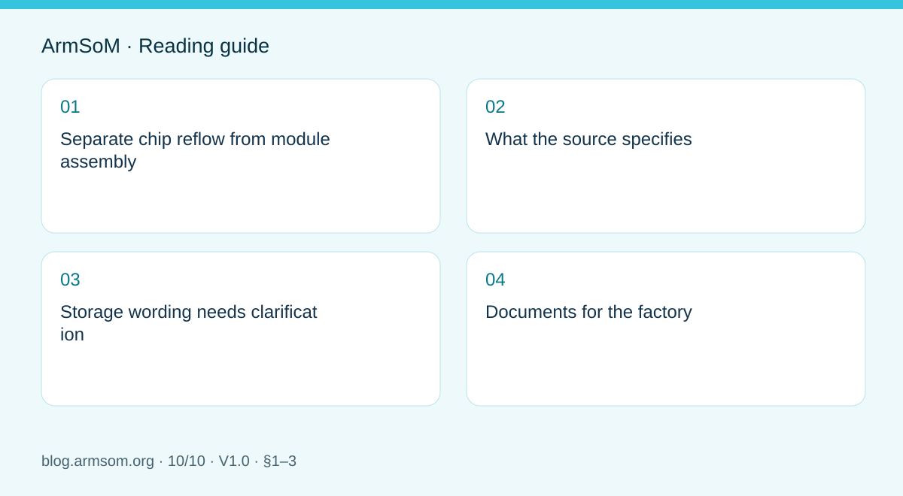
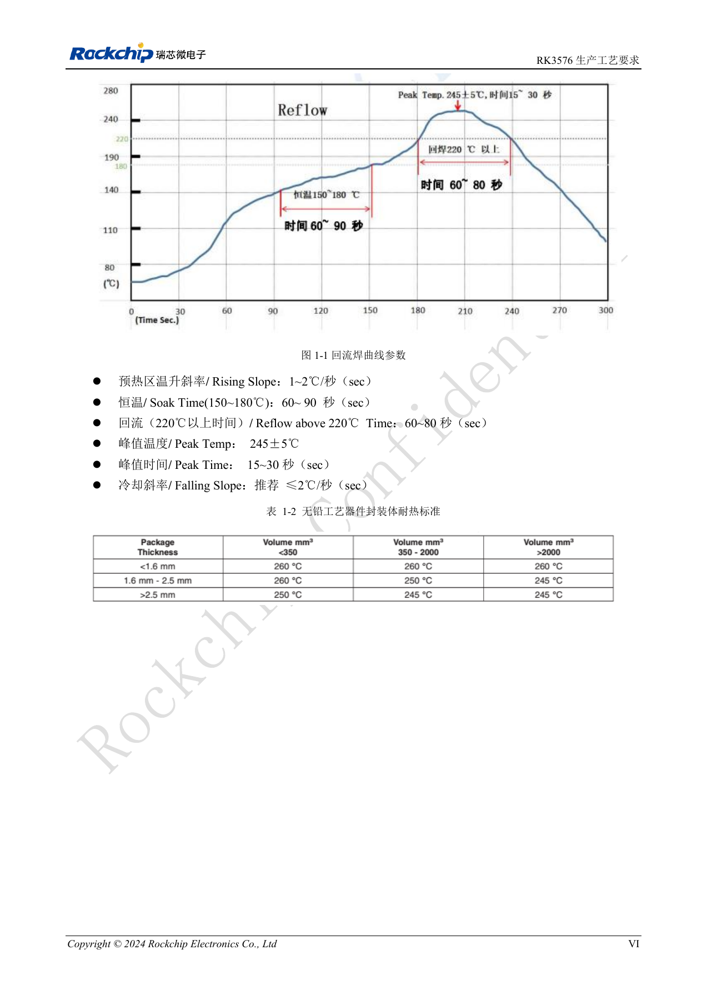

# Rockchip prototype to production: process requirements and test records

## Scope and sources

This is a task-focused engineering guide, not a page-by-page translation of the complete PDF. Source examples are not ArmSoM measurements. Check voltages, pins, SDK/BSP and kernel against the actual board revision.

**Rockchip:** `RK3576_Production_Process_Requirements_V10_20240522_CN.pdf` · V1.0 · §1–3

## Separate chip reflow from module assembly

A chip reflow profile applies to its package context, not automatically to reflowing a complete CM5, CM7s or AIM7 module. Connectors, thermal materials and enclosures have their own assembly requirements. Modules reduce the scope of SoC assembly work, but carrier and product quality still need independent control.

## What the source specifies

Section 1.3 provides references for process engineers to validate against the board, paste and equipment, not an unmeasured production recipe.

| Item | Source reference |
| --- | --- |
| Paste | SAC305; flux fraction 10%–11.5% |
| Rising slope | 1–2℃/s |
| Soak at 150–180℃ | 60–90s |
| Above 220℃ | 60–80s |
| Peak | 245±5℃; 15–30s |
| Falling slope | Recommended ≤2℃/s |

Section 3.2.2 gives rounded square apertures with r=0.05mm, side 0.30–0.32mm and stencil thickness 0.1mm. These belong to the RK3576 context, not every package.

## Storage wording needs clarification

Section 2.2 states MSL 3, ≤30℃/60%RH and recommended use within 168 hours after opening, but also mentions a six-hour pre-reflow dwell. The MSL 1 table row says “≤300℃/85%RH”. These are source statements with unresolved conditions or values. Do not use 300℃ as storage advice or silently discard six hours. Obtain supplier clarification and follow the lot label and applicable process specification.

## Documents for the factory

- Versioned schematic, BOM, PCB, assembly and test files.
- Complete module and peripheral part numbers, revisions and substitution rules.
- Confirmed process parameters, measured profiles and exception handling.
- Image checksum, programming procedure, serial-number assignment and results reporting.

Separate supply checks, boot, interface function and sustained-load tests. Use pilot-build results to establish release criteria; a desktop demonstration is not factory acceptance. Retain review and retest records after process or component changes.

## Source illustration

Chinese original; no matching English figure was found in the supplied materials. Reference design, not an ArmSoM board schematic.

`RK3576_Production_Process_Requirements_V10_20240522_CN.pdf` · PDF p. 7.

## Products and development resources

- **CM5** — [Product page](https://www.armsom.org/cm5) · [Documentation](https://docs.armsom.org/armsom-cm5)
- **CM7s** — [Product page](https://www.armsom.org/cm7s) · [Documentation](https://docs.armsom.org/armsom-cm7s)
- **AIM7** — [Product page](https://www.armsom.org/aim7) · [Documentation](https://docs.armsom.org/armsom-aim7)

## Continue this series

- [RK3576 hardware bring-up: minimum system and first-power checks](/articles/rk3576-hardware-bringup/)
- [ArmSoM CM5 carrier-board checklist: power, boot and interface planning](/articles/019-cm5-carrier-production/)
- [RK3576 high-speed interfaces: review schematics and PCB together](/articles/rk3576-high-speed-interface-design/)
- [RK3588S hardware design: from a reference circuit to a CM7s carrier](/articles/rk3588s-cm7s-carrier-design/)
- [RK3588 edge-AI hardware: plan power, cooling and expansion together](/articles/rk3588-edge-ai-hardware-design/)
- [RK3588 high-speed PCB review: stackup, impedance and routing](/articles/rk3588-high-speed-pcb-review/)
- [RK3506 industrial HMI hardware: choosing a CM1 or Forge1 development path](/articles/rk3506-industrial-hmi-hardware/)
- [RK3308 hardware variants: compatibility checks for P2 Pro audio projects](/articles/rk3308-hardware-variant-compatibility/)
- [RK3588S versus RK3588S2: what to check before a hardware revision](/articles/rk3588s-rk3588s2-hardware-differences/)
