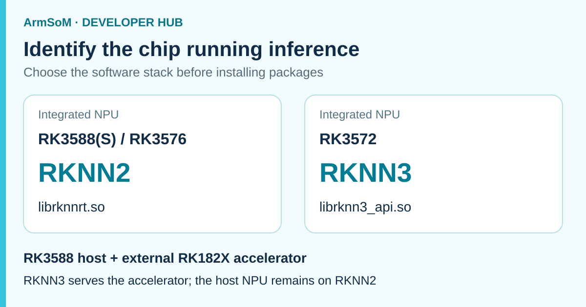
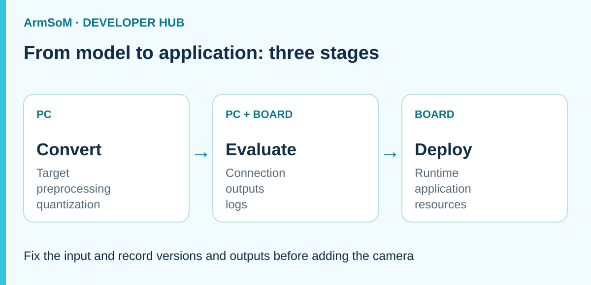

**Choose the software stack by the chip that will actually run inference: RK3588/RK3588S and RK3576 use RKNN-Toolkit2; RK3572 uses RKNN3-Toolkit.** When an RK3588 host is connected to an RK1820/RK1828 coprocessor, RKNN3 serves the external accelerator. The host's integrated NPU still uses RKNN2.

This guide follows a practical sequence: select the stack, inspect the board, create an isolated environment, run a reference model, then integrate it into an application. The version baseline is RKNN-Toolkit2 2.5.0 and RKNN3-Toolkit 1.2.0. Host commands assume Ubuntu x86_64 and Python 3.10.

> Scope: platform guidance for developers using RK3588 products such as Sige7, AIM7 and LM7, or RK3576 products such as CM5 and Sige5. The RK3572 section is an official-SDK platform reference. Match the board image, kernel driver and Runtime separately. This article was checked against documentation and example source; it does not report an ArmSoM hardware inference test or present another author's measurements as ArmSoM results.



## 1. Select the stack before installing packages

| Component | RKNN2 route | RKNN3 route |
| --- | --- | --- |
| Main targets in this article | RK3588/RK3588S and RK3576; the official list also includes RK3566/3568, RK3562, selected RV families and RK2118 | RK3572; RK1820/RK1828 operate as coprocessors |
| PC conversion toolkit | RKNN-Toolkit2 | RKNN3-Toolkit |
| Runtime libraries | `librknnrt.so` | `librknn3_api.so`; the RK3572 native path also involves `librknn3_api_native.so` |
| Connected-board debugging | `rknn_server` | `rknn3-server` for RK3572; `rknn3_transfer_proxy` for RK182X communication |
| On-board Python | RKNN-Toolkit-Lite2 | RKNN3-Toolkit Lite |
| Files in the examples below | `.rknn` | `.rknn` plus its matching `.weight` |
| Large language models | Separate RKNN-LLM SDK | RKNN3 LLM workflows and `rkllm3-server`; model and platform support still need checking |

Examples for both toolkits may import `from rknn.api import RKNN`. **An identical import statement or file extension does not establish model-format or Runtime compatibility.** Changing toolkit families or target chips requires conversion from the source model; renaming a `.rknn` file is not a migration procedure. Consult the release-specific support lists: [RKNN2](https://github.com/airockchip/rknn-toolkit2/tree/2c723177a94fac65cbc036d722907ddbc91980cf) and [RKNN3](https://github.com/airockchip/rknn3-toolkit/tree/141883c8e11b05ef4cca4a69d8a7572c4d855191).

| ArmSoM product starting points | Integrated NPU route | Project checks |
| --- | --- | --- |
| [Sige7](https://www.armsom.org/sige7), [AIM7](https://www.armsom.org/aim7), [LM7](https://www.armsom.org/lm7) | RK3588 → RKNN2 | Board or carrier, power and cooling, OS image and driver |
| [CM5](https://www.armsom.org/cm5), [Sige5](https://www.armsom.org/sige5) | RK3576 → RKNN2 | Module/carrier revision, camera input, SDK and deployment interface |
| RK3572 platform | RKNN3 | Check the actual development board and BSP; a platform reference is not validation of an ArmSoM product |

Use the [Sige7 documentation](https://docs.armsom.org/armsom-sige7) and [CM5 documentation](https://docs.armsom.org/armsom-cm5) for product facts. If an RK3588 image contains `librknn3_api.so`, investigate whether it supports an external RK182X. Its presence does not change the integrated NPU's software family.

## 2. Separate conversion, connected evaluation and deployment



| Stage | Execution location | Required outcome |
| --- | --- | --- |
| Conversion | PC environment for the selected Toolkit | Target platform, input format, preprocessing, calibration data and exported model |
| Connected evaluation | PC and development board | Verify outputs on the real target, with communication components appropriate to this mode |
| Standalone deployment | On-board Runtime/C++ or Lite Python | The application owns model loading, inputs, outputs and resource lifetime |

`rknn_server` is the RKNN2 connected-debugging proxy, not the final application. A standalone C/C++ application calls the Runtime directly; the absence of a persistent PC debugging service is not sufficient evidence of deployment failure. RKNN3 likewise distinguishes connected and local execution.

Begin with one fixed input image. Add a camera, decoder, network requests and threading after the model path is understood. This separates model errors from capture, color order, resizing and memory-copy problems.

## 3. Inspect the Android board first

Run these read-only checks on the development host. For a Linux board, inspect the corresponding `/usr/lib` and `/usr/bin` locations over SSH; Android `/vendor` paths are not universal Linux paths.

```bash
adb devices
adb shell getprop ro.board.platform
adb shell uname -m
adb shell 'ls -l /vendor/lib64/librknn* /vendor/bin/rknn* /dev/rknpu* /dev/dri/renderD*'
adb shell 'cat /sys/kernel/debug/rknpu/version'
```

The final command may fail because debugfs is not mounted, permissions are insufficient or the BSP uses another path. The device node need not be `/dev/rknpu` or a particular `renderD` number. Use driver logs, firmware documentation and actual enumeration together; a missing guessed path does not prove the NPU is absent.

Record board/carrier revision, image source, kernel, NPU driver, Runtime and Toolkit versions. Prefer components supplied together in one SDK release. For mixed versions, consult compatibility guidance rather than assuming identical version numbers are a permanent requirement across all releases.

## 4. RK3588 / RK3576: the RKNN2 reference workflow

### 4.1 Prepare the repositories and Python environment

Place the official [Toolkit2](https://github.com/airockchip/rknn-toolkit2/tree/2c723177a94fac65cbc036d722907ddbc91980cf) and [Model Zoo](https://github.com/airockchip/rknn_model_zoo/tree/837db8e992815ff8647eadb709f07067f4bc3a71), or the equivalent complete SDK directories, at `~/Projects/rknn-toolkit2` and `~/Projects/rknn_model_zoo`. Existing SDK users can skip downloading them again after checking the version baseline. Python 3.10 and venv support must already be installed.

```bash
python3.10 -m venv ~/venvs/armsom-rknn2
source ~/venvs/armsom-rknn2/bin/activate
cd ~/Projects/rknn-toolkit2/rknn-toolkit2
python -m pip install -r packages/x86_64/requirements_cp310.txt
python -m pip install packages/x86_64/rknn_toolkit2-2.5.0-cp310-cp310-manylinux_2_17_x86_64.manylinux2014_x86_64.whl
python -m pip check
python -c "from rknn.api import RKNN; import importlib.metadata as m; print(m.version('rknn-toolkit2'))"
```

Install the release's requirements before the matching wheel. `cp310` is not a Python 3.8 package, and an x86_64 host wheel is not an aarch64 board package. The examples use venv; Conda can also provide separate environments.

### 4.2 Start rknn_server only when connected debugging needs it

Check an existing firmware service before starting another copy. If the service is missing and the development image allows NPU execution from a shell, copy the SDK's Android arm64 binary to a temporary directory. Keep it in the foreground in a separate terminal so that errors remain visible:

```bash
cd ~/Projects/rknn-toolkit2
adb push rknpu2/runtime/Android/rknn_server/arm64/rknn_server /data/local/tmp/rknn_server
adb shell 'chmod +x /data/local/tmp/rknn_server'
adb shell /data/local/tmp/rknn_server
```

Leave that terminal running and execute PC inference in another one. A temporary directory does not fix missing libraries, device permissions or SELinux policy. Diagnose the actual layer. Production images should integrate components and startup configuration through the BSP build, rather than treating writes to a read-only `/vendor` partition or disabled security policy as standard installation steps.

### 4.3 Verify the first target with YOLOv5

This example uses the official Model Zoo's `yolov5s_relu.onnx`. Before conversion, ensure `datasets/COCO/coco_subset_20.txt` and its referenced images are present. The small example calibration set is a starting point; production models need representative data. [Example and arguments](https://github.com/airockchip/rknn_model_zoo/blob/837db8e992815ff8647eadb709f07067f4bc3a71/examples/yolov5/README.md)

```bash
source ~/venvs/armsom-rknn2/bin/activate
cd ~/Projects/rknn_model_zoo/examples/yolov5/model
bash download_model.sh
cd ../python
python convert.py ../model/yolov5s_relu.onnx rk3588 i8 ../model/yolov5s_relu.rknn
python yolov5.py --model_path ../model/yolov5s_relu.rknn --target rk3588 --img_save
```

`i8` enables quantization. `--img_save` suits a headless host, while `--img_show` needs a display. For RK3576 on CM5/Sige5, change **both** the conversion and inference targets, and use a distinct output filename:

```bash
python convert.py ../model/yolov5s_relu.onnx rk3576 i8 ../model/yolov5s_relu_rk3576.rknn
python yolov5.py --model_path ../model/yolov5s_relu_rk3576.rknn --target rk3576 --img_save
```

Acceptance includes an error-free process exit, classes consistent with the input, an inspectable result image and the expected target/version in logs. No ArmSoM FPS or latency measurement is claimed here. Continue with [C/C++ deployment](/articles/rknn-v250-sdk-guide-c-deployment/) or [Lite2 on-board deployment](/articles/rknn-v250-sdk-guide-lite-deployment/).

## 5. RK3572: a separate RKNN3 environment and model

### 5.1 Create the other Python environment

Place [RKNN3 Toolkit](https://github.com/airockchip/rknn3-toolkit/tree/141883c8e11b05ef4cca4a69d8a7572c4d855191) and [RKNN3 Model Zoo](https://github.com/airockchip/rknn3-model-zoo/tree/7f8c7d848448fa14cf16ba359ca98405c8bb94b5) at `~/Projects/rknn3-toolkit` and `~/Projects/rknn3-model-zoo`. Skip the first `deactivate` line if no venv is currently active.

```bash
deactivate
python3.10 -m venv ~/venvs/armsom-rknn3
source ~/venvs/armsom-rknn3/bin/activate
cd ~/Projects/rknn3-toolkit/rknn3-toolkit
python -m pip install -r packages/requirements_cp310-1.2.0.txt
python -m pip install packages/x86_64/rknn3_toolkit-1.2.0-cp310-cp310-manylinux2014_x86_64.whl
python -m pip check
python -c "from rknn.api import RKNN; import importlib.metadata as m; print(m.version('rknn3-toolkit'))"
```

The checked Python 3.10 requirements specify `numpy<=1.26.4` for RKNN2 2.5.0 and `numpy>=2.0` for RKNN3 1.2.0. They cannot share one environment. After importing, verify the installed distribution and version so that another `rknn` module is not mistaken for the intended Toolkit.

These commands inspect the RK3572 Android connected-mode components; adapt paths to the BSP. The C++ demo below runs locally, rather than using the PC connection service as the application:

```bash
adb shell 'ls -l /vendor/lib64/librknn3_api.so /vendor/lib64/librknn3_api_native.so'
adb shell '/vendor/bin/rknn3-server -v'
```

### 5.2 Explicitly choose the RK3572 YOLOv6 model

The official 1.2.0 quick-start uses **`yolov6n.onnx`** for RK3572. In the inspected download script, the enabled command fetches the RK182X-optimized `yolov6n_rknn3.onnx`; the standard model command is commented out. Running the default script is therefore not enough to obtain the RK3572 example. Use the standard-model URL provided in that script:

```bash
source ~/venvs/armsom-rknn3/bin/activate
cd ~/Projects/rknn3-model-zoo/examples/yolov6/model
wget -O yolov6n.onnx https://ftrg.zbox.filez.com/v2/delivery/data/95f00b0fc900458ba134f8b180b3f7a1/examples/yolov6/yolov6n.onnx
cd ../python
python convert.py ../model/yolov6n.onnx rk3572 i8
ls -lh ../model/yolov6n.rknn ../model/yolov6n.weight
```

Check that both `.rknn` and `.weight` were generated by the same conversion. An old help string in `convert.py` mentions only `rk1820`, but the 1.2.0 quick-start explicitly documents `rk3572`, and the script passes this argument into `target_platform`. [Official RKNN3 documents](https://github.com/airockchip/rknn3-toolkit/tree/141883c8e11b05ef4cca4a69d8a7572c4d855191/doc) · [Inspected conversion script](https://github.com/airockchip/rknn3-model-zoo/blob/7f8c7d848448fa14cf16ba359ca98405c8bb94b5/examples/yolov6/python/convert.py)

### 5.3 Build and run the Android arm64 example

Install CMake and an Android NDK supported by the SDK, and set `ANDROID_NDK_PATH` to the actual NDK directory. The board needs matching Runtime libraries, a driver and execution permissions. The build script regenerates its own demo installation directory.

```bash
cd ~/Projects/rknn3-model-zoo
: "${ANDROID_NDK_PATH:?Set ANDROID_NDK_PATH to your Android NDK directory}"
./build-android.sh -t rk3572 -a arm64-v8a -b Release -d yolov6
adb push install/rk3572_android_arm64-v8a/rknn_yolov6_demo /data/local/tmp/
```

Run the program in the board shell, then return to the host to retrieve the image:

```bash
adb shell
cd /data/local/tmp/rknn_yolov6_demo
export LD_LIBRARY_PATH=./lib${LD_LIBRARY_PATH:+:$LD_LIBRARY_PATH}
./rknn_yolov6_demo model/yolov6n.rknn model/yolov6n.weight model/bus.jpg 1
exit
adb pull /data/local/tmp/rknn_yolov6_demo/out.png .
```

The final `1` is the example's core mask, matching conversion with `core_num=1`. Do not copy a different platform's multicore mask. Inspect `out.png`, classes, confidence and coordinates, and retain logs. Official example outputs or someone else's timings are not measurements of your board.

Linux deployment uses the corresponding `build-linux.sh`, aarch64 cross-toolchain and Linux Runtime. Android ELF binaries and libraries cannot simply be reused. See the [RKNN3 Runtime guide](/articles/rknn3-v120-runtime-c-lifecycle/) for API and resource-lifetime details.

## 6. Connect the demo to an Android application

| Integration | Useful for | Design work |
| --- | --- | --- |
| APK + JNI | Camera UI and interactive detection | ABI, preprocessing, inference thread, Runtime dependencies, permissions and lifecycle |
| System service + IPC | Several applications sharing models | Service contract, process identity, queues, recovery and BSP integration |
| Local HTTP service | Prototypes, browser interfaces or multiple client languages | Define image/result protocol, rate limits and timeouts; bind to loopback by default |

Rockchip's [RKNN2 Android APK example](https://github.com/airockchip/rknn-toolkit2/tree/2c723177a94fac65cbc036d722907ddbc91980cf/rknpu2/examples/rknn_yolov5_android_apk_demo) illustrates Java/JNI separation. Replacing a library name does not make it an RKNN3 implementation. Loading vendor libraries also depends on Android linker namespaces and SELinux; copying a `.so` file alone is insufficient. [Linker namespaces](https://source.android.com/docs/core/architecture/vndk/linker-namespace) · [SELinux](https://source.android.com/docs/security/features/selinux)

Local HTTP is an application architecture choice, not a default REST interface provided by `rknn_server`. RKNN3's `rkllm3-server` provides an OpenAI-compatible LLM/VLM service, not a ready-made YOLO detection endpoint. Select the API after identifying the model type.

## 7. Troubleshoot by layer

| Symptom | First checks |
| --- | --- |
| `No module named 'torch'` | Correct venv, complete release requirements and accidental use of `--no-deps` |
| Missing `libcublas.so` or similar | PyTorch package and dependencies; if CUDA is unnecessary, consider a compatible official CPU build |
| Import works but no device connects | ADB authorization, data cable/port, service, Runtime, device permissions and logs |
| `.rknn` cannot load | Toolkit family, target chip, export version and matching RKNN3 `.weight` |
| Incorrect detections | RGB/BGR, resize/padding, normalization, tensor layout, calibration and postprocessing |
| Still images work but video stalls | Measure capture, preprocessing, inference, postprocessing, copies and display separately |
| Cannot write `/vendor` | Partition policy and BSP integration; temporary-shell testing does not establish production APK permissions |

For example, only in the RKNN2 Python 3.10 environment, after confirming that CUDA is unnecessary and the project permits this version, an official CPU package can be selected as follows. This is not a universal reinstall instruction:

```bash
python -m pip install --force-reinstall torch==2.4.0 --index-url https://download.pytorch.org/whl/cpu
python -m pip check
```

See [PyTorch's official version instructions](https://pytorch.org/get-started/previous-versions/). Offline preparation requires all dependencies for the same architecture/Python version, models, calibration images and repository files. One copied wheel does not reproduce an environment.

## 8. Turn the first model into a reproducible project

Keep board/carrier identity, OS image, Toolkit/Runtime/service/driver versions, repository commits, model and input checksums, preprocessing parameters, commands and outputs. Separate first-load time, warmed inference and end-to-end time; two FPS figures without these conditions are usually not directly comparable.

Choose the next project entry point: [CM5](https://www.armsom.org/cm5), [Sige5](https://www.armsom.org/sige5) or [Sige7](https://www.armsom.org/sige7). Continue reading [RKNN2 YOLOv5 and accuracy evaluation](/articles/rknn-v250-sdk-quickstart-yolov5/) and [RKNN3 platforms and software stack](/articles/rknn3-v120-platform-guide/).

## Sources and verification scope

The starting material was a reader-supplied screenshot of “RK 平台 NPU 开发快速入门：RK3588 与 RK3572” by RK软件开发-吴工, dated 2026-11-14 ([original article](https://mp.weixin.qq.com/s/67VJOwm3z00N_u6xIudwdA)). It ends at the beginning of section 3.3. ArmSoM organized the subsequent steps from official material; this is not presented as a complete extraction of that article.

Official snapshots checked on 2026-11-17: RKNN2 `2c723177a94f`, RKNN3 `141883c8e11b0`, RKNN Model Zoo `837db8e99281`, and RKNN3 Model Zoo `7f8c7d848448`. Commands, paths and dependencies use these baselines. Image compatibility and hardware validation remain project-specific work. Both diagrams are ArmSoM editorial illustrations, not device screenshots or performance results.
