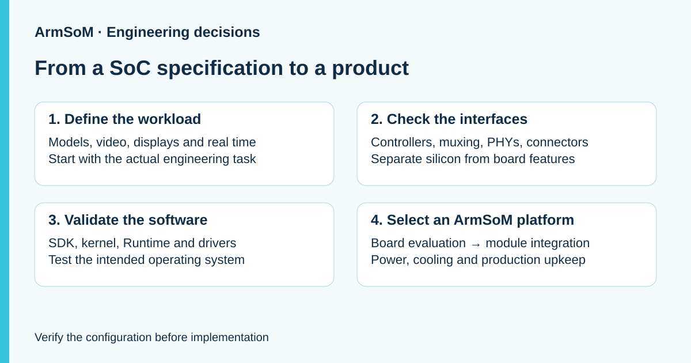

**Choose a Rockchip platform by the complete model, video and interface pipeline, then compare CPU specifications or TOPS.** For ArmSoM projects, RK3588 platforms are useful candidates for demanding multimedia and expansion; RK3576 platforms merit evaluation for compact computing and embedded AI. RK3572 requires a separate check of its newer NPU stack and the intended board's availability.

This article turns the supplied nine-chip comparison into an engineering selection guide. Silicon specifications are not promises about ArmSoM board features. No third-party measurements are presented as our tests, and process node, power consumption, clock rates, availability and lifecycle are not inferred from model numbers.

## 1. Narrow the list with CPU and accelerator requirements

| SoC | CPU | GPU family | Stated NPU rating |
| --- | --- | --- | --- |
| RK3588 | 4 × Cortex-A76 + 4 × Cortex-A55 | Mali-G610 | 6 TOPS |
| RK3576 | 4 × Cortex-A72 + 4 × Cortex-A53 | Mali-G52 | 6 TOPS* |
| RK3572 | 2 × Cortex-A73 + 6 × Cortex-A53 | Mali-G310 | 4 TOPS* |
| RK3562 | 4 × Cortex-A53 | Mali-G52 | 1 TOPS |
| RK3568 | 4 × Cortex-A55 | Mali-G52 | 1 TOPS |
| RK3566 | 4 × Cortex-A55 | Mali-G52 | 1 TOPS |
| RK3399 | 2 × Cortex-A72 + 4 × Cortex-A53 | Mali-T860 | — |
| RK3326 | 4 × Cortex-A35 | Mali-G31 | — |
| PX30 | 4 × Cortex-A35 | Mali-G31 | — |

The asterisk retains the supplied comparison's sparse-compute qualification for RK3576 and RK3572. This is not an equal-conditions performance ranking. GPU families are listed without mixing API support from different driver releases. A dash means no dedicated NPU is listed for those models; **it does not mean AI cannot run on their CPU or GPU**.

The official [RK3562 product page](https://www.rock-chips.com/a/en/products/RK35_Series/2024/0626/1983.html) and [RK3572 introduction](https://www.rock-chips.com/a/cn/news/rockchip/2026/0518/2168.html) provide basic platform references. Deployment still depends on operator coverage, quantization accuracy, memory use and end-to-end latency.

### AI projects need more than a TOPS comparison

Fix the input resolution, model revision, quantization, batch size and target frame rate. Measure preprocessing, inference and postprocessing separately. Multi-camera systems also incur decoding, color conversion and memory-copy costs: a fast inference kernel does not prove a fast video pipeline.

The integrated NPUs in RK3588 and RK3576 use RKNN2; RK3572 uses RKNN3. An external RK182X accelerator introduces another deployment path. Conversion tools, model files and Runtime must match; see the [ArmSoM RKNN2/RKNN3 guide](/articles/rockchip-npu-rknn2-rknn3-getting-started/).

## 2. Build a shortlist around application constraints

| Project | Candidates to evaluate | Required checks |
| --- | --- | --- |
| Multiple vision streams, complex displays, substantial expansion | RK3588; Sige7, AIM7, LM7 | Codec and concurrency limits, storage throughput, cooling and carrier routing |
| Smart terminals, edge gateways, compact AI | RK3576; CM5, Sige5 | Model accuracy, exposed interfaces and target Android/Linux image |
| Cost/function balance on a newer platform | RK3572 | RKNN3 integration, BSP maturity, board and production plans |
| Gateways, control and established designs | RK3568 / RK3566 | Do not assume identical pins or interfaces |
| Simpler displays or embedded terminals | RK3562 | Native display interfaces; include bridge and driver cost if HDMI is required |
| Existing device upgrades and maintenance | RK3399 / RK3326 / PX30 | Software assets, memory pressure, security updates and actual supply |

This is a screening order, not a benchmark chart. A maintenance-oriented recommendation is not an end-of-life announcement. Redesign benefits must justify migration, certification and regression costs when an existing software platform works well.

## 3. Split a multimedia maximum into five questions

1. **Codec:** H.264, H.265, VP9 and AV1 have different resolution, frame-rate and profile limits. A headline maximum does not apply to every format.
2. **Pixel format:** Can bit depth, YUV420/422/444, stride and buffer layout pass correctly through ISP, RGA, MPP and display?
3. **Concurrency:** Can the required cameras, encoder and displays operate together within bandwidth and display-resource limits?
4. **Physical connection:** Check HDMI/eDP/DP combinations, MIPI lanes, Type-C multiplexing and actual connectors.
5. **Target OS:** Validate Linux and Android drivers, userspace components, camera tuning and application frameworks separately.

The [ArmSoM video-codec documentation](https://docs.armsom.org/advanced-manual/rockchip-video-codec) can inform a test plan. Its presence does not establish that a particular simultaneous workload has passed.

## 4. Take memory, networking and storage down to board level

The silicon address limit is not a purchasable RAM option. Budget weights, activations, inputs, outputs, video buffers and operating-system headroom for inference. For NAS workloads, include sustained writes, networking, filesystem behavior and temperature.

| Common shortcut | What to establish instead |
| --- | --- |
| Two MACs mean two usable network ports | PHYs, interface modes, connectors, drivers and board-level speed |
| PCIe, SATA and USB counts can be added | Combo-PHY sharing, lane allocation and simultaneous-use restrictions |
| UFS support means a board can accept UFS | Pads, power, boot support and the actual BOM |
| A CAN controller connects directly to the bus | Transceivers, isolation, termination and device tree |
| A module automatically exposes every SoC interface | Module pinout, carrier routing, voltage levels and software |

For a module such as CM5, maintain separate module and carrier interface lists. For a complete Sige board, begin with its schematic and connectors. Never fill a specification gap using another chip's features.

## 5. Keep a reviewable selection record

The supplied comparison lists these datasheet editions. They are **the source author's stated basis**, not a claim that every listed edition was obtained and checked page by page here. Official briefs from other revisions serve as cross-checks, not silent replacements.

| Model | Edition listed in the supplied source |
| --- | --- |
| RK3588 | V1.8 · 20240821 |
| RK3576 | V1.3 · 20240826 |
| RK3572 | V1.0 · 20260324 |
| RK3562 | V2.0 · 20241104 |
| RK3568 / RK3568B2 | V2.1 · 20240621 |
| RK3566 | V1.4 · 20240621 |
| RK3399 | V1.8 · 20180529 |
| RK3326 | V1.4 · 20190110 |
| PX30 | V1.2 · 20190110 |

Record the complete chip suffix, board revision, RAM/storage configuration, schematic revision, SDK release, kernel commit, NPU Runtime, workload, results and unresolved items. In particular, retain distinctions between RK3568B2 and RK3568, and between RK3588 and RK3588S.

## 6. Move from a shortlist to an ArmSoM prototype

Validate a real business pipeline on a development board before selecting a module and carrier. Use your own data for vision, the target panel for display, and sustained traffic for storage. Include cold boot, power-loss recovery, long runs and upgrade regression rather than qualifying a design from one successful demo.

Write the conclusion as constraints met and gaps remaining, not a universal winning chip. References: the [supplied nine-chip article](https://mp.weixin.qq.com/s/Li61_e6BUuoQ_YPQWkJuKg), the official material linked above and the relevant ArmSoM documentation.

## Products and further reading

Start an ArmSoM evaluation with the RK3588-based [Sige7](https://www.armsom.org/sige7), [AIM7](https://www.armsom.org/aim7) or [LM7](https://www.armsom.org/lm7), or the RK3576-based [CM5](https://www.armsom.org/cm5) and [Sige5](https://www.armsom.org/sige5). Check interfaces and available images in the [Sige7](https://docs.armsom.org/armsom-sige7), [CM5](https://docs.armsom.org/armsom-cm5) and [Sige5](https://docs.armsom.org/armsom-sige5) documentation. These links support product selection; they do not certify every SDK combination discussed here.
