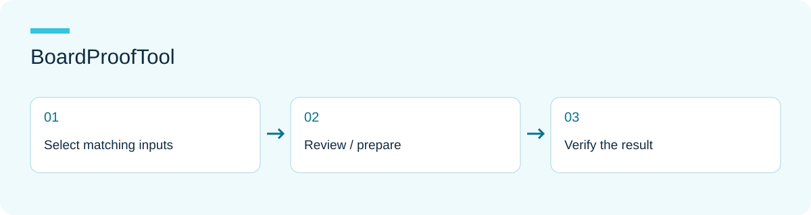



BoardProofTool is provided as a Windows package with `ProofDll.dll`, `RKUpgrade_DLL.dll` and Qt dependencies. Its revision note explicitly fixes dropping the last CPU ID byte. That detail matters when using device identity, but the supplied files do not contain a complete PDF defining the protection algorithm or provisioning protocol.

## Keep the package intact

Extract all files, including `platforms/qwindows.dll`; copying only the executable can cause a Qt platform-plugin error. `config.json` specifies `DLL=ProofDll.dll` and enables logging. Its `APP_VERSION` remains `v1.0` while the archive/revision is 1.01; keep both facts rather than silently rewriting the upstream configuration.

## Establish an identity reference

Before any write-oriented integration, obtain the device identifier using the board SDK's documented read procedure. Record the full byte length and representation, including leading zeroes and the final byte. Compare it with the tool's result on a designated sample. A truncated CPU ID can invalidate an otherwise plausible record; an ID is not automatically a serial number or secret key.

## Define the missing integration contract

For actual deployment, obtain the matching BSP guidance for inputs, output format, supported SoCs, target communication mode and the meaning of success. Decide whether the operation only derives a host file or changes device state. These points are not established by the filename or the two-line revision note, so this guide does not invent a Run-button workflow.

## Acceptance record

Keep package hash, DLL version, board revision, SDK, full identifier comparison and expected output. Store logs privately if they contain device identifiers. This article provides the verified package facts and preparation steps; the board-specific write procedure remains to be supplied and validated.

## Applicability and verification

This is a documentation-based workflow for the supplied tool collection. Confirm the exact board, SoC, carrier, SDK/BSP and host architecture before using it. No flashing, provisioning, register writes or hardware tests were performed. Package availability does not establish support for every ArmSoM product.

## GitHub tool directory, versions and SHA-256

Open the matching GitHub directory, select the required host/version, then verify the file hash and extract the full directory. Links below open repository directories.

[Open the tool directory on GitHub](https://github.com/ArmSoM/rockchip-tools/tree/main/downloads/board-proof)

| Platform / version | File | SHA-256 |
|---|---|---|
| Windows / 1.01 | `BoardProofTool_v1.01_20240823_02.zip` | `72c732d7c91ba7742c4c36d2a549171f9289d820c3d50aad468e38cdd7806029` |

[GitHub · catalog.json](https://github.com/ArmSoM/rockchip-tools/blob/main/catalog.json) · [SHA256SUMS](https://github.com/ArmSoM/rockchip-tools/blob/main/SHA256SUMS)

## Source documents and figures

- BoardProofTool_v1.01_20240823_02.zip: config.json, revision.log and executable/dependency inventory

## Continue with the related workflow

- [RKDevInfoWriteTool: controlled serial-number and MAC provisioning](/articles/rockchip-tool-devinfo-write/)
- [EfuseTool 1.42: prepare a traceable Secure Boot provisioning station](/articles/rockchip-tool-efuse-tool/)
- [Rockchip tool download and workflow index](/articles/rockchip-tools-download-guide/)

## Find the correct ArmSoM board documentation

For board and carrier requirements, use the product manual first. The links below are platform references, not a statement that this archived tool has been validated on these products.

[ArmSoM Docs](https://docs.armsom.org/) · [Sige7](https://www.armsom.org/sige7) / [Docs](https://docs.armsom.org/armsom-sige7) · [CM5](https://www.armsom.org/cm5) / [Docs](https://docs.armsom.org/armsom-cm5)


