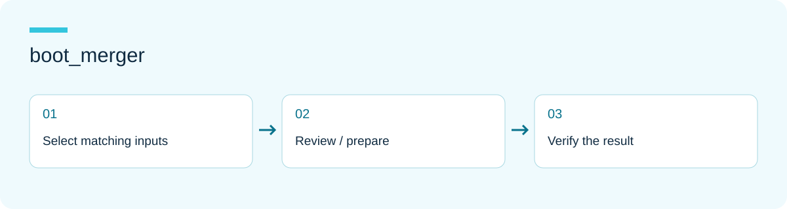





`boot_merger` packages early-boot components into a Loader. It belongs before firmware flashing in the workflow: generating a Loader does not itself write a board. The supplied packages contain the executable and revision notes, not a complete standalone user manual.

## Inputs come from one board SDK

A Loader may combine DDR initialization, a USB download component and boot code. Rockchip's RK3588 configuration in the official `rkbin` repository illustrates `[CODE471_OPTION]`, `[CODE472_OPTION]`, `[LOADER_OPTION]` and `[OUTPUT]`; `FlashData` and `FlashBoot` point to different components. Preserve the configuration supplied with the board SDK rather than assembling files solely because their names contain the same SoC.

## A controlled packaging procedure

1. Identify the board revision, memory type and capacity, SoC and intended storage. Save the working Loader before changing anything.
2. Copy the SDK's entire loader configuration and referenced binaries into an isolated build directory. Resolve relative paths from the expected working directory.
3. Select the host package and SDK-documented invocation. The collection's Linux notes reach 1.35; macOS is labeled 1.3 and Windows 1.32. They are not a synchronized release set.
4. Confirm output path, file size, hash and return status. Retain the input configuration and every input binary version alongside the result.
5. Validate on a recoverable development board using its documented procedure. Distinguish a RAM download from writing IDBlock to storage.

## Why version details matter

The Linux notes describe IDBlock alignment changes, 2K interleaving and CRC-related options. These affect boot format, not just the filename. Do not carry a format flag into another BSP without confirming the corresponding boot ROM/Loader requirements.

## Failure triage

Missing files indicate path/configuration problems; a generated file that fails DDR initialization calls for checking memory-specific inputs. A successful packaging exit does not prove that the Loader can initialize the target. Keep the known-working Loader and a recovery route. This article provides a preparation and validation workflow; it does not invent command flags absent from the supplied manual.

## Applicability and verification

This is a documentation-based workflow for the supplied tool collection. Confirm the exact board, SoC, carrier, SDK/BSP and host architecture before using it. No flashing, provisioning, register writes or hardware tests were performed. Package availability does not establish support for every ArmSoM product.

## Download, versions and SHA-256

Download the matching archive, verify the hash, and extract the entire directory. For the split Linux PinDebug archive, follow the linked reconstruction instructions; the hash below is for the reconstructed file.

| Host / version | Package |
|---|---|
| Linux / 1.35 release notes | [boot_merger-linux-directory-snapshot.zip](https://raw.githubusercontent.com/ArmSoM/rockchip-tools/main/downloads/boot-merger/boot_merger-linux-directory-snapshot.zip) |
| macOS / 1.3 | [boot_merger_v1.3_mac.zip](https://raw.githubusercontent.com/ArmSoM/rockchip-tools/main/downloads/boot-merger/boot_merger_v1.3_mac.zip) |
| Windows / 1.32 | [boot_merger_v1.32.zip](https://raw.githubusercontent.com/ArmSoM/rockchip-tools/main/downloads/boot-merger/boot_merger_v1.32.zip) |

**boot_merger-linux-directory-snapshot.zip — SHA-256**

```text
185fb0b12c95317f70a683919f36486153e7219a60c30bd3c9ef0a5019783bbb
```

**boot_merger_v1.3_mac.zip — SHA-256**

```text
c9427f5e6448c610dae2e450ad1e245d03c39fd36756bbb02b78f20a0228f64f
```

**boot_merger_v1.32.zip — SHA-256**

```text
00e12d8683c73c62df0d10102d284407721ab90310d10da23e8e090cdac124f9
```

[GitHub · catalog.json](https://github.com/ArmSoM/rockchip-tools/blob/main/catalog.json) · [SHA256SUMS](https://github.com/ArmSoM/rockchip-tools/blob/main/SHA256SUMS)

## Source documents and figures

- boot_merger Linux revison.log through 1.35; macOS 1.3 and Windows 1.32 package notes
- [https://github.com/rockchip-linux/rkbin/blob/master/RKBOOT/RK3588MINIALL.ini](https://github.com/rockchip-linux/rkbin/blob/master/RKBOOT/RK3588MINIALL.ini)

## Continue with the related workflow

- [rk_ddrbin_tool: inspect and change DDR initialization parameters](/articles/rockchip-tool-ddrbin-tool/)
- [RKDevTool download and workflow: Loader, partitions and update.img](/articles/rockchip-tool-rkdevtool/)
- [afptool and rkImageMaker: understand and package Rockchip update.img](/articles/rockchip-tool-firmware-pack-tools/)
- [Rockchip tool download and workflow index](/articles/rockchip-tools-download-guide/)

## Find the correct ArmSoM board documentation

For board and carrier requirements, use the product manual first. The links below are platform references, not a statement that this archived tool has been validated on these products.

[ArmSoM Docs](https://docs.armsom.org/) · [Sige7](https://www.armsom.org/sige7) / [Docs](https://docs.armsom.org/armsom-sige7) · [CM5](https://www.armsom.org/cm5) / [Docs](https://docs.armsom.org/armsom-cm5)


